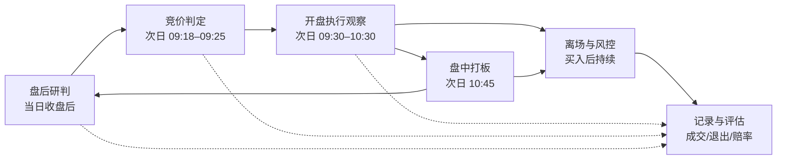

# 策略口径与提示词规范

> 本文合并原 docs/strategy、docs/超短策略 与任务提示词规范（2026-11-23 仓库清理）。运行时策略正文以 PostgreSQL `strategy_document` 为准。

---

## 涨停接力策略：分阶段与同高度竞争

> 并入自 `docs/strategy/抱团Q95与主升Q70涨停筛选策略.md`（2026-11-23 仓库清理）。

> 状态：第二版前向验证。职责为识别涨停延续、形成同高度竞争观察和次日复核，不自动下单、不决定仓位。旧固定分位与分数仅作背景资料，不再用旧分数线决定入选，也不解释为胜率。

### 一、范围与时点

仅扫描沪深主板、非ST、非未开板新股、目标日收盘涨停的股票，不受个人标的池限制。候选资格所需连板数、封单、成交额、首次封板与价格形态缺失时不猜测；其他历史或消息缺口逐项保留。

收盘候选只使用收盘时已取得的事件与日线；盘中10:45只用当时独立快照。不得把收盘封单、全天量或后来公告倒填盘中结论。停牌、未来结果和缺失开板次数不补零。

### 二、叙事与题材

同义词采用固定规则归一，出版发行、图书发行、教科书发行等合并为出版传媒；风电表达归一。控制权变更、资产重组可作为独立交易叙事保留，不能作为已核实利好。

保留多个驱动，同一标的近五个交易日仍有效标签的连续性优先，再比较当日宽度及名称；不因每日涨停原因文字变化随意切换主驱动。题材宽度、持续性和晋级率仅作背景，未知不当成充分证据。涨停原因必须与公告事实分开。

### 三、三个阶段与两条路线

- 首板：比较催化新旧、个股辨识度、首次封板和剩余买单覆盖，不因热门板块宽而自动提级。
- 二至三板确认：比较前一板至今的承接、同高度竞争者和题材核心状态。
- 四板及以上续板：重点观察高位放量弱封、断板负反馈和异常波动/停牌风险，不依靠历史涨幅提级。

抱团路线保留二板及以上的题材最高板候选；主升路线侧重首板至三板的启动与确认。两路线各最多两只、合并最多四只，先列各路线数据首位；同股重复只计一次。二至三板确认、首板、高位续板分别展示，不能把旧分直接跨阶段比较。双路线标签只说明兼具两种风格，不等于独立胜率共振或全场第一。

### 四、数据风险与比较顺序

同高度数据比较依次看：风险状态、收盘封单/成交额、封单保持率、首次封板、题材核心角色、成交承接负担。成交额小不等于小市值，封单大不等于真实净流入。代码只稳定展示，不裁决并列。

当前前向验证采用以下观察降级线，属于本期研究后待验证的风险规则，不是已证实的最优阈值：

1. 封单/成交额不足5%，仅观察，不列为数据首位。
2. 三板及以上、成交量至少为前一开市日2倍且封单/成交额不足10%，标记高位放量弱封，仅观察。
3. 缺封单、成交额、首次封板或价格形态，标记数据不足。缺最大封单、前日成交量等应保留未知，不能宣称承接改善。
4. 一字板保留强势识别，独立标记排队成交不确定，不能把理论延续收益当成可得收益。

盘中累计量不能与前日全天量比较为缩量；上午封板、封单比例和低成交额均不构成单项买入条件。研究样本中的3亿元、20%等分桶不直接设为统一买入门槛。

### 五、同高度竞争与消息、情绪复核

每个高度形成完整竞争组，包括未进入最终四只观察名单的竞争者。例如三进四必须比较全部可评估三板，不能只比较已推荐的一只与全市场最高板。

数据首位只表示量价比较顺序。最终首选逐项回答：

1. 角色：谁是独立催化/题材核心，谁依赖前排；相同题材是否只是跟随，独立题材是否有持续承接。
2. 承接：封单相对成交额、保持率、首次封板、前日到本日量能变化；是否巨量弱封，数据缺失是什么。
3. 情绪：最高板继续强势还是断板、同高度晋级及跌停负反馈、竞争题材分流；高度释放不代表低位必然受益，炸板率不能单项决定晋级。
4. 消息：公告/报道的原始来源、实际发布时间、直接受益程度、新催化或旧闻、澄清/减持/监管/停牌等风险。至少核验拟选者及最强同高度对手；消息未知不加分，已检索无新消息是有效结论。未经核验的传闻不得加分。
5. 执行：谁仅适合观察强度，谁可待竞价复核；高开代价、排队可成交性和开板后被动成交风险。

必须说明胜者相对同高度最强对手的具体优势和落选者的主因；数据并列、消息证据不足或全部有硬伤时允许无首选。消息可使候选降级，不得把数据不足、观察降级或名单外竞争者擅自升级为正式候选。不得声称已获知主力真实持仓或未来资金去向。

### 六、次日竞价与最高板竞争

只复核前一开市日有效收盘候选及盘中先手，不临时扩大入场范围。最终竞价同时获取同高度竞争者和最高梯队；同高度对手只作比较，不能自动新增交易信号。

- 一字延续：达到涨停价、买方未匹配量为正、换手不超过10%、数据完整；仅表示强势验证与排队观察，不保证买到。
- 非一字换手晋级：涨幅0%至5%、买方未匹配量为正、换手不超过10%，且原生候选未被数据风险降级。先比较同高度竞争者，不因竞价高开本身判优。
- 低开但买方未匹配为正、方向冲突或消息待核实时只作分歧观察，不计入可参与首选。
- 非一字高开超过5%、买方未匹配不为正、换手超过10%、跌停/停牌或数据异常，放弃本次新参与；一字分支单列，不能用它绕过非一字追价限制。
- 价格、未匹配方向、换手或最终竞价状态缺失，记数据不足，不用分时涨幅补造。

最高梯队至少一只接近涨停且买方未匹配为正记高度压制；全部低开或卖方未匹配且无接近涨停者记高度释放；其余为高度混合。该标签与同高度竞争同时报告，不覆盖原门禁。盘中候选假定前一日曾尝试排队，其竞价持有复核不能套用新开仓追价语义。

### 七、结果与验证

输出各阶段候选、两路线数据首位、同高度完整竞争组及胜负理由、消息来源和时间、情绪背景、强势观察与可参与条件、缺口和失效原因。全部仅为观察候选；最终摘要允许无首选。

独立收盘任务与结构化池外机会一致，原候选不因最终消息复核落选而删除，保留理由用于前向评估。盘中快照与收盘二次复核分开，不相互覆盖。

旧固定基准仅用于背景分数展示；新规则的晋级率、次日开盘收益和真实成交收益分别统计。买入当日只计浮盈，卖出遵守T+1，披露涨停无法买入、停牌/跌停无法退出、费用、未满窗口、重复路径和版本差异。不把一字理论收益、数据顺位或信号等级解释为买入胜率。

至少积累20个交易日、30笔归因完整的真实闭环后才评审可执行收益；各执行分支至少10笔。收益均值、中位数和最近20笔中位数需为正，披露最大单笔亏损与未成交。达到数量不等于毕业，正式变更仍由真实用户批准。本版为用户授权的前向观察规则，不宣称已经验证盈利。

---

## 涨停梯队盘中先手策略

> 并入自 `docs/strategy/涨停梯队盘中先手策略.md`（2026-11-23 仓库清理）。

工作日10:45使用当时的涨停、炸板、行情与最终竞价快照，识别首板、二至三板确认、高位续板三个阶段。不自动下单、不决定仓位，不用收盘信息回填盘中。

### 数据候选与同高度竞争

扫描沪深主板、非ST、非未开板新股、当时仍涨停的股票。一字与10:30后封板不作资格硬排除，分别记录排队成交不确定及晚封风险。封单、成交额、首次封板或价格形态缺失不得选作数据首位；弱封单仅观察。盘中累计量不与前日全天量比较为缩量。

同高度完整分组，比较风险、封单/当前成交额、保持率、首次封板、题材角色和承接负担，再保留最多四只正式观察候选。同题材最多两只，首板与高位连板均有合格项时各保留至少一只；候选保留不等于参与推荐。旧角色分与连板高度不再直接决定全场第一。

### 唯一首选排队标的

数据首位仅供复核。在当前正式候选内，结合《涨停接力策略：分阶段与同高度竞争》，比较同高度最强对手，核验拟选者与对手的消息新旧、直接受益、澄清/减持/监管/停牌风险和实际发布时间；同时比较最高板、断板负反馈、题材分流、最终竞价承接和排队可成交性。使用本地时点消息线索，再检索原始公告核实；不能把涨停原因当成公告。

可以选出一只首选，也可以无首选。须分别说明数据胜者与最终首选是否一致、胜者相对对手的优势及其余候选落选主因。一字强票独立列为强势观察，不能因为强而宣称适合追入；消息未知不加分，证据不足不强行选一只。数据并列不能按股票代码判胜。

摘要第一句写“首选排队标的：代码、名称、理由”或“无首选”，并明确阶段、同高度PK结论、参与前提与主要风险。该结论不构成自动买入。

### 收盘与次日复核

10:45结果仅为先手，收盘使用最终市场结构独立复核为正式候选、封住未入选或未封住，保留全部盘中候选与落选理由。次日竞价同时比较同高度对手及最高梯队，不把高度释放当作必然晋级；结论为晋级强、正常晋级、分歧持有、转弱退出或数据不足。

只保存独立盘中快照，真实成交和退出只认用户记录。至少20个交易日后统一评审，强势识别、排队成交率、可执行收益分开统计，不承诺胜率。

---

## 超短策略总纲（大纲）

> 并入自 `docs/超短策略/大纲.md`（2026-11-23 仓库清理）。

> **状态**：01–04 已按节点落地；05 记录与评估暂缓，待样本积累后再做。
> **定位**：只描述超短线从 T 日盘中到 T+1 盘中的节点、职责和边界；每个节点的具体规则、字段和阈值放进单独文档。
> **边界**：不自动交易；仅沪深主板个股；所有结论需前向验证，不构成收益承诺。

---

### 一、总体思路

超短线只做两件事：**在情绪和筹码最强的标的上找机会，用纪律截断亏损。**

- 选股：最高连板、最先封板、题材核心、同高度竞争；低吸只做强势股回踩，不做无辨识度跟风。
- 执行：竞价 9:20–9:25 和开盘 9:30–9:35 是主窗口；错过就放弃，不追。
- 风控：单笔 3%～5% 止损、单票 20%～40%、连续 2 次止损停止当日新开仓。
- 评估：强势识别、排队成交率、可执行收益分开统计；不以理论涨停收益代替可得收益。

---

### 二、四个执行节点 + 离场风控



图中从盘后研判开始，次日完成竞价、开盘和盘中打板，收盘后进入下一轮。

| 节点 | 时间 | 职责 | 现有/新增 | 章节 |
|---|---|---|---|---|
| **盘后研判** | 当日收盘后 | 重构收盘任务：收盘打板 + 盘中信号复核 + 断板/炸板/前期龙头低吸池 + 统一 T+1 关注池 | 重构现有 `limit_up_close_scan`，不新增任务 | [03-盘后研判与关注池](#03-盘后研判与关注池) |
| **竞价判定** | 次日 09:18–09:25 | 采样 + 判定一体：一字延续（9:20–9:24 实时买入提醒）、换手晋级、高开放弃、低开分歧、成交概率、下单窗口 | 新增 1 个任务；与现有 09:26 竞价任务分工 | [01-竞价判定](#01-竞价判定) |
| **开盘执行观察** | 次日 09:30–10:30 | 打板接力确认、四种低吸形态触发、止损/失效/撤单提醒；10:30 后不再新触发 | 扩展现有盘中采样与通知，不新建采样器/执行表 | [04-开盘执行与低吸](#04-开盘执行与低吸) |
| **盘中打板** | 次日 10:45 | 盘中涨停梯队候选、同高度竞争、唯一首选排队提醒；排队状态交给 03 | 保留现有 `first_board_intraday_scan`；新增 T 日竞价强度优先级和首选提醒 | [02-盘中打板与排队](#02-盘中打板与排队) |
| **离场与风控** | 买入后持续 | 打板/低吸两套止损止盈、时间止损、开板/炸板、情绪止损、连亏熔断 | 60 秒基础层 + 5 秒快速层；复用现有采样与持仓记录，不新增任务/表 | [05-离场与风控](#05-离场与风控) |
| **记录与评估** | 全程 | 成交/未成交、退出、胜率与赔率、前向验证 | 扩展现有记录，不单列任务 | 并入本文件记录与评估章节 |

#### 节点合并原则

- **竞价采样与判定合并**：一个任务在 9:15–9:25 内多次采样并在 9:25 给出判定，不拆成“采样任务 + 判定任务”。
- **盘后打板、断板/炸板分析、晚间融合合并**：都发生在收盘后、服务于同一份 T+1 关注池，作为一个节点的三个内部步骤，不新增三个任务。
- **打板接力与低吸观察合并**：都在 T+1 开盘后、都依赖同一批实时快照和情绪数据，归入“开盘执行观察”一个节点。
- **离场风控不合并两套规则**：打板与低吸的止损、止盈、持有期分开；只共用同一份实时采样和提醒通道。
- **不单列队列记录、情绪计算、关注池生成**：作为节点的内部字段或步骤，不升格为任务。
- **关注池统一**：所有超短标的一视同仁，走同一套 01/04 流程，只按强度/优先级排序，不设“观察/可执行”两类。
- **优先扩展现有任务/服务**：仅“竞价判定”需要新增一个任务；其余复用 `limit_up_close_scan`、`first_board_intraday_scan`、盘中采样和现有通知。
- **离场检查不受 10:30 截止限制**：新开仓 10:30 截止，已买入持仓的止损/时间退出检查全天有效。
- **持久化从简**：T+1 关注池、低吸池和判定结果优先放任务结构化输出；只有竞价轨迹需要新增一张采样表，避免为每个节点建表。

---

### 三、各节点一句话

#### 1. 盘后研判（当日收盘后）

重构现有收盘任务，用收盘数据生成次日全部关注候选：盘后打板、盘中信号复核、断板/炸板/前期龙头低吸，合并成一份统一 T+1 关注池。**所有候选都是关注信号，不区分“观察/可执行”，只分优先级；开仓由用户决定。**低吸池不是全市场扫描，只来自前一日涨停、炸板、连板和前期龙头。

#### 2. 竞价判定（次日 09:18–09:25）

对关注池逐只判定：一字延续是否值得排队、成交概率多大；非一字是否换手晋级；高开是否过度、低开是否分歧；低吸候选是否出现弱转强。**一字不是“买不到/买得到”的二元判断**，按竞价换手/流通市值、未匹配/竞价量分档；9:20–9:25 不可撤单阶段是核心。**一字延续满足条件时，9:20–9:24 立即提醒买入，不等 9:25；越早排队成交概率越高。**

#### 3. 开盘执行观察（次日 09:30–10:30）

对竞价通过的标的做最后确认：打板接力看开盘承接、封板质量、同高度和题材；低吸看形态触发和分时止跌/放量回收。只处理关注池内标的，不临时扩大范围；触发即执行，失效即放弃。

#### 4. 盘中打板（次日 10:45）

现有盘中涨停梯队扫描：首板、二至三板、高位续板，比较封单、首次封板、T 日竞价强度、题材角色和同高度竞争，保留最多四只观察候选和唯一首选排队标的。**只对首选发排队提醒；竞价平开/低开/未匹配为负的不作首选；不假设一定买得到。**

---

### 四、低吸形态（只列名单，细节见节点文档）

| 形态 | 一句话 |
|---|---|
| 龙回头 | 强势股回踩 5/10 日线缩量企稳，博弈第二波 |
| 单阳不破 | 放量大阳后小 K 线横盘不破大阳低点，再度放量介入 |
| N 字结构 | 冲高 → 缩量回调 → 再放量拉起，第二波启动点介入 |
| 线上阴线买 | 趋势向上时回踩重要均线收阴线，低吸 |

情绪前提：**退潮期不做低吸**；没有明确主线时，前期/断板龙头被重新认可的概率相对更高；主线明确时只做主线核心，不做支线跟风。具体识别窗口、量能阈值、支撑位、触发和失效放在 [04-开盘执行与低吸](#04-开盘执行与低吸)。

---

### 五、精简实现

- **任务**：只新增“竞价判定”一个任务；盘后研判重构现有收盘打板任务，开盘观察扩展现有盘中采样服务。
- **数据**：只新增竞价实时采样（一张表或任务内 JSON），其余复用 `market_limit_event`、`strategy_entry_signal`、`first_board_intraday_snapshot`、`intraday_market_sample`、`auction_snapshot`/`auction_short_term_benchmark`。
- **触发**：价格、量能、均线、竞价、止损全部确定性计算；LLM 只做 03 的复核和消息风险核对，不参与 9:20–9:25 判定。
- **执行**：系统只输出候选、判定、价位、止损和窗口；真实成交由用户记录，系统不自动下单。
- **离场**：打板与低吸两套规则分开；硬止损、开板/炸板、时间止损、情绪止损、连亏熔断全部确定性计算，提醒优先于入场。

---

### 六、评估与边界

- 指标：强势识别（次日溢价/涨停率）、排队成交率、可执行收益、胜率、赔率、最大单笔亏损。
- 现状基线：盘中信号约 60% 胜率/1.29 赔率，盘后约 64.3%/1.11；但盘后按自身竞价门禁只有约 26% 通过，可执行口径明显更弱；一字成交概率需要用竞价换手/未匹配量分档。
- 样本要求：至少 20 个交易日、30 笔完整闭环、各分支 10 笔；未达标前只做影子运行和前向观察。
- 交易权限、仓位、止损等硬约束以《投资总策略》和用户确认为准。

---

### 七、后续文档

| 文档 | 内容 |
|---|---|
| [01-竞价判定](#01-竞价判定) | 采样节奏、竞价指标、成交概率分档、下单窗口、9:20–9:24 一字买入提醒、数据缺口 |
| [02-盘中打板与排队](#02-盘中打板与排队) | 盘中候选、同高度竞争、T 日竞价强度、首选排队提醒、排队状态交接 |
| [03-盘后研判与关注池](#03-盘后研判与关注池) | 重构收盘任务：收盘打板、盘中信号复核、断板/炸板/前期龙头低吸池、统一 T+1 关注池与优先级 |
| [04-开盘执行与低吸](#04-开盘执行与低吸) | 四种低吸形态、开盘触发、止损/失效、撤单提醒、情绪状态 |
| [05-离场与风控](#05-离场与风控) | 打板/低吸分开的止损止盈、时间止损、开板/炸板、盈亏比、熔断与执行纪律 |
| `06-记录与评估.md` | 成交/退出记录、胜率赔率、样本门槛、前向验证 |

每个节点完成后单独评审，再决定是否进入数据库迁移和任务实现；本文只保留节点级共识，不写死参数。

---

## 超短策略实现约定

> 并入自 `docs/超短策略/实现约定.md`（2026-11-23 仓库清理）。

> 本文只记录落地时的模块边界、接口和默认口径，不重复四个节点文档里的业务规则；规则冲突时以节点文档为准。

### 一、落地范围

- 01 竞价判定、02 盘中首选排队、03 盘后关注池、04 开盘执行四个节点已落地。
- 05 离场与风控：规则已定稿（打板/低吸两套），快速层 5 秒退出引擎已接入；06 记录与评估暂缓。
- 全部确定性计算；01/02/04 不引入 LLM，03 的 LLM 只做复核和消息风险核对。
- 系统只提醒，不自动下单；所有结论都是关注信号。

### 二、数据表

| 表 | 职责 |
|---|---|
| `ultra_short_watchlist` | T+1 关注池；03 写入，01 写竞价字段，04 写触发字段 |
| `auction_intraday_sample` | 09:18–09:25 竞价轨迹；01 写入 |
| `intraday_market_sample`（`role='watch'`） | 04 复用盘中采样（当前 120 秒） |
| `notification_delivery`（`kind='ultra_short'`、`event_key`） | 超短提醒去重入队 |

表结构和字段注释见迁移 `server/migrations/0176_超短策略关注池与竞价采样.sql`。

### 三、模块边界

```
server/modules/ultra-short/
  types.ts      共享类型（已定稿，只加不改）
  repo.ts       关注池/竞价/成交关联的唯一读写入口（含买入、清仓、02 补关联）
  alerts.ts     提醒文案与入队（已定稿）
  exit.ts       05 离场纯规则：打板/低吸分开、开板分级、熔断统计
  fast-lane.ts  05 快速层：5 秒行情、开板确认、退出提醒
  environment.ts  03 连板情绪、指数/广度、低位扩散、主线真空
  build.ts        03 候选生成、过滤、优先级、写关注池
  low-buy.ts      03 四种低吸形态识别（只判形态，不触发）
  auction.ts      01 竞价采样、分支判定、成交概率、优先级、提醒
  sampling.ts     120 秒关注池采样（role='watch'）与窗口判断
  watch-observer.ts 120 秒超短未持仓 LLM 观察 worker
```

- 业务写入只能经过 `repo.ts`；提醒只能经过 `alerts.ts`。
- 行情只读 PostgreSQL 和现有 datasource helper；不新建数据同步链路。
- 不新增表、任务或采样器；01 新增一个确定性 `analysis` 任务，04 扩展现有盘中 worker（当前普通持仓 60 秒、超短观察 120 秒）。

### 四、关键接口

#### 03

```ts
buildUltraShortWatchlist(db, { targetDate, dataDate?, now? }): Promise<{
  target_date: string; data_date: string;
  status: "success" | "partial" | "unavailable";
  environment: EnvironmentResult;
  rows: WatchlistDraft[];
  gaps: string[];
}>
```

- 用 `queryLimitUpSignals(db, dataDate)` 取收盘打板候选（纯读取，不写信号表）。
- 用 `first_board_intraday_snapshot` 最近一条取盘中梯队候选。
- 用 `market_limit_event`（近 10 个交易日）+ `market_bar` 做低吸池和形态识别。
- 过滤：主板、非 ST/新股、非跌停、流动性不足、明显 A 杀。
- 同一代码一行，共振标记；同题材最多 2 只，总量 4–6（弱环境 2–3，允许空池）。
- 写表用 `replaceWatchlist(db, targetDate, dataDate, rows)`。

#### 01

```ts
runUltraShortAuctionCycle(db, now, opts?): Promise<AuctionCycleResult>
```

- 目标日 = 上海当日；只处理 `listWatchlist(db, today)`。
- 09:18 采样 `stage=live` 只作上下文；09:20–09:25 每分钟采样。
- 09:25 使用 `stage=final` + `auction_short_term_benchmark` 生成最终判定。
- 09:20–09:24 一字延续满足条件立即提醒；09:25 不再补发买入提醒。
- 写 `auction_intraday_sample`、更新关注池竞价字段、必要时发提醒。

#### 04

```ts
runUltraShortIntradayCycle(pool, now, shared?): Promise<{ sampled: number; triggered: number; gaps: string[] } | null>
```

- 只在 09:30–10:30 产生新触发；10:30 后只做失效/持仓复核。
- 只处理 `listWatchlist(db, today)` 中 `review_status<>'invalid'` 的行。
- 采样写 `intraday_market_sample`（`role='watch'`），复用现有盘中 worker 的行情批量接口。
- 触发写关注池字段并发提醒；同一标的同一类型只提醒一次。

### 五、默认阈值（全部可回测后调整）

- 一字成交概率：高 = 换手/流通 ≥1.5% 且 未匹配/竞价量 ≤1.5；中 = 换手 0.8%–1.5% 或未匹配比 1.5–5；低 = 其余。
- 高开过度：非一字高开 >5%；低开分歧：竞价低于前收但买方未匹配仍为正。
- 低吸不追高：触发价距支撑/均线不超过 3%–5%。
- 止损 3%–5%；单票 20%–40%；连续 2 次止损停止当日新开仓。
- 退潮/冰点不新触发低吸；主线明确只做主线核心；同题材最多 2 只。

### 六、验证

- 服务端：`npx tsc --noEmit`、相关 `npx vitest run tests/server/<file>.test.ts`。
- 测试库由 `tests/server/helpers.ts` 自动准备；不要对生产库跑测试。
- 每个引擎至少覆盖：纯判定函数（分支/触发/优先级）、数据缺口、去重键、空池、非交易日。

### 七、落地状态（2026-10）

| 节点 | 实现 | 接线 |
|---|---|---|
| 03 盘后关注池 | `environment.ts`、`low-buy.ts`、`build.ts` | `limit_up_close_scan` 运行前由 Runner 确定性构建并写 `ultra_short_watchlist`；提示词追加关注池摘要，模型只通过 `ultra_short_review_write` 复核 |
| 01 竞价判定 | `auction.ts` | 新增 `ultra_short_auction_watch`（`analysis` 任务，`analysis_type=ultra_short_auction`），cron `18,20-25 9 * * 1-5` |
| 02 盘中首选与排队 | `first-board-advance.ts` 扩展 | `first_board_intraday_scan` 成功后按快照 `preferred` 发唯一首选排队提醒 |
| 04 超短未持仓观察 | `watch-observer.ts` | 120 秒、09:30–10:30；只观察未持仓候选，指标交 LLM 判断观察/接近触发/触发/放弃 |
| 05 离场与风控 | `exit.ts` 纯规则 + `repo.ts` 成交关联 + `fast-lane.ts` 5 秒快速层 | 只处理已持仓；5 秒确定性硬止损/开板/时间止损/止盈；每日计划按混合口径展示超短退出预案 |
| 普通持仓观察 | `intraday-risk/service.ts` | 60 秒 LLM；排除超短持仓，汇总一条消息 |
| 展示 | 路由内联于 `server/http/router.ts` + `web/src/views/UltraShortView.vue` | `GET /api/ultra-short/watchlist`，侧栏“超短关注池” |
| 提醒 | `notification_delivery` 的 `ultra_short` / `intraday_digest` | 每个任务每轮一条汇总，按内容哈希 event_key 去重 |

- 05 离场与风控规则见 [05-离场与风控](#05-离场与风控)：打板与低吸分开止损/止盈/持有期，新开仓 10:30 截止，持仓退出检查全天有效。
- 三个盘中常驻任务：`position_intraday_watch`（60 秒，普通持仓）、`ultra_short_exit_watch`（5 秒，超短持仓）、`ultra_short_watch_observe`（120 秒，超短未持仓）。任务中心用 `job_type='worker'` + `job_worker_status` 心跳展示，不写 `job_run`；启停通过 `enabled` 即时生效。
- 每日计划包含超短持仓：超短硬规则（硬止损、开板/炸板、D+1 时间止损、低吸 1.5R/2.5R）由服务端计算，LLM 只写情景和解释，不能放宽硬规则；普通持仓仍走原兜底退出。
- 06 记录与评估暂缓；成交与退出继续以用户持仓记录为准。
- 旧 `limit_up_close_scan` 的结构化打板机会（`off_pool_opportunity`）仍保留给 09:26 竞价任务读取，属于过渡期的双写；下一步可改为只读 `ultra_short_watchlist` 后删除旧路径。
- 新增表只用于本机运行数据，不进入固定资产包。
- 部署更新时先执行 `npm run db:migrate`，再构建 `npm run web:build` 并重启应用。

---

## 01 竞价判定

> 并入自 `docs/超短策略/01-竞价判定.md`（2026-11-23 仓库清理）。

> **父文档**：[超短策略总纲（大纲）](#超短策略总纲大纲)
> **上游**：[03 盘后研判与关注池](#03-盘后研判与关注池)
> **状态**：设计稿 v2，默认执行口径已确认；不替代运行时策略正文，不写死阈值。
> **职责**：在 T+1 09:18–09:25 对 03 关注池做竞价验证；对合格的一字延续在 **09:20–09:24 实时提醒买入**；不新增候选、不删除候选、不自动下单。

---

### 一、定位

01 只做一件事：**用竞价事实验证 03 的关注池，并对一字延续发出买入提醒。**

- 03 给的是“值得关注”的假设；
- 01 用 9:18–9:25 的真实竞价判断“延续、分歧、走弱还是数据不足”；
- 一字延续一旦确认，**不等 9:25，在 9:20–9:24 就提醒用户买入**，越早挂单排队越靠前；
- 04 再用开盘后的量价决定是否继续持有/触发/退出；
- 是否买入、买多少仍由用户决定，系统不自动下单。

所有 03 关注池标的都进入 01，一视同仁；01 只更新竞价分支、成交概率、优先级和提醒状态，不改变池子成员。

---

### 二、输入与输出

#### 2.1 输入

| 输入 | 来源 | 用途 |
|---|---|---|
| T+1 关注池 | `ultra_short_watchlist`（03 产出） | 候选全集、来源、标签、关键价位、03 优先级、复核/风险状态 |
| 竞价实时快照 | `auction_snapshot(stage=live)` | 9:18–9:25 价格、未匹配、成交量轨迹 |
| 竞价最终快照 | `auction_snapshot(stage=final)` | 9:25 最终判定 |
| 竞价短线基准 | `auction_short_term_benchmark` | 市场竞价情绪 |
| 同高度/最高板 | 03 关注池与 `limit_up` 结构 | 相对强弱比较 |
| 前收/涨停价 | 03 关键价位 | 分支判定与排队价格 |
| 历史成交数据 | 用户记录/05 评估 | 校准一字成交概率 |

#### 2.2 输出

不新增决策表；直接更新 `ultra_short_watchlist` 对应行，并写竞价采样表 `auction_intraday_sample`。

每只标的增加：

- `auction_branch`：一字延续 / 换手晋级 / 高开过度 / 低开分歧 / 走弱 / 数据不足；
- `auction_fill_tier`：高 / 中 / 低 / 无（仅一字排队有意义）；
- `auction_priority`：P1/P2/P3（竞价后的执行优先级）；
- `auction_metrics`：竞价价、涨幅、未匹配、未匹配/竞价量、竞价换手/流通市值、9:20→9:25 变化；
- `queue_window`：建议排队窗口和价格（仅一字分支）；
- `auction_note`：一句话结论与数据缺口；
- `auction_status`：ready / partial / insufficient；
- `reminder_at`、`reminder_type`、`reminder_status`：买入提醒/升级提醒/撤单提醒的时间与状态。

03 的 `priority` 保留为基础优先级；04 按 `auction_priority` 排序，再参考基础优先级。

---

### 三、时间与采样

| 时间 | 动作 |
|---|---|
| 09:18 | 一次上下文采样；不做 09:15 采样 |
| 09:20 | 不可撤单阶段起点；记录基线 |
| 09:20–09:24 | 每分钟采样；一字延续满足条件立即提醒买入 |
| 09:25 | 最终快照 + 基准；生成最终判定并回写关注池，**不再新发买入提醒** |

- 09:15 不运行；09:18 只作上下文，防止被可撤单阶段的虚假挂单误导。
- 9:20 后的价格、未匹配量和成交量变化才是核心。
- 采样与判定是**一个任务**，按分钟运行；不拆成“采样任务 + 判定任务”。
- 关键字段缺失、最终快照迟到或来源时间不符时，标 `insufficient`，不猜。

---

### 四、判定字段

#### 4.1 价格

- 竞价价格、相对前收涨跌幅；
- 距离涨停价的距离；
- 9:20→9:25 价格是否维持、走高或回落；
- 高开幅度与同高度对手比较。

#### 4.2 盘口

- 买方/卖方未匹配量，未匹配方向；
- 未匹配量/竞价量；
- 9:20→9:25 未匹配量变化：增加/减少/转负；
- 竞价量、竞价额、竞价换手/流通市值、竞价额/流通市值；
- 竞价量/昨日成交量、竞价量比。

#### 4.3 环境

- `auction_short_term_benchmark` 的短线风向标；
- 最高板、同高度竞争者的竞价强弱；
- 03 的连板情绪与指数环境标签；
- 同题材候选的竞价相对强度。

---

### 五、分支判定

| 分支 | 条件（暂定） | 01 结论 | 04 关注点 |
|---|---|---|---|
| 一字延续 | 竞价达到涨停、买方未匹配 > 0、换手 ≤ 10%、数据完整 | 分成交概率档；**09:20–09:24 满足条件立即提醒买入** | 是否成交；开板走弱则退出 |
| 换手晋级 | 竞价 0–5%、买方未匹配 > 0、换手 ≤ 10%、T 日候选未被风险降级 | 更新优先级，不单独发一字买入提醒；04 看开盘承接 | 开盘承接、同高度对比 |
| 高开过度 | 非一字高开 > 5% | 不追价；持仓进入兑现/减仓复核 | 冲高回落、量价背离 |
| 低开分歧 | 竞价低于前收，但买方未匹配仍为正；或方向冲突 | 只作分歧观察；持仓复核 | 开盘能否收回、低吸形态是否成立 |
| 走弱 | 买方未匹配 ≤ 0、换手 > 10%、竞价跌停/停牌/异常 | 放弃本次新参与；持仓按退出规则 | 不接飞刀 |
| 数据不足 | 价格、未匹配、换手、最终状态任一关键字段缺失/迟到 | 不判断；保留关注 | 等 04 或放弃 |

> 分支只描述竞价事实和验证结论，不改变“所有信号都是关注信号”的语义；04 仍会对全部标的做开盘观察。

---

### 六、一字延续买入提醒

#### 6.1 触发条件

同时满足：

- 03 关注池中该标的的一字延续分支成立；
- 竞价达到涨停、买方未匹配 > 0、换手 ≤ 10%、数据完整；
- 03 的复核状态不是 `invalid`，风险等级不是 `high`；
- 成交概率分档为高、中或低；低档仍提醒，但明确标注“成交概率低”，由用户决定是否排队。

#### 6.2 时间

- **只在 09:20–09:24 发买入提醒**，满足条件的第一次采样立即发，不等 09:25。
- 越早挂单排队越靠前；提醒文案明确“最早可在 9:20 以涨停价排队”。
- 09:24 后不再新发买入提醒；09:25 只做最终判定，避免用户在最后时刻追价。
- 数据不足、09:25 后才拿到最终状态的不发买入提醒。

#### 6.3 提醒内容

- 标题：`一字延续买入提醒：代码 名称`；
- 竞价价、涨停价、相对前收涨幅；
- 未匹配量、未匹配/竞价量、竞价换手/流通市值；
- 成交概率档；
- 建议排队窗口（9:20–9:24）和价格（涨停价）；
- 止损位、仓位上限（来自 03 风险模板）；
- 风险提示：不保证成交；未成交不追；开板/未匹配转负/换手异常时撤单复核；
- 数据时间与来源。
- 明确“是否买入由用户决定”，不是系统自动下单。

#### 6.4 提醒更新与撤销

- 每只标的首次满足条件发一次买入提醒；
- 成交概率档从低升到中/高，或竞价强度明显增强时，最多再发一次“升级提醒”；
- 提醒发出后，如果价格离开涨停、未匹配转负、换手超限或出现高风险公告，发“撤单复核提醒”，并标记原提醒失效；
- 09:25 最终仍强但未提醒的，只记录判定，不再补发买入提醒；
- 相同内容去重，避免每分钟重复打扰。

#### 6.5 边界

- 系统只提醒，不自动下单；用户可自行决定是否排队、买多少。
- 提醒不代表成交承诺，也不代表收益承诺。
- 高风险/复核不通过的标的不发买入提醒，只在关注池和任务结果中标注风险。

---

### 七、一字成交概率

一字排队不是“买得到/买不到”的二元判断，按以下信息分档：

- 竞价换手/流通市值；
- 未匹配量/竞价量；
- 竞价额、竞价量、流通市值；
- 9:20–9:25 未匹配量是否持续增加；
- 同高度对手的一字强度。

初始分档（待真实成交校准）：

| 档位 | 参考条件 | 建议 |
|---|---|---|
| 高 | 竞价换手/流通市值 ≥1.5%，未匹配/竞价量 ≤1.5，数据完整 | 9:20–9:24 涨停价排队，可优先提醒 |
| 中 | 换手 0.8%–1.5%，未匹配/竞价量 1.5–5 | 可小仓尝试排队，提醒但不保证成交 |
| 低 | 换手 <0.8% 或未匹配/竞价量 >5 | 仍发低概率提醒，明确标注成交概率低、谨慎排队 |
| 无 | 非一字、数据不足、停牌 | 不走排队分支 |

- 排队价只能是涨停价；越早挂单排队越靠前，但不保证成交。
- 未成交不追、不在开盘后补价；成交与否由用户确认并记录。
- 分档阈值需要真实成交样本校准，不能把理论收益当成可得收益。

---

### 八、优先级更新

01 只更新 `auction_priority`，不改变池子成员和 03 的 `priority`。

- **P1**：一字高成交概率，或换手晋级且竞价强于同高度、未匹配持续为正；
- **P2**：分支成立但成交概率中等，或相对强度一般；
- **P3**：高开过度、低开分歧、走弱、数据不足，或成交概率低。

04 按 `auction_priority` 排序，再参考 03 基础优先级；P3 仍然会被 04 观察，只是提示顺序靠后。

---

### 九、与现有 09:26 竞价任务的分工

- 01 是**超短关注池的实时竞价判定与一字买入提醒**，9:18–9:25 运行，确定性规则；
- 现有 `auction_opportunity_assessment`（09:26）继续负责账户持仓、每日计划和盘后打板机会的复核与解释；
- 09:26 任务读取 01 的结果，不重复采样同一批超短候选；两套结论不一致时，以 01 的实时事实为准，09:26 只解释差异；
- 01 不使用 LLM；消息风险已在 03 复核，01 不再引入消息判断。

---

### 十、实现方式

- 新增一个任务 `ultra_short_auction_watch`，不新增 `job_type`；复用现有 `datasource` pipeline 框架。
- 任务在 `09:18,09:20,09:21,09:22,09:23,09:24,09:25` 运行，每次采样并写 `auction_intraday_sample`；09:20–09:24 的每次运行都检查一字提醒条件，满足即通过现有通知通道发送提醒；09:25 使用 `stage=final` + 基准生成最终判定，更新 `ultra_short_watchlist`，不再发买入提醒。
- 只新增两张表：`auction_intraday_sample`（采样）和已有的 `ultra_short_watchlist`（03 产出，01 更新字段）；不新增决策表。
- 提醒去重、升级和撤单状态写入 `ultra_short_watchlist` 的提醒字段；通知发送失败不阻断判定，记录失败原因。
- 候选范围只来自 03 关注池，加上最高板/同高度对手用于比较，不临时扩大。
- 09:18 先做一次数据可用性预检；live 字段不可用或延迟严重时，退化为只使用 09:25 最终快照并标记 `partial`。
- 任务失败或数据缺失时保留 03 关注池，不删除、不覆盖，等待 04 或用户处理。

---

### 十一、验证

- 按 `auction_branch`、`auction_fill_tier`、`auction_priority` 统计：实际成交率、次日开盘溢价、开盘后触发率、可执行收益、胜率、赔率、最大单笔亏损。
- 重点验证一字提醒：提醒时间越早是否成交率越高；高/中档的实际成交率是否分层；提醒后撤单的比例。
- 验证提醒质量：提醒后未成交、开板走弱、次日亏损的样本是否集中在低档/高风险标的；避免过度提醒。
- 记录 live 与 final 的差异、数据延迟和缺失率；这些是决定 01 是否可靠的前置指标。
- 样本达到至少 20 个交易日、30 笔完整闭环后再评审。

---

### 十二、默认执行口径

- 09:15 不采样；09:18 一次上下文采样，09:20–09:25 按分钟运行；
- 一字延续满足条件时，09:20–09:24 立即发买入提醒，不等 9:25；
- 高/中/低成交概率档都发一字延续提醒；低档明确标注成交概率低、谨慎排队；
- 03 复核 `invalid` 或风险 `high` 的标的不发买入提醒；
- 提醒后条件恶化发撤单复核提醒；
- 01 只更新 `auction_priority`，保留 03 的 `priority`；
- 高开 >5% 仍保留在关注池并进入 04 的持仓/兑现复核；
- 09:26 现有竞价任务保留并读取 01 结果；
- 系统只提醒，不自动下单。

---

## 02 盘中打板与排队

> 并入自 `docs/超短策略/02-盘中打板与排队.md`（2026-11-23 仓库清理）。

> **父文档**：[超短策略总纲（大纲）](#超短策略总纲大纲)
> **下游**：[03 盘后研判与关注池](#03-盘后研判与关注池)
> **状态**：设计稿，默认口径已确认并实现；不替代运行时策略正文，不写死阈值。
> **职责**：T 日 10:45 扫描当时仍涨停的主板个股，按现有《涨停梯队盘中先手策略》给候选、同高度竞争和唯一首选排队标的；提醒用户是否排队，并把全部候选和排队状态交给 03。

---

### 一、定位

02 是 T 日盘中的**执行节点**，不是选股研究的终点：

- 只扫描沪深主板、非 ST、非未开板新股、10:45 当时仍涨停的股票；
- 保留最多四只正式观察候选，同题材最多两只；
- 在候选内选出一只“首选排队标的”，也可以无首选；
- 首选只作为排队提醒，是否排队、买多少由用户决定；
- 全部候选和排队状态交给 03，由 03 在收盘后复核并决定是否进入 T+1 关注池；
- 02 不负责次日低吸、不负责 T+1 竞价；那些属于 03/01/04。

现有策略规则以本文「涨停梯队盘中先手策略」章节和数据库中的任务策略正文为准；本文只定节点流程、接口和新增的排队/提醒逻辑，不重复写阈值。

---

### 二、时间与流程

| 时间 | 动作 |
|---|---|
| 10:45 | 扫描当时涨停、炸板、行情、T 日 09:25 竞价快照；生成候选、同高度分组和唯一首选 |
| 10:45–10:46 | 有首选时发送“排队提醒”；无首选则不提醒 |
| 盘中 | 用户自行决定是否在涨停价排队；系统不自动下单 |
| 收盘后 | 全部候选、首选、排队提醒状态交给 03 复核 |
| 次日 | 03/01/04 处理 T+1 关注与竞价；02 不参与 |

> 02 只在 10:45 扫描一次，不做事后回填；收盘和次日复核由 03 独立完成，不能用收盘信息修正盘中结论。

---

### 三、输入

| 输入 | 用途 |
|---|---|
| 当时涨停池、炸板池 | 确定候选全集 |
| 个股行情快照（开高低收、成交量/额、涨跌停价、封单） | 封板质量、价格形态、成交承接 |
| T 日 09:25 竞价最终快照 | 竞价强度、未匹配、竞价换手；进入候选优先级 |
| 连板高度、同高度分组、最高板 | 阶段判断和同高度竞争 |
| 板块/题材关系 | 题材宽度、核心角色、同题材去重 |
| 日线与均线 | 价格形态、前高/前低、关键位 |
| 消息/公告 | 仅做风险核验和解释 |

---

### 四、候选与同高度

#### 4.1 候选生成

沿用现有策略：

- 只保留当时仍涨停的主板、非 ST、非未开板新股；
- 一字板、10:30 后封板不作硬排除，分别记录排队不确定和晚封风险；
- 封单、成交额、首次封板或价格形态缺失的，不选作数据首位；
- 弱封单只观察/降低优先级；
- 同高度完整分组，比较风险、封单/成交额、封单保持率、首次封板、题材角色和承接负担；
- 最多四只正式观察候选，同题材最多两只；首板与高位连板均有合格项时各保留至少一只；
- 候选保留不等于推荐，更不等于买入。

#### 4.2 T 日竞价强度

02 把 T 日 09:25 竞价作为候选优先级的重要输入：

- 竞价近涨停、竞价高开且买方未匹配为正的，提高优先级；
- 平开、低开或买方未匹配为负的，降低优先级，原则上不作为首选；
- 竞价强度只调整优先级，不新增候选、不改变资格条件；
- 竞价数据缺失时标数据不足，不猜。

---

### 五、唯一首选与排队提醒

#### 5.1 首选

- 在正式候选内选一只首选排队标的，也可以无首选；
- 比较同高度最强对手、最高板、断板负反馈、题材分流、T 日竞价承接和排队可成交性；
- 数据首位只表示量价顺序，不等于首选；
- 一字强票只作强势观察，不能因为强而宣称适合追入；
- 消息未知不加分，证据不足不强行选一只；数据并列不按代码判胜。

#### 5.2 排队提醒

有唯一首选时，10:45 扫描完成后通过现有通知通道提醒用户：

- 标题：`盘中排队提醒：代码 名称`；
- 代码、名称、当前涨停价、当前封单/成交额、同高度对比结论；
- 一字/晚封/弱封等排队风险标记；
- 建议排队价（涨停价）和排队说明；
- 失效条件：11 点前炸板、收盘未封住、题材核心转弱、次日竞价明确卖方未匹配等；
- 明确“排队不保证成交，是否排队由用户决定”。

**只提醒首选**；其余候选只作为观察，不发排队提醒。无首选时不发提醒。

#### 5.3 排队状态

- 系统不能读取券商成交，排队结果以用户实际记录为准；
- 提醒后用户可在持仓事件中记录买入，05 按 `strategy_code=first_board_advance`、代码和日期匹配；
- 02 的任务结果记录“是否提醒、提醒时间、首选、风险标记”，不新建第二套成交事实；
- 未成交/部分成交/撤单由用户记录或人工确认；05 统计排队成交率时区分“已提醒未成交”。

---

### 六、输出与交接

#### 6.1 现有输出

- `strategy_entry_signal`：`first_board_advance` 信号；
- `first_board_intraday_snapshot`：候选、同高度分组、题材上下文、跳过项和数据缺口；
- 任务结果 Markdown：首选/无首选、同高度 PK、风险与参与前提。

#### 6.2 交给 03

- 全部候选（不只首选）；
- 唯一首选及排队提醒状态；
- 一字/晚封/弱封、竞价强度、同高度分组；
- 11 点前炸板/收盘未封住等失效条件；
- 数据缺口。

03 收盘后复核这些信息，决定是否进入 T+1 关注池；02 不直接决定次日关注。

#### 6.3 交给 05

- 强势识别：次日/后续是否涨停、次日开盘溢价；
- 排队成交率：已提醒首选的成交/未成交；
- 可执行收益：实际成交后的收益；
- 分首选/非首选、一字/换手、首板/高位统计。

---

### 七、LLM 在 02 的角色

02 是现有 `first_board_intraday_scan` 任务，保留 LLM 的窄职责：

- 核验消息/公告、澄清/减持/监管/停牌风险；
- 解释同高度竞争和首选/落选理由；
- 把结构化结果写成可读摘要。

LLM 不新增候选、不改资格条件、不改同高度分组、不产生排队指令；候选和优先级由确定性规则给出，提醒是否发送由首选结果决定。

---

### 八、实现方式

- 保留现有任务 `first_board_intraday_scan` 和 10:45 时点，不新增任务；
- 现有扫描逻辑继续输出候选/信号/快照；新增：
  - 把 T 日 09:25 竞价强度纳入优先级；
  - 首选确定后发送排队提醒；
  - 在任务结果/信号 evidence 中记录首选、提醒时间、排队风险；
- 不新增排队表；成交以现有持仓事件和用户记录为准；
- 不自动下单；不修改持仓、关注池和每日计划；
- 数据缺失或扫描失败时保留明确缺口，不用收盘信息回填。

---

### 九、验证

- 强势识别：首选 vs 非首选、一字 vs 换手、首板 vs 高位的次日溢价/涨停率；
- 排队成交率：已提醒首选的成交比例、未成交原因；
- 可执行收益：实际成交后的收益、胜率、赔率、最大单笔亏损；
- 提醒质量：首选提醒后炸板/走弱/次日亏损的比例；
- 样本达到至少 20 个交易日、30 笔完整闭环后再评审。

---

### 十、默认执行口径

- 10:45 只扫描一次，不做事后回填；
- 候选最多四只，同题材最多两只；首选 0 或 1 只；
- 只对唯一首选发排队提醒；一字强票只作观察，不强行提醒排队；
- T 日竞价强度进入优先级，平开/低开/未匹配为负的不作首选；
- 不新增排队表；成交以现有持仓事件和用户记录为准；
- 不自动下单，不修改持仓/关注池/每日计划；
- 全部候选与排队状态交给 03。

### 十一、已确认

- 只提醒“唯一首选”，正式候选不发观察提醒；
- 一字强票不发排队提醒，只标强势观察；
- 排队状态只记录“提醒/风险”，成交以用户持仓记录为准，不新建排队表；
- T 日 09:25 竞价强度作为优先级输入，平开/低开/未匹配为负的不作首选。

---

## 03 盘后研判与关注池

> 并入自 `docs/超短策略/03-盘后研判与关注池.md`（2026-11-23 仓库清理）。

> **父文档**：[超短策略总纲（大纲）](#超短策略总纲大纲)
> **状态**：设计稿 v2，默认口径已确认并实现；不替代运行时策略正文，不写死阈值。
> **核心变化**：03 **重构现有收盘任务**（`limit_up_close_scan`），不是新增一个后处理；产出统一超短关注池（打板池）。

---

### 一、定位与原则

03 在 T 日收盘后，把所有超短线候选整理成一份 T+1 关注池，回答三件事：

1. 明天哪些标的值得关注；
2. 每只标的在竞价和开盘后分别要验证什么；
3. 什么条件下放弃。

#### 1.1 三条原则

- **所有产出都是关注信号，不是开仓指令。** 开不开仓、买多少由用户决定；03 只给候选、强度、关键价位和验证条件。
- **不区分“观察”和“可执行”。** 所有超短标的一视同仁，走同一套流程；只按**强度/优先级**排序。
- **可以空池，不凑数。** 没有合格标的就输出空池；不为了填满 4–6 只保留弱分支。

---

### 二、输入与输出

#### 2.1 输入

| 输入 | 来源 | 用途 |
|---|---|---|
| 盘后打板结构化信号 | `limit_up_close_scan` 现有结构化结果 | 打板接力候选 |
| 盘中打板结构化信号 | `first_board_intraday_scan` / `first_board_intraday_snapshot` | 收盘复核后纳入关注池 |
| 涨停/炸板/跌停事件 | `market_limit_event` | 断板、炸板、前期龙头低吸池 |
| 日线与指标 | `market_bar`、`market_indicator_value` | 均线、量能、形态、低位扩散度 |
| T 日竞价最终快照 | `hithink_dataset_snapshot(auction_snapshot)` | 竞价强度特征 |
| 指数、涨跌家数、涨停/炸板统计 | 核心宽基指数与市场数据 | 指数环境与连板情绪 |
| 板块/题材关系 | `market_board`、`market_board_membership` | 主线、题材宽度、同题材去重 |
| 消息/公告 | 现有盘前/竞价任务与 Web 工具 | 复核与消息风险核对 |

#### 2.2 输出

一张 `ultra_short_watchlist` 表保存全部关注标的，另在任务输出中追加可读摘要。

每行至少包含：

- 代码、名称、来源（盘后打板/盘中打板/低吸）、共振标记；
- **优先级**（P1/P2/P3）与简短理由；
- 战法标签：一字延续、换手晋级、龙回头、单阳不破、N 字、线上阴线；
- T 日事实：阶段、高度、封单/成交额、换手、首次封板、竞价强度、断板/炸板状态、是否已排队/成交；
- 关键价位：前收、涨停价、MA5/10/20、形态低点、失效位、止损位；
- 交接字段：01 的竞价验证条件、04 的盘中触发条件；
- 风险：仓位上限、盈亏比参考、风险模板（均为风险提示，不是买入指令）；
- 数据状态与缺口；
- 复核字段：`review_status`（pass/flag/invalid）、`risk_level`、`risk_flags`、复核说明与来源。

---

### 三、环境判定：连板情绪优先，指数环境调节

#### 3.1 连板情绪（主状态）

第一优先级。观察项：

- 最高板高度、连板家数、同高度晋级/断板反馈；
- 炸板率、炸板后回封/走弱；
- 昨日涨停/连板今日溢价；
- 涨停家数、跌停家数、涨停集中度；
- 竞价短线风向标。

输出三档（阈值待回测）：**强 / 中 / 弱**。

#### 3.2 大盘指数环境（调节项，不是越高越好）

指数大涨/普涨对抱团连板不一定是好事：低位补涨吸引资金，会分流抱团连板；尤其“除涨停板所在行业外没有明确新主线、前期主线又承压”时，指数好看但连板更容易分歧。

反过来，指数整体不好看、缩量、涨停集中在少数行业、没有新主线可去时，资金更容易回流抱团连板。

因此按“资金分散还是抱团”理解指数环境：

| 指数/广度状态 | 资金行为 | 对连板/抱团的影响 |
|---|---|---|
| 指数普涨、上涨家数多、低位补涨扩散、成交放大 | 资金分散到低位和补涨 | 偏负面：降低连板预期和仓位 |
| 指数弱/横盘、缩量、涨停集中、无新主线、旧主线承压 | 资金无处可去，回流最强 | 偏正面：抱团连板更容易吸引资金 |
| 指数强、主线明确、主线板块领涨 | 资金聚焦新主线 | 只做主线核心，不做支线跟风 |
| 指数放量普跌、跌停潮、上涨家数极少 | 风险偏好崩溃 | 系统性风险，收缩/空仓，一票否决 |

**低位扩散度**是必看项：

- 上涨家数中，股价低于 MA20/MA60 的占比；
- 小盘指数相对沪深 300 的当日/近 3 日超额；
- 低位首板占全部首板的比例；
- 若指数上涨、低位扩散度同时上升、成交放大，则连板资金被分流的概率更高。

其他指标：核心指数当日/近 3 日涨跌与成交额；上涨/下跌家数、中位数涨幅；涨停集中度；新主线是否形成、旧主线近 5 日表现；连板情绪与指数强弱的背离。

#### 3.3 主线真空

“主线真空”是抱团连板的温床，单独作为环境标签：

- 除涨停板所在行业外，没有明确新主线；
- 前期主线承压或退潮；
- 涨停集中在少数行业，资金没有新的扩散方向。

主线明确时，打板和低吸都只做主线核心；主线真空时，优先最高板/同高度核心，不做无题材跟风。

#### 3.4 组合判断

| 连板情绪 | 指数/广度 | 主线 | 03 结论 | 关注池规模 |
|---|---|---|---|---|
| 强 | 弱/缩量/集中 | 无新主线、旧主线承压 | **最佳抱团环境** | 4–6，打板优先 |
| 强 | 普涨/低位扩散 | 主线不明确 | 可做但防分流 | 3–5，降低预期 |
| 强 | 强 + 主线明确 | 新主线 | 只做主线核心 | 3–5，主线优先 |
| 中 | 弱/结构 | 无主线 | 分歧/轮动 | 2–4 |
| 弱 | 普涨 | 低位轮动 | 不打板 | 2–3，低吸优先 |
| 弱 | 弱/普跌 | 退潮 | 收缩 | 2–3 或空池 |
| 任意 | 放量普跌/跌停潮 | — | 系统性风险 | 0 |

**优先级**：连板情绪 > 指数环境。指数只调节规模、优先级和风险预期，不能单独否掉强连板情绪；只有系统性风险（放量普跌/跌停潮）可以一票否决。指数普涨也不能自动上调连板仓位。

---

### 四、候选生成

#### 4.1 盘后打板候选

来源：T 日 17:25 收盘打板结构化信号。

- 按阶段：首板、二至三板、高位 4 板+；3 板需共振、封单质量或竞价强度，否则降低优先级。
- 按路线：抱团优先；主升只有在跨策略共振或竞价/封单明显更强时提高优先级。
- 按筹码：封单/成交额、封单保持率、首次封板、开板次数、换手；弱封单降低优先级。
- 按竞价：T 日竞价强度作为特征；高开过度、低开或未匹配为负的降低优先级。
- 一字板不排除，标记“成交不确定”，交给 01 分档估计成交概率。

#### 4.2 盘中打板信号（收盘复核后纳入）

来源：T 日 10:45 盘中梯队信号。

处理方式：

- 收盘后复核：仍满足强度/结构条件的，纳入关注池；不符合的剔除或降优先级。
- T 日是否已排队/成交只作为上下文，不作为入池门槛；对用户提醒“可关注/需复核”。
- 与盘后信号同时选中时标记共振，提高优先级。
- 所有纳入项与其他候选走同一套 01/04 流程，不单独设“观察”类别。

#### 4.3 断板/炸板/前期龙头低吸池（常开，受情绪限制）

来源只限：

- 近 5–10 日最高连板或题材核心，T 日断板但未放量崩坏；
- 盘中触板后开板、收盘结构未破坏的炸板强势股；
- 炸板后回封或尾盘回封；
- 前期龙头回踩关键均线/平台。

四种形态（03 只判断形态是否形成/待触发/不成立，触发在 04）：

| 形态 | 03 关注点 |
|---|---|
| 龙回头 | 前期强势、回踩 MA5/MA10、缩量、企稳 |
| 单阳不破 | 放量大阳、随后小 K 横盘、不破大阳低点 |
| N 字结构 | 第一波强、缩量回调、低点守住关键位 |
| 线上阴线买 | 趋势向上、回踩 MA10/MA20、阴线不破位 |

排除项：A 杀、连续跌停、放量破位、无题材归属、ST、新股未开板、流动性不足、旧龙头退潮多日。

情绪限制：退潮/冰点只降低优先级、缩小规模；无明确主线时前期/断板龙头优先；主线明确只做主线核心。

---

### 五、过滤、融合与优先级

1. **先过滤**：数据不足、跌停/停牌、明显 A 杀、流动性不足、无题材且无辨识度的剔除。
2. **同一代码一行**：打板与低吸标签可以并存，但只保留一个主风险模板，避免重复占位。
3. **共振优先**：盘后+盘中、或两个打板策略同时选中，优先提高优先级。
4. **同题材最多 2 只**；总量 4–6，弱环境 2–3，空池允许。
5. **统一流程**：所有关注标的都进入 01 竞价判定和 04 开盘观察；不区分“观察/可执行”，只区分优先级。
6. **风险模板分开**：打板止损 3%–5%；低吸按形态低点/均线失效位；同一代码按主导战法执行。
7. **盈亏比前置**：止损距离过宽、或关键位测算盈亏比明显不足的，降低优先级或剔除。

**优先级（已确认）**：

- P1：最强核心/共振，竞价或形态条件明确；
- P2：逻辑成立但需更强验证，或位置/量能略弱；
- P3：验证条件更苛刻、优先级最低，但仍与其他标的走同一套 01/04 流程。

优先级只影响排序和提示强度，不改变“所有信号都是关注信号”的语义。

---

### 六、交接给 01 / 04 / 05

| 接收方 | 03 提供 | 不提供 |
|---|---|---|
| 01 竞价判定 | 全部关注池标的、预期分支、关键价位、T 日筹码事实、复核状态与风险标签 | 不替 01 决定成交概率和最终买卖 |
| 04 开盘执行 | 全部关注池标的、形态/触发位、失效位、观察窗口、风险模板、复核状态与风险标签 | 不替 04 判断盘中触发 |
| 05 记录评估 | 来源、标签、优先级、环境状态、是否共振 | 不记录成交和收益 |

01/04 只处理关注池内标的，不临时扩大范围。

---

### 七、LLM 的唯一职责：复核 + 消息风险核对

03 的 LLM 只承担一个复核层，包含两项检查：

1. **规则与证据复核**：逐只核对确定性引擎给出的候选是否满足入池条件；阶段、高度、封单、竞价、断板/炸板、形态、关键位和数据缺口是否自洽；发现矛盾或缺口时标记。
2. **消息/公告风险核对**：核对候选最新公告、澄清、减持、监管、停牌、重大合同等风险；保留来源与发布时间，不把未核实传闻当事实。

输出字段：`review_status`（pass/flag/invalid）、`risk_level`（high/medium/low/unknown）、`risk_flags`、`review_note`、`sources`。

权限边界：

- 不新增候选，不改变总量、仓位、止损；
- 不能上调优先级；可因可验证的风险或规则矛盾下调优先级、标记 flag/invalid；
- 复核结论不删除标的，只标注；是否参与由 01/04 验证和用户决定；
- 无法核验时标 unknown，不阻断、不猜测；不使用未来信息。

---

### 八、重构实现

03 不是新增任务，而是**重构现有 `limit_up_close_scan`**：

- 保留任务代码和收盘时点，替换其提示词、结构化输出和规则编排；
- **确定性引擎**负责：连板情绪、指数环境、低位扩散度、主线真空、候选生成、过滤、优先级、关键价位、关注池写表；
- **任务流程**：确定性引擎先生成候选并标记待复核 → LLM 读取候选与证据，执行复核和消息风险核对 → 通过窄接口写回复核字段；LLM 不直接写业务表；
- **LLM 仅负责复核层**：规则/证据复核 + 消息风险核对，输出复核状态与风险标签；不改池子结构、仓位和止损；
- 新增一张 `ultra_short_watchlist` 表，承载打板、盘中复核、低吸全部候选；不单独建低吸表/融合表；
- 低位扩散度按全市场主板日线 + MA20/60 计算，复用 `market_bar` / `market_indicator_value`；性能不足时用核心指数+涨跌家数+涨停集中度临时过渡，但必须保留全市场口径；
- 先影子运行：只写表、发摘要，不改变现有交易建议，积累样本后再调整规则。

---

### 九、验证

- 按来源/标签/优先级统计：次日竞价通过率、开盘后触发率、可执行收益、胜率、赔率、最大单笔亏损。
- 单独验证环境判断：同样连板情绪下，“指数弱+主线真空”是否真的比“指数普涨+低位扩散”更适合抱团连板。
- 验证优先级是否有效：P1/P2/P3 的收益和胜率是否分层。
- 验证复核价值：被标记风险/降级的标的是否确实表现更差；避免 LLM 过度降级或把未核实消息当风险。
- 样本达到至少 20 个交易日、30 笔完整闭环后，再评审 03 的规则；未达标只做影子观察。

---

### 十、默认执行口径

以下按推荐方案执行，如需调整再改：

- 优先级 P1/P2/P3；总量 4–6，弱环境 2–3，空池允许；
- 03 产出独立超短关注池（打板池），不同步全局 `pool_membership`；
- 低位扩散度按全市场主板日线 + MA20/60 计算；
- 重构现有 `limit_up_close_scan`，任务时点保持 17:25；
- LLM 只承担复核层：规则/证据复核 + 消息风险核对；
- 复核发现重大风险时，仅标记/降级，不移出关注池；01/04 读取风险状态，是否参与由用户决定；
- 消息截止以任务实际执行前已发布的信息为准，不使用未来信息。

---

## 04 开盘执行与低吸

> 并入自 `docs/超短策略/04-开盘执行与低吸.md`（2026-11-23 仓库清理）。

> **父文档**：[超短策略总纲（大纲）](#超短策略总纲大纲)
> **上游**：[03 盘后研判与关注池](#03-盘后研判与关注池)、[01 竞价判定](#01-竞价判定)
> **状态**：设计稿，默认口径已确认并实现；不替代运行时策略正文，不写死阈值。
> **职责**：T+1 09:30–10:30 对 03 关注池的全部标的做开盘执行观察：确认打板接力、触发四种低吸形态、给出止损/失效/撤单提醒；不新增候选、不自动下单。

---

### 一、定位

04 是关注池的**执行验证节点**，不是选股节点：

- 只看 03 关注池内标的，不临时扩大；
- 01 已给出竞价分支和优先级，04 用开盘后的量价做最后确认；
- 所有标的走同一套观察流程，只按 01 的 `auction_priority` 和触发条件排序；
- 系统只提醒，是否买入、买多少由用户决定；
- 04 不因“没触发”而删除标的，也不因“触发”而替用户下单。

---

### 二、输入与输出

#### 2.1 输入

| 输入 | 来源 | 用途 |
|---|---|---|
| T+1 关注池 | `ultra_short_watchlist`（03 产出） | 候选全集、标签、关键位、风险模板 |
| 竞价判定 | `ultra_short_watchlist` 的 01 字段 | 分支、成交概率、优先级 |
| 盘中实时样本（120 秒） | 现有 `intraday_market_sample` 扩展 | 价格、量能、开盘承接、日内高低 |
| 日线与均线 | `market_bar`、`market_indicator_value` | MA5/10/20/60、前高前低、形态关键位 |
| 板块/题材 | `market_board`、`market_board_membership` | 主线、题材强度、同题材相对强弱 |
| 盘中情绪 | `intraday_market_sentiment` 与涨停/炸板统计 | 冰点/修复/发酵/退潮判断 |
| 用户成交/止损记录 | `portfolio_position_change` | 熔断与持仓复核 |

#### 2.2 输出

更新 `ultra_short_watchlist` 对应行，不新增第二张执行表：

- `intraday_status`：waiting / triggered / invalidated / no_chase / filled；
- `trigger_type`：换手晋级、龙回头、单阳不破、N 字、线上阴线；
- `trigger_at`、`trigger_price`、`trigger_reason`；
- `intraday_note`、数据缺口；
- `reminder_at`、`reminder_type`、`reminder_status`（提醒/升级/撤单）；
- 止损位、失效位、仓位上限沿用 03 风险模板。

成交与退出仍以用户持仓记录为准，04 不新建成交事实。

---

### 三、时间窗口

| 时间 | 重点 | 允许动作 |
|---|---|---|
| 09:30–09:35 | 竞价结果验证、开盘承接 | 确认是否守住竞价/前收；打板接力是否可观察 |
| 09:35–10:00 | 第一波方向、板块强弱 | 触发确认；低吸形态首次成立 |
| 10:00–10:30 | 二次确认、主线/抱团是否形成 | 低吸二次触发；未触发则当日放弃 |
| 10:30 后 | 不再新开仓 | 只处理持仓退出与已触发计划 |

- 04 只在 09:30–10:30 发新触发提醒；10:30 后只做持仓复核。
- 触发必须来自 03 关注池，不在盘中临时加票。
- 触发后若快速失效，按止损/失效处理，不因“已经提醒”而放宽。

---

### 四、打板接力的开盘确认

#### 4.1 一字延续

- 01 已判定一字延续的标的：
  - 若用户已排队成交，04 只做持有/退出复核；
  - 若未成交，04 不追价，不做开盘补买；
  - 若开盘后开板走弱、未匹配转负、封单快速衰减，发“持仓/排队复核”提醒。

#### 4.2 换手晋级

01 判定为换手晋级的标的，04 观察：

- 开盘是否在 0–5% 区间，未出现高开 >5%；
- 是否守住竞价价/前收/开盘平台；
- 成交量是否支持，不能是无量冲高；
- 同高度对手、板块和最高板是否配合；
- 条件成立且价格接近/触及涨停时，发“换手晋级触发”提醒；
- 若开盘走弱、跌破前收/竞价低点、同高度更强对手出现，标 `invalidated`，不触发。

#### 4.3 高开过度/低开/走弱

- 高开 >5%：不追价，只做持仓兑现/减仓复核；
- 低开分歧：持仓复核；低吸候选等形态触发，不在弱转强前接；
- 走弱：持仓按退出规则，不进入新触发。

---

### 五、四种低吸形态

> 04 只处理 03 已标记“形态形成/待触发”的候选；以下为触发和失效的框架，具体阈值需历史回测校准。

#### 5.1 龙回头

| 项目 | 规则 |
|---|---|
| 前置 | 近 5–10 日强势（2 连板以上或题材核心），主升结构未破坏 |
| 03 准备 | 回踩 MA5/MA10 或平台，缩量，关键低点未破 |
| 04 触发 | 分时止跌后重新站回 MA5/MA10，或放量突破回踩小平台；触发价不得高于支撑/均线太多，避免追高 |
| 失效 | 放量跌破 MA10/形态低点；题材退潮；同高度出现更强替代 |
| 止损 | 形态低点/MA10/前低，取更近者 |

#### 5.2 单阳不破

| 项目 | 规则 |
|---|---|
| 前置 | 放量大阳或涨停，随后 3–8 根小 K 横盘 |
| 03 准备 | 收盘不破大阳线低点，量能收缩 |
| 04 触发 | 再次放量突破横盘区间高点/大阳线收盘价，分时确认；不追离大阳低点过远的价格 |
| 失效 | 收盘跌破大阳线低点；横盘时间过长、题材降温 |
| 止损 | 大阳线低点/横盘下沿 |

#### 5.3 N 字结构

| 项目 | 规则 |
|---|---|
| 前置 | 第一波涨停/大阳，随后 3–8 日缩量回调 |
| 03 准备 | 回调低点守住第一波起点/MA10/MA20，第二波未启动 |
| 04 触发 | 放量突破回调区间高点或第一波收盘高点，分时确认；不追已远离回调低点的价格 |
| 失效 | 回调放量破位、第二波无量假突破、题材走弱 |
| 止损 | 回调低点/突破平台下沿 |

#### 5.4 线上阴线买

| 项目 | 规则 |
|---|---|
| 前置 | MA20/MA60 向上，价格在均线上方 |
| 03 准备 | 回踩 MA10/MA20 收阴，未有效跌破，量能不放巨量 |
| 04 触发 | 次日止跌回收、重新站上均线或突破前一日高点，分时确认 |
| 失效 | 收盘跌破均线且不能快速收回；趋势拐头 |
| 止损 | 均线下方/阴线低点 |

#### 5.5 低吸共同约束

- 只在 03 低吸池内触发，不做全市场形态扫描；
- 触发价距离支撑/均线过远（已明显追高）不触发；
- 退潮/冰点不接飞刀；无明确主线时前期/断板龙头优先；主线明确只做主线核心；
- 同题材最多 2 只；同一标的只发一次主触发提醒。

---

### 六、情绪与风控门禁

#### 6.1 情绪

- 03 的环境标签 + 盘中实时情绪：
  - 退潮/冰点：不新触发，只做持仓退出；
  - 修复/分歧：低吸优先，打板接力只做确认；
  - 发酵/高潮：打板接力优先，低吸只做主线核心；
  - 无明确主线：前期/断板龙头低吸优先。
- 盘中情绪恶化（最高板断板、炸板率快速上升、跌停增加）时，降低或停止新触发。

#### 6.2 风控

- 单笔止损 3%–5%，按 03 风险模板；
- 单票仓位 20%–40% 上限，系统只提示，不强制执行；
- 连续 2 次止损后停止当日新开仓：读取用户当日已记录的止损；数据不可得时提醒用户自查；
- 不加仓摊低成本、不追已错过的价格；
- 数据缺失/迟到、停牌、跌停、无法退出时，不触发。

---

### 七、提醒、更新与撤销

#### 7.1 触发提醒

条件成立时通过现有通知通道发提醒：

- 标题：`超短触发提醒：代码 名称`；
- 战法/形态：换手晋级 / 龙回头 / 单阳不破 / N 字 / 线上阴线；
- 触发价、参考入场区、止损、失效位；
- 仓位上限、竞价优先级、风险标签；
- 触发时间、数据时间；
- 明确“是否买入由用户决定，系统不自动下单”。

#### 7.2 去重与升级

- 同一标的同一触发类型只提醒一次；
- 触发后强度明显增强（如放量确认、板块共振）可发一次升级提醒；
- 同一标的不同触发类型不重复占提醒，只保留最强的一条。

#### 7.3 撤销

触发后出现以下情况，发“撤单/失效提醒”并标 `invalidated`：

- 跌破止损/形态低点/关键均线；
- 放量下跌、承接失败；
- 板块/题材明显走弱；
- 数据源异常或停牌。

10:30 后不再新发触发提醒；已触发但未成交的，由用户决定是否放弃。

---

### 八、交接

| 接收方 | 04 提供 |
|---|---|
| 05 记录评估 | 触发类型、时间、价格、是否提醒、失效/撤单、用户成交记录关联 |
| 01（次日） | 当日触发和失效结果，作为次日竞价的历史上下文 |
| 03（次日） | 哪些形态触发成功/失败，用于调整候选池和优先级 |

04 不新增关注池成员，不修改 03 的候选结构。

---

### 九、实现方式

- **不新增任务/采样器**：扩展现有盘中采样服务（120 秒），把 `ultra_short_watchlist` 中的候选加入采样范围，使用独立角色标签，不改变持仓风险采样的语义。
- 04 拆成两个任务：未持仓候选由 `ultra_short_watch_observe` 每 120 秒把指标交给 LLM 判断观察/接近触发/触发/放弃；已持仓由 `ultra_short_exit_watch` 每 5 秒按确定性规则判断离场。两者只更新 `ultra_short_watchlist` 对应字段，不写成交事实。
- 不新增执行表；触发状态、提醒状态、失效原因写关注池行；盘中行情复用现有采样表。
- 未持仓观察的触发判断交给 LLM，代码不做确定性阈值；已持仓离场仍全部确定性，用 03/05 预先算好的价位。消息风险已在 03 复核。
- 数据缺失时标 `insufficient`，不触发；与现有持仓风险提醒分开去重，避免重复打扰。
- 10:30 后停止新触发；只保留持仓复核。

---

### 十、验证

- 触发率、实际成交/未成交、触发后收益、胜率、赔率、最大单笔亏损；
- 按形态/竞价优先级/情绪状态分组，验证哪类低吸和接力真正有效；
- 验证“不追高”和“10:30 截止”是否降低无效触发；
- 验证提醒质量：触发后失效/撤单比例，避免过度提醒；
- 样本达到至少 20 个交易日、30 笔完整闭环后再评审。

---

### 十一、默认执行口径

- 09:30–10:30 观察，10:30 后不再新触发；
- 只处理 03 关注池，不临时加票；
- 打板接力只做换手晋级确认；一字不追价；高开 >5% 只做持仓复核；
- 低吸只在 03 池内触发，退潮不接飞刀；
- 触发提醒一次，失效发撤单提醒；系统只提醒，不自动下单；
- 不新增任务/采样器/执行表，扩展现有盘中采样；
- 止损 3%–5%、单票 20%–40%、连续 2 次止损停止新开仓。

### 十二、待确认

1. 10:30 后不再新触发，只做持仓复核——确认？
2. 低吸“不追高”的距离阈值先用 3%–5%（相对支撑/均线）作为初始范围，回测后再定——确认？
3. 不新增采样器和执行表，扩展现有 30 秒采样——确认？
4. 连续 2 次止损熔断优先读取用户当日记录，读不到时提醒用户自查——确认？
5. 触发提醒覆盖打板接力 + 四种低吸全部类型——确认？

---

## 05 离场与风控

> 并入自 `docs/超短策略/05-离场与风控.md`（2026-11-23 仓库清理）。

> **父文档**：[超短策略总纲（大纲）](#超短策略总纲大纲)
> **上游**：[03 盘后研判与关注池](#03-盘后研判与关注池)、[01 竞价判定](#01-竞价判定)、[02 盘中打板与排队](#02-盘中打板与排队)、[04 开盘执行与低吸](#04-开盘执行与低吸)
> **状态**：已实现（基础层 60 秒 + 快速层 5 秒）；所有数值先按本稿执行，回测后再校准。
> **职责**：把“买入后怎么走”写成确定性规则。**打板接力与低吸分开两套，不共用止损、不共用止盈、不互相转换。**

---

### 一、总则（所有战法先守这十条）

1. **没有止损价不进场。** 入场前必须同时写下：入场价区间、硬止损价、第一止盈价、失效条件、仓位。
2. **先算 R 再下单。** `R = 入场价 − 硬止损价`；预期第一目标空间至少 `2R`，否则放弃。
3. **单笔风险不超过账户 1%。** 仓位 = 允许亏损金额 ÷ R；单票仓位上限：打板 30%、低吸 20%。
4. **T+1 是硬约束。** 设实际买入日为 D 日，则最早 D+1 才能卖：
   - 打板：D = T 日，D+1 = 次日；
   - 低吸：D = T+1 日，D+1 = T+2 日。
   所有“当日止损”只对已经可卖的持仓有效；买入当日只做“次日计划”。
5. **止损优先于止盈。** 同一时刻两者都触发，先执行止损。
6. **不补仓、不摊低、不反手、不追已错过。** 止损后当日不再碰同一标的。
7. **连亏熔断。** 同一账户连续 2 次止损 → 当日停止新开仓；同一周 3 次 → 下周仓位减半。
8. **执行窗口固定。** 竞价 9:20–9:25 决策，9:25 前挂单；开盘 9:30–9:35 确认；盘中触发 1 分钟内执行。
9. **卖出用市价/对手价。** 不挂“等回本”单；跌停卖不出时，次日 9:15 无条件挂跌停价排队，不撤单、不等反弹。
10. **每天收盘记录一笔 R 结果。** 入场理由、止损位、实际执行、盈亏 R、偏离原因；不记录就不算完成。

#### 离场信号优先级（从高到低）

```
硬止损 / 跌停无法卖 > 一字开板或炸板 > 时间止损 > 情绪/环境止损 > 止盈
```

---

### 二、打板接力线（D 日涨停价买入，D+1 起可卖）

> 核心：**打板赚的是“次日是否继续封板”的钱，不是“拿几天”的钱。断板即走，不参与反包。**

#### 2.1 一字板

| 情形 | 触发 | 动作 | 执行 |
|---|---|---|---|
| D+1 继续一字/大幅高开 ≥7% | 封单强、未开板 | 持有，等封板 | 盘中每 30 秒看封单与开板 |
| D+1 高开 3%–7% | 9:30–9:35 不能快速回封 | 先卖一半；剩余以开盘价/分时均线为保护 | 9:35 前 |
| D+1 高开 0%–3% | 不及预期 | 开盘直接卖，不等回封 | 9:30–9:31 |
| D+1 平开/低开 | 任何低开 | 9:25 前挂卖，竞价成交 | 9:20–9:25 |
| D+1 大幅低开/跌停 | — | 9:15 挂跌停价排队卖，不撤 | 9:15 |
| D+1 开板 | 第一次开板且 3 分钟内回封 | 可持有一次 | 回封失败立即卖 |
| D+1 再开板/放量开板 | 第二次开板 | 全部卖出 | 开板即卖 |
| 跌破分时均线且 5 分钟不收回 | — | 全部卖出 | 触发即卖 |

**止损**：硬止损 `买入价 −4%`；或开板价跌破 `−3%`，先到先执行。
**止盈**：不设固定止盈，**封住就持有、断板就卖**；D+1 高开 >7% 但 10:00 前不封 → 卖一半，14:50 仍不封 → 清。

#### 2.2 换手板 / 首板 / 连板

| 情形 | 触发 | 动作 | 执行 |
|---|---|---|---|
| D+1 高开 >5% | 冲高不封 / 量价背离 | 先卖一半；10:00 前不板清仓 | 9:35 / 10:00 |
| D+1 高开 0%–5% | 站稳前收/竞价价且放量上攻 | 持有等板 | 9:30–9:35 确认 |
| D+1 跌破前收/开盘平台 | 不能快速收回 | 全部卖出 | 触发即卖 |
| D+1 低开 | 9:30 不能拉回前收 | 全部卖出 | 9:30–9:31 |
| 盘中触板封住 | 封单健康 | 持有 | 每 30 秒 |
| 盘中炸板不回封 | 开板后 3 分钟未回封 | 全部卖出 | 开板即卖 |
| 14:50 仍未涨停 | 时间止损 | 清仓，不留隔夜 | 14:50 |

**止损**：`买入价 −4%` 或跌破前收/开盘平台，先到先执行。
**止盈**：封住持有；断板/炸板即走；**不把打板做成中线**。

#### 2.3 高位板（4 板及以上）

- 只做 D+1 竞价“强转强”；高开不板、炸板、断板 → 立即卖。
- **不隔夜到 D+2**，除非 D+1 继续一字或强封且封单/成交额健康。
- 不参与反包；反包只允许低吸线单独触发，且按低吸规则执行。

#### 2.4 打板失败 / 炸板

| 情形 | 动作 |
|---|---|
| D 日买入后炸板 | D+1 竞价**无条件卖**，低开也卖，不等回本 |
| D 日排队未成交 | D+1 不追、不补排队，取消 |
| D 日尾盘勉强封板（弱封） | 按弱封处理：D+1 高开即减半，不板清仓 |

#### 2.5 开板 / 炸板分级（打板线核心）

**先定义清楚：**

- **开板**：封住涨停后，最新价 < 涨停价，且至少 2 个连续快照确认（防数据毛刺）。
- **回封**：开板后重新封住涨停，且封单恢复。
- **炸板**：开板后未在容忍时间内回封，或尾盘仍未封住。开板是“风险事件”，炸板是“结果”。

**不能一刀切：开板不等于立刻清仓。** 按以下分级执行：

| 级别 | 条件（同时满足） | 动作 |
|---|---|---|
| A 强回封 | 开板 <60 秒；回封封单 ≥ 开板前 70%；开板量 < 前 5 分钟均量 1.5 倍；同高度未同步开板 | 持有，不卖 |
| B 弱回封 | 开板 1–3 分钟回封；封单恢复 40%–70%；开板量 1.5–2 倍 | 卖一半，剩余以分时均线保护 |
| C 弱转跌 | 开板 >3 分钟未回封；或跌破分时均线/前收；或开板量 >2 倍 | 清仓 |
| D 直接炸板 | 放量直线跳水；同高度集体开板；最高板断板；封单 < 开板前 30% | 立即清仓，不等回封 |
| E 一字板 | 第一次开板 | 先卖一半；60 秒内不回封或封单 <70% → 清；第二次开板必清 |
| F 高位板（4板+） | 任何开板 | 立即清仓，不给容错 |
| G 尾盘 | 14:30 后任何开板 | 立即清仓（没有时间回封，隔夜风险大） |
| H 已开板 ≥2 次 | 再次开板 | 立即清仓 |

**回封概率评分（0–100，先按经验权重，样本积累后校准）：**

| 因子 | 权重 | 高分（易回封） | 低分（易转跌） |
|---|---|---|---|
| 开板持续时长 | 30% | <30 秒 | >3 分钟 |
| 开板量 / 封单恢复 | 25% | 量小、封单恢复到 70%+ | 量大、封单 <30% |
| 开板次数 | 15% | 第 1 次 | 第 2 次及以上 |
| 板型 | 10% | 换手板/首板（有换手基础） | 一字板（获利盘集中） |
| 时间 | 10% | 上午 | 14:30 后 |
| 情绪/同高度 | 10% | 同高度未开板、炸板率低 | 同高度集体开板、最高板断板 |

- **封单数据缺失时按弱回封处理**：先卖一半，不猜回封；已卖过一半的再次开板直接清剩余。
- **≥70 分**：允许一次回封，持有；
- **40–69 分**：先卖一半，剩余看回封；
- **<40 分**：直接清仓，不等。

**转跌概率高的直接信号（任一命中立即清）：**
开板量 > 前 5 分钟均量 2 倍；价格跌破分时均线且 1 分钟不收回；封单 < 开板前 30%；同高度核心集体开板；最高板断板；当日炸板率 >40%。

#### 2.6 采样频率：30 秒不够，必须双速

- 30 秒只够“常规监控/情绪观察”，**不够开板执行**；封板到开板可能只有几秒到几十秒。
- 但也不能全市场 3 秒轮询：扶摇请求队列是全局单并发、最小间隔 3 秒；`fetchSnapshot` 一次可批量 200 只，所以“3 秒一轮”只对一小批热点股可行。
- 推荐**双速**：
  - **基础层 60 秒**：关注池全部标的、情绪、板块；
  - **快速层 3–5 秒**：仅“正在封板/临近涨停/已持仓”的 4–8 只；用 `interactive` 优先级，暂停低优先级同步；
  - **封单层 15–30 秒**：拉一次涨停池/炸板池，拿 `seal_money`、`max_seal_money`、`open_times`，判断开板/回封与封单恢复率。
- 3 秒是现实下限（上游快照约 3 秒 + 全局 3 秒间隔）；低于 3 秒没有增量信息。
- 持久化只存“事件 + 30 秒基线”，不把 3 秒样本全部落库，避免表膨胀。

#### 2.7 打板止损止盈总表

| 离场类型 | 条件 | 动作 |
|---|---|---|
| 硬止损 | 买入价 −4% | 清仓 |
| 开板止损 | 一字/连板开板不回封 | 清仓 |
| 破位止损 | 跌破前收/开盘平台/分时均线不收回 | 清仓 |
| 时间止损 | D+1 14:50 未涨停 | 清仓 |
| 情绪止损 | 最高板断板、炸板率 >40%、跌停骤增 | 减半或清仓，停止新开仓 |
| 止盈 | 封住持有；断板即走 | 不设固定目标 |
| 保护性止盈 | 浮盈 >10% 后回撤 1/3 | 卖一半/清仓 |

---

### 三、低吸线（D 日买入，D+1=T+2 起可卖）

> 核心：**低吸赚的是“回踩后第二波”的钱。买入前就限定支撑、止损和目标；不启动就走。**

#### 3.1 龙回头

| 项目 | 规则 |
|---|---|
| 入场前提 | 近 5–10 日 2 连板以上或题材核心；回踩 MA5/MA10 缩量企稳 |
| 硬止损 | 跌破 MA10 或形态低点 −1%，或买入价 −4%，先到先执行 |
| 第一止盈 | 前高下方/买入价 +1.5R，卖一半 |
| 第二止盈 | 前高附近/买入价 +2.5R，清仓；放量突破前高则改移动止损 MA5 |
| 时间止损 | D+2 收盘仍未涨过买入价 +2%，清仓 |
| 失效 | 放量跌破 MA10、题材退潮、同高度出现更强替代 |

#### 3.2 单阳不破

| 项目 | 规则 |
|---|---|
| 入场前提 | 放量大阳/涨停后 3–8 根小 K 横盘，不破大阳低点 |
| 硬止损 | 收盘跌破大阳线低点，或买入价 −4%，先到先执行 |
| 第一止盈 | 突破后 +1.5R，卖一半 |
| 第二止盈 | 大阳线等幅目标/前高，清仓 |
| 时间止损 | 横盘超过 8 根 K 线仍未突破，已持有的 D+2 清仓 |
| 失效 | 跌破横盘下沿、放量破位、题材降温 |

#### 3.3 N 字结构

| 项目 | 规则 |
|---|---|
| 入场前提 | 第一波涨停/大阳，3–8 日缩量回调，低点守住第一波起点/MA10/MA20 |
| 硬止损 | 回调低点/突破平台下沿，或买入价 −4%，先到先执行 |
| 第一止盈 | 第一波高点附近，卖一半 |
| 第二止盈 | 突破前高后按 MA5 移动止损；无量假突破立即清仓 |
| 时间止损 | D+2 收盘未创新高，清仓 |
| 失效 | 回调放量破位、第二波无量、题材走弱 |

#### 3.4 线上阴线买

| 项目 | 规则 |
|---|---|
| 入场前提 | MA20/MA60 向上，回踩 MA10/MA20 收阴，未有效跌破 |
| 硬止损 | 阴线低点/均线下方 −1%，或买入价 −3%（低吸仓更紧），先到先执行 |
| 第一止盈 | 回到前高/买入价 +1.5R，卖一半 |
| 第二止盈 | 前高/趋势加速后移动止损 MA10，清仓 |
| 时间止损 | D+1 收盘未收复均线，清仓 |
| 失效 | 收盘跌破均线且不能收回、趋势拐头 |

#### 3.5 低吸止损止盈总表

| 离场类型 | 条件 | 动作 |
|---|---|---|
| 硬止损 | 形态低点/均线下方/买入价 −3%～−4% | 清仓 |
| 时间止损 | 龙回头/N 字 D+2、单阳 8 根 K、线上阴线 D+1 | 清仓 |
| 情绪止损 | 退潮/冰点/跌停潮 | 减半或清仓 |
| 第一止盈 | +1.5R | 卖一半 |
| 第二止盈 | +2.5R/前高/等幅目标 | 清仓 |
| 保本 | 达到 1R 后止损上移到成本 | 不再亏本金 |
| 移动保护 | 达到 2R 后按 MA5/MA10 移动止损 | 落袋不贪 |

#### 3.6 低吸的“冲高回落”（不套用打板开板规则）

- 低吸不按“开板/炸板”处理；按盈利回吐处理。
- 低吸持仓触及 +1.5R 后回落：跌回买入价/VWAP 下方 → 先卖一半；跌破止损位 → 清仓。
- 低吸持仓冲到涨停后开板：**第一次触板先卖一半**；开板跌破分时均线 → 剩余清仓，不参与打板式回封博弈。
- 低吸永远不因为“开板可能回封”而加仓或摊低。

---

### 四、两条线严格隔离

1. **打板失败不转低吸**：炸板/断板就卖，不因为“跌下来了”改成低吸摊低。
2. **低吸失败不转打板**：低吸不启动就走，不因为突然拉板去追。
3. **同一代码只按一个主导战法**：03 已给主风险模板；盘中触发冲突时以主导战法为准。
4. **止损不共用**：打板固定 −4%；低吸用结构位，线上阴线 −3%。
5. **仓位不共用**：打板单票 ≤30%，低吸单票 ≤20%；同日两类合计新开仓 ≤60%。
6. **持有期不共用**：打板最多到 D+1 收盘（高位板除非继续一字）；低吸最多 3 个交易日。

---

### 五、盈亏比与仓位管理

- **入场门槛**：预期空间 < 2R 不做；看不懂目标位不做。
- **1R 保本**：浮盈达到 1R，止损上移到成本价。
- **2R 落袋**：浮盈达到 2R，先卖一半；剩余按均线/分时保护。
- **不贪**：打板断板即走；低吸到第二目标清仓，不把短线做成中线。
- **日亏损上限**：单日累计亏损 ≥ 2R 或账户 2%，停止当日交易。
- **连亏熔断**：连续 2 次止损停当日；一周 3 次下周减半。
- **禁止**：补仓摊低、亏损加仓、止损后反手、用低吸逻辑救打板单。

---

### 六、执行纪律（高强度）

| 时点 | 动作 | 时限 |
|---|---|---|
| 9:15–9:20 | 看竞价，确定是否参与 | — |
| 9:20–9:24 | 一字/强票挂单 | 提醒后 1 分钟内 |
| 9:25 | 确认竞价结果，撤/留 | 9:25 前 |
| 9:30–9:35 | 开盘确认，执行首笔买卖 | 1 分钟内 |
| 盘中触发 | 按规则执行 | 1 分钟内 |
| 14:50 | 打板时间止损检查 | 准时 |
| 收盘后 | 记录 R 结果与偏离 | 10 分钟内 |

- **触发即执行**：不找理由、不等反弹、不看群消息。
- **错过即放弃**：价格已过触发区，不追。
- **跌停不幻想**：卖不出就次日竞价继续挂，不撤单。
- **每笔交易只允许一次犹豫**：犹豫就用规则默认动作。

---

### 七、系统实现映射（已接入）

- `ultra_short_watchlist` 已增加持仓期字段：`entry_price`、`position_opened_at`、`exit_status`、`exit_stage`、`exit_reason`、`exit_price`、`exit_at`、`realized_r`、`exit_reminder_at`、`exit_reminder_type`；不复用 `intraday_status` 表达真实成交。
- 买入关联：用户记录买入时，若代码在当日关注池，写 `filled` 与入场价；`strategy_code` 打板统一映射 `limit_up`（或正式支持 `first_board_advance`）。
- 退出引擎：独立 `ultra_short_exit_watch` worker，5 秒检查已持仓；新开仓 10:30 截止，持仓退出检查 09:30–15:00。
- 每日计划：超短持仓按本稿硬规则生成结构化退出预案（硬止损/开板/时间止损/低吸目标位），LLM 只写情景和解释，不能放宽硬规则。
- 双速采样：基础层 30 秒；封板/临近涨停/已持仓标的走 3–5 秒快速层；涨停池/炸板池 15–30 秒刷新封单与 `open_times`。
- 开板事件：连续 2 个快照确认后按 A–H 分级；只落库“事件 + 30 秒基线”，不存全部 3 秒样本。
- 提醒优先级：硬止损/开板 → 时间止损 → 情绪 → 止盈；同一标的同一原因只提醒一次。
- 熔断：读取当日 `portfolio_position_change` 的止损卖出，连续 2 次停止当日新触发。
- 02 排队成交：仍由用户记录，系统不假设成交；未成交不补买。

---

### 八、默认口径（已按此实现，可回测调整）

1. 打板硬止损：**−4%**（推荐）还是 −3%/−5%？
2. 打板 D+1 时间止损：**14:50 未涨停清仓**（推荐）还是 10:00/收盘？
3. 低吸第二目标：**+2.5R 清仓**（推荐）还是前高/涨停价？
4. 高位板：**不隔夜到 D+2**（推荐）还是允许继续持有？
5. 连亏熔断：**2 次停当日、周 3 次减半**（推荐）还是更严/更松？
6. 超短持仓与 `daily_plan_flow`、`intraday_position_risk` 冲突时：**超短硬止损优先**（推荐）。

---

## 盘中加减仓规则调整方案

> 并入自 `docs/strategy/盘中加减仓规则调整方案.md`（2026-11-23 仓库清理）。

> 依据：`docs/回测结论/盘中加减仓信号复盘结论.md`（2026-10-27 至 2026-11-10，2944 行，11 个交易日，8 只标的，1 个账户）。
> 用途：交给研发实现「减仓触发时点、情绪过滤、加仓方向、去抖」四项改动，以及盘中提示词强化条款。
> 状态：待实现，未上生产。

### 一、减仓触发时点

改什么：现在减仓必须同时满足「预案已触发」和「现价落在预案区间内」，等于只在跌破平台之后才出声，信号价自然落在当日低位。

改成什么样：

1. 触发态保留条件改为「预案已触发 且 现价位于当日振幅 30% 分位以上」。
2. 已触发但现价低于 30% 分位时，动作降级为 wait，提示文案改为「减仓条件成立，等反抽到 X 元（≥30% 分位）再执行」，同时保留减仓预案区间。
3. 破位例外：当日跌幅达到 5% 且创当日新低时允许直接给 reduce，标记为「破位直接减」，不受位置闸门限制。

位置分位口径：`(现价 − 当日最低) / (当日最高 − 当日最低)`，分母为 0 时按 50% 处理。

预期效果：当日收盘窗口 147 条减仓里有 64 条落在 30% 分位以下；有次日数据的 135 条中该档 57 条次日下行只有 21.1%、均值 +6.13%。闸门会挡掉这一档，减少追跌。减仓不会变多，只会变少、变晚但更准。

风险：真实放量破位时等不到反抽。用「跌幅 5% + 新低」例外兜底；5% 是经验值，风控优先，不是拟合结果。30% 分位是拟合值，样本 57 条、单一窗口，需前瞻验证。

### 二、情绪过滤

改什么：现在不区分情绪，weak/neutral/strong 下减仓用同一套触发逻辑。

改成什么样：

| emotion | 减仓规则 |
|---|---|
| strong | 按第一章位置闸门正常触发 |
| weak / neutral | 必须同时满足：现价位于当日振幅 50% 分位以上、当日跌幅不低于 3%、所属板块当日同步下跌，三项缺一即降级为 wait |
| unknown | 一律只给 wait，已触发预案保持 waiting 展示，不发提醒 |

预期效果：weak/neutral 样本共 75 条（早盘 41、午后 34），早盘次日下行仅 26.8%、均值 +5.92%，是表现最差的一档；按三项条件基本会被挡掉。strong 档次日下行 62%–66%，维持现状。

风险：弱市首波下跌会晚减，靠「跌幅 3% + 板块同步」兜底。weak 仅 34 条、neutral 41 条，阈值属拟合，需前瞻复核。

### 三、加仓方向

现状判断：不是模型拒绝执行冰点条款。该窗口全表 0 条 ice_point，市场每日涨停均值 26–80 只、跌停峰值多为个位数到 27 只，10-30 午后到过 87 只但当日涨停均值仍 44 只，属分化行情，等于没有冰点样本，模型是否会用这条无法验证。真正的问题在加仓集中在 strong（19/32）与 neutral（12/32），属偏热加仓。

改成什么样：

1. 加仓必须发生在当日振幅 50% 分位以下；现价在 50% 分位以上时只给等待或更低的加仓区间，不得追价加仓。
2. emotion 为 strong 时收紧到 30% 分位以下。
3. 例外通道：当日创出新高且最近 30 分钟量能增量达到前 30 分钟均量 2 倍以上，可标注「突破加仓」，不受分位限制。
4. 冰点条款保持原样，等出现冰点行情后再单独复盘。

预期效果：当日收盘窗口 29 条 add 里有 15 条、有次日数据的 25 条里有 13 条落在 50% 分位以上，该档次日上行 45% 与 0%，闸门会挡掉这部分；0–30% 分位档次日上行 75%（仅 4 条）。

风险：真突破被挡、加仓机会减少。用例外通道缓解；分档样本每档仅 2–11 条，属极弱证据，必须前瞻验证。

### 四、去抖口径

改什么：现在每轮采样独立输出，同一标的同一天平均切换 8.5 次，单标的单日最多 25 次，同一事件被连续重述。

改成什么样：

1. 同方向冷却 30 分钟：同一标的同一方向（add 或 reduce）30 分钟内不重复发提醒，只更新预案。
2. 变向需连续 2 轮确认：add 与 reduce 互相翻转时，必须连续 2 轮（间隔不少于 3 分钟）同向才发提醒，首轮只更新预案。
3. 只对触发态去抖：waiting 预案每轮照常更新，不冷却、不延迟。
4. 冷却解除：价格越过上一轮触发价 1% 以上且最近量能增量达到上一轮 2 倍时，立即解除冷却。

依据：同向重复间隔中位 9 分钟、75 分位 49 分钟、68% 在 30 分钟以内，说明多数重复是同一事件的重述；首笔与后续同向表现无差异（reduce 次日下行 50.0% vs 49.5%，add 次日上行 50.0% vs 55.6%），去抖不损失信号。

预期效果：提醒条数下降，独立样本提高，复盘口径可信。

风险：快速反向行情会延迟一轮（约 3 分钟）才出声，用第 4 条例外兜底。

### 五、提示词必须新增/修改的条款

以下句子可直接抄进盘中判断的系统提示词，逐条对应上面的规则。

1. 判断前必须先定位当前价在当日振幅中的位置：位置=(现价−当日最低)/(当日最高−当日最低)，并同时给出距当日最高、最低的百分比；该位置必须写进 reason，例如「现价处于当日振幅32%分位、距高−4.1%」。
2. 情绪冰点既不等于减仓，也不等于不动作：冰点时个股不再创新低、缩量止跌或放量回收才给加仓预案；个股仍在放量新低时给等待；禁止把冰点本身当作减仓理由。
3. emotion为weak或neutral时，给出触发态减仓必须同时满足现价位于当日振幅50%分位以上、当日跌幅不低于3%、所属板块当日同步下跌；缺任一条件时action只能为wait，并在reason写明缺的是哪一项。
4. 同一标的同一天内不得无理由翻转上一轮方向：上一轮为add则本轮不得直接给reduce，反之亦然；只有reason写出上一轮之后新出现的量价事实（新破位、新放量收复、新高低点）时才允许翻转。
5. 数据不足或过期、有效采样不足3次时action只能为wait，add_plan与reduce_plan的status只能为waiting；输出前逐条自检：任一标的action为add或reduce时，其对应预案status必须为triggered且现价必须落在该预案区间内，不满足就把action改回wait。
6. reason必须以当日可核对的量价事实开头（现价、当日高低、分位、量能增减、平台得失），情绪判断只能作为补充；禁止只写「情绪偏弱」「板块走弱」这类没有数字的结论。
7. 减仓预案的触发价不得低于当日振幅30%分位；现价已低于30%分位时不给触发态减仓，改为给出「反抽至X%分位再减」的等待预案；当日跌幅达到5%且创当日新低时除外，此时可直接给减仓并注明「破位直接减」。
8. 加仓必须发生在当日振幅50%分位以下；现价在50%分位以上时只能给更低的加仓区间或等待；emotion为strong时收紧到30%分位以下；当日创新高且最近30分钟量能增量达到前30分钟均量2倍以上时，可注明「突破加仓」。

---

## 有效信号生命周期与验证方案

> 并入自 `docs/strategy/有效信号生命周期与验证方案.md`（2026-11-23 仓库清理）。

### 状态与范围

2026-11-11 研究评审建议，未改变生产规则。本文定义规则设计改法与验收，不声称已证明收益改善。前瞻收益与运行数据留在 PostgreSQL 或私有研究区，不把逐笔样本、行情、运行结果写入 Git。

### 已查明的设计问题

1. `server/modules/strategy-runtime/service.ts` 的 `entryItems` 同时收集正式信号和接近候选。`persistEntrySignals` 每轮插入这些行，统一风险字段仅取 `item.invalidation`。因此空字段不能直接推断策略没有风险规则，也不能把所有行数当新机会数。
2. 波段评估在 `server/modules/plans/swing-signals.ts` 已返回 `evidence.initial_stop`、确认突破价与确认上限。满足日线四条件即输出正式信号，但次日突破确认仍在未来；“扫描合格”与“执行已触发”没有独立状态表达。
3. 两年反转在 `server/modules/plans/two-year-reversal-signal.ts` 已返回 `signal_low` / `signal_low_raw`，并预先筛选长期行业强势、近期行业回撤。它不是完全没有行业过滤。现行规则用个股急跌和相对行业落后来定义候选，并不要求先止跌。
4. `server/modules/pools/attention-lifecycle.ts` 的 `attentionValidUntil` 明确只表示信息新鲜度，默认到下一开市日；统一信号落库也调用它。信息新鲜度、入场窗口、事件跟踪期限、持仓退出期限需要分别表达。
5. 现有《左侧两年结构反转策略研究结论》规定事件低点风险线、MA20减半、成本保护与盈利移动止损，不设置固定持仓到期。该研究也明确长区间费用压力下不稳健。因此不能给所有策略套统一持有天数或强行右侧过滤。

### 改法一：风险规则随信号固化，区分候选与执行

优先级最高。这是可审计与可度量的前提，并非收益提升承诺。

- 每个可行动信号必须具备：触发条件、触发窗口、取消条件、价格口径、计算依据、观测方式与截止条件。仅“关注风险”不合格。
- 波段先复用已计算的 `initial_stop`；同时输出次日突破 `confirmation_must_exceed` 与不得追高的 `confirmation_price_cap`。次日未突破或超过上限即本次入场窗口取消，日线筛选合格不等于已成交。
- 两年反转复用事件低点风险规则；未成交前收盘跌破锚定低点即事件失效。成交后的MA20修复兑现、成本保护、ATR退出沿用现行研究正文，不用未成交的取消规则替代持仓管理。
- 价值错杀分开披露财务资格失效（排名、财务数据过期或质量门槛不再满足）与入场价格风险。若现行正文没有可复现的价格风险线，就保留研究候选，不能让模型临时补一条止损后变成可行动信号。
- 涨停策略按已有子策略的封板、竞价、题材转弱条件逐条映射；未定义的部分先降为观察，不统一编造百分比止损。
- 价格必须说明原始/复权口径；公司行动按可追溯规则调整，不能直接混用 `signal_low_raw` 与复权收盘。
- 数据缺失记为无法评估，不等于结构破位。已有持仓或人工特别关注的存续独立处理，不随候选事件失效机械删除。

验收：逐策略构造破位、窗口到期、数据缺失、除权场景；可行动信号风险字段完整率100%，能精确重放失效日期与原因；未知风险规则只能输出研究候选。验证时同时读风险证据和统一字段，不只用NULL统计判断风险覆盖。

### 改法二：每天评估保留，同一事件只首发一次

- 每日扫描快照继续保留；新增“独立机会事件”身份，基础键为策略、标的、触发类型、首次触发日期和规则版本。某次扫描归属于哪个事件必须可追溯。
- 事件状态为观察、待触发、已触发、已失效、已过期；成交状态从真实交易记录单独关联，不能把触发当成交。
- 同一事件存续期间每日命中只更新证据和 `last_seen`，不重复计新信号，不重复推送。允许接近到合格、合格到触发、失效等真实状态变化通知。
- 风险锚与入场截止日不因重复命中向下放宽或顺延；跟踪风险线只按该策略已定义的规则上移。
- 事件结束后，必须先观察到触发条件复位，再次由不满足到满足才能新建事件；新的规则版本变化单独标记，不把迁移重算当全新alpha。
- 不采用全策略统一固定冷却期。波段使用已有T+1确认窗口；其他策略无明确入场窗口时先补定义并验证。事件跟踪至少保留1/3/5/10日评价窗口，评价窗口不是持仓到期。
- 跨策略同票保留独立证据，用户界面合并成一张机会卡；收益统计同时报告策略事件数、标的事件数和同时暴露，避免把同票多策略当独立样本。

验收：连续5日满足同一条件，得到5条扫描记录、1个事件与1次首发；接近升级与失效各有状态记录；失效后未复位不得复活；交易日历缺失不猜截止日；报告拆开新增、延续、升级、失效、缺数。按独立事件重新统计重复比例，不能从总行数直接推出通知重复或历史转化率。

### 改法三：行业与止跌先做消融，保留左侧策略的研究边界

不立即把“站上MA20、行业走强”硬塞给所有策略。

- 两年反转已有长期行业过滤；波段已有周期行业范围、缩量/深跌豁免、RSI和反转K线。先查现有条件是否真正执行，以及候选、日线合格、次日确认三个阶段各自表现。
- 使用同一独立事件样本，比较四组：现行基线；仅行业短期条件；仅止跌确认；两者同时。行业短期条件的首个待测版本为行业收盘高于MA20且MA20较前一交易日不下降；止跌确认待测版本为信号后首次收盘突破信号日高点且未破事件低点。它们是待研究变体，不是已批准生产阈值。
- 两年反转、价值错杀允许继续输出左侧研究候选；要求确认的变体单独标识。波段先验证已承诺的T+1确认，不另加重复门槛。
- 原始信号统一从可执行的下一交易日价格起评估；确认变体从实际确认后的下一可执行时点起算，不能用确认后的涨幅筛样本、却从原信号日计算收益。
- 涨跌停、停牌、缺数和未确认分别报告。无法买入不得当作已获得收益；最新样本未成熟不参与对应期限统计。
- 同时报告1/3/5/10日相对上证与所属行业超额的均值、中位数、胜率、最差10%、最大不利变动、覆盖率与信号等待成本。按独立事件计算，按标的和日期考虑聚集影响。
- 分策略、行业、市场环境及规则版本，训练与样本外按时间切分、清除重叠观察窗口；费用压力沿用该策略既有口径。当前线上短样本只用于诊断，不作长期有效证据。

验收与停止条件：过滤组只有在未参与调参的样本外同时改善主要持有期限的行业超额和左尾风险、扣费后仍为正、且覆盖率与等待成本透明时才考虑接入。只提高胜率但恶化超额/左尾、只在单个强市月份有效、或独立事件不足以估计不确定性时，维持研究，不上线。主要评价期限须事先按策略声明，不得看到1/3/5/10日结果后挑最优期限。

### 推进顺序

先补风险字段映射和事件生命周期，再按独立事件复盘，最后才决定过滤或停策略。前两项解决“记录是否代表可执行机会”，第三项才检验“是否有alpha”。运行失败率是交付可靠性，不能直接换算为同等比例的选股收益损失；关注池当前存量也不能直接充当历史转化率分母。

本轮只做诊断与建议，不修改策略正文、生产参数、任务或关注池。规则与链路需求由主管汇总后交研发实施。

---

## 研究台账进场推荐度与盈亏比基准

> 并入自 `docs/strategy/研究台账进场推荐度与盈亏比基准.md`（2026-11-23 仓库清理）。

本文件取代《A股进场条件评分口径》。旧稿仅保留为退役说明，不再作为计算依据。

版本：评分公式v1.0；主行业映射THS881-v1（2026-11-18起生效，见第七章）；成本预算v1.1；目标口径v2.0与综合研判口径v1.0（2026-11-23起生效，见第三章及其附一）。制定日：2026-11-16，最近修订2026-11-23，修订记录见第八章。各消费端实际采用版本须另行核验，不以文档更新宣称任务已生效。

本基准用于收盘后的A股研究，不修改生产策略、不追改旧评分。所有权重、阈值和观察周期都是预先制定的研究规则，不是回测拟合结果，也未证明有超额收益。推荐度是技术观察分数，不是上涨概率、仓位比例或长线估值结论。自2026-11-23起，推荐度、盈亏比及各项结构条件都是综合研判里的观察项：任何单项都不单独决定是否入场，也不作为严格门禁；是否入场按第三章附一综合基本面、技术面、消息面和盈亏比四项给出。

### 一、数据契约与缺失处理

1. 评估日t为北京时间的目标交易日，只用t收盘前已形成且本地PostgreSQL已完整入库的数据，通过既有领域service或受控只读导出取得。目标日缺数不得沿用上一日出正常分。使用bars接口前须确认请求不会触发空缓存外采或写库；未确认只读防护时复用已验证的只读快照，不以未知窗口探测替代防护。返回非stored立即判不合格，不把remote_on_demand当本库数据。
2. 股票使用同一次导出、同一复权基准的forward日线OHLC；行业指数使用none日线。股票与行业分别求收益再比较，禁止直接比较价格水平。股票内部、指数内部混合adjustment或复权基准不明，一律待定，不自动把混合标记视为等价。
3. 评分至少需要股票与行业在相同的连续61个市场交易日有唯一有效日线。停牌缺行不补、不拿更早一行替代该交易日；重复行不擅自挑选。股票与行业日历按本地开市日历对齐。
4. 使用明确标的—行业映射。没有唯一主行业时待定；多行业不能挑最高分行业。记录行业代码、映射快照和取数时间，之后重算仍用该映射。
5. 必需字段：股票61日收盘、最近20日高低价、t及此前20日成交量；行业61日收盘。均须有限值且价格为正、成交量非负，前20日均量必须大于0，OHLC必须自洽。MA不采用来源不明的缓存值，统一由日线重算。
6. 台账正式发布另设成交额质量门禁：股票最近20日成交额均须存在、非负且币种及单位已核实。成交额不参与评分公式权重，只判断本次是否满足完整发布条件；只有volume不能冒充turnover或成交额。此门禁不要求换手率、流通股本，也不扩展为全市场全部历史字段齐全。

6.1 成交额单位自证判据（唯一判据，所有分析师统一照此判，本补注不改变评分公式版本）：

- 同时满足三条即认定成交额单位为「元」，门禁通过：`volume_unit` 有值且为「股」；`volume`、`low`、`high`、`close`、`turnover` 均为有限正值；`VWAP = turnover/volume` 严格落在当日 `[low, high]` 闭区间内。三条缺一即待定，不得只凭其中一条放行。
- `volume_unit` 由 `/api/market/bars` 原样返回（2026-11-16 起，接口透传库内 `market_bar.volume_unit`，空值保持 null、不推断）。字段为空或不是「股」时写“待定：成交额单位无法自证”，点明缺的是单位字段，不允许自行补「股」或换来源拼凑。此前接口未提供该字段时采用的「VWAP 区间自证」降级路径自本版起作废，不再作为放行依据；但区间校验仍必须做，两条互为交叉验证。
- 成交额是全天逐笔累加，VWAP 自然不等于收盘价，因此不得要求 `turnover/(volume×close)` 等于 1，也不得用 0.98—1.02 这类固定比值当硬阈值。实测 002371.SZ、002475.SZ、300751.SZ 于 2026-10-16—2026-11-16 各 22 个交易日共 66 个交易日，严格落入当日高低区间 66/66；改用 0.98—1.02 只有 18/22、19/22、9/22 命中，会把迈为股份 2026-11-16 的 1.0253 这类正常日误判为待定。
- VWAP 越出区间，或 `volume`/`low`/`high`/`close`/`turnover` 任一为空、非正：写“待定：成交额单位无法自证”，并点明缺哪个字段或越界值（VWAP 与当日高低），不得写“待定”而不点项，也不得单位不明仍出正分。
- 本条只适用个股。行业指数（881/884 等）的 turnover 与 volume 单位口径与个股不同（实测 881121.TI 2026-11-16 的 turnover/volume 远低于当日价格区间），指数不做成交额门禁，不得据此判个股或反向套用。
- 判据与结论同源留档：把 `volume_unit`、VWAP、当日 low/high、比值落到当日结论或账本；只写“已核”不算核过。
7. 任一必需项、成交额门禁或价基核验失败：推荐度写“待定：具体缺项”，不输出整数、不画新评分点、不在历史CSV制造分值。禁止插值、历史均值补缺、跨标的替代、改成5日量比或从图片读数凑分。不得对剩余项重新分配权重。
8. 盈亏比单独验数据：评分齐全不代表风险结构成立；风险位缺失不抹去合格技术分，必须分别披露。成交额门禁失败仅压正式推荐度，不压已有完整OHLC结构所算的计划盈亏比，这是有意分层：该比值只描述价格目标/风险距离及固定费用预算，不评价流动性和可成交性。可显示比值，但必须并列写“成交额门禁未通过，仅价格计划测算，不构成可执行入场结论”，禁止声称正式执行已获准。综合研判口径v1.0起，成交额门禁失败只让推荐度写待定，其余三个面照常研判，结论句并列“推荐度待定”及原因，不因这一项单独否决。若价基、目标日或基础行情失败，当日不出入场结论，写“待定：具体缺项”。
9. 重算凭证：版本、目标日、标的/行业代码、映射、只读快照标识及哈希、数据截止日、adjustment与成交量/成交额单位、取数时间、全部原始输入及分项分值。相同日同标的只有版本和快照均相同时才承诺相同结果；修订数据必须明示版本/快照变化，不静默改旧分。

### 二、进场推荐度：唯一公式

定义clip(x)=min(1,max(0,x))，所有比例用小数（5%=0.05）。不对中间值四舍五入。

确定性运算：API/快照原始十进制字符串按精确十进制或有理数解释；均值、除法、加权及最终floor都以精确有理数为准，不先转二进制浮点。贴边按十进制交叉相乘、不加epsilon。只有展示中间值时可取12位小数，展示值不得参与后续计算。最终S在精确W上执行1+floor(99W+1/2)。

边界先按整数/十进制交叉乘判断：A在10C≤9M60时精确取0，10C≥11M60时精确取1；B在20M20≤19M60时取0，20M20≥21M60时取1；E在5V(t)≥12*前20日均量或V(t)=0时精确取0。D先用|5(C−L20)−3(H20−L20)|与2(H20−L20)作精确交叉乘比较，前者≥后者时D=0（含p=0.2和p=1.0两个边界），否则D=1−|5(C−L20)−3(H20−L20)|/[2(H20−L20)]；H20=L20仍按待定处理。其余分段同样按原始分数比较，不能以显示后的小数判断。M20/M60若由分数均值表示，比较时继续交叉相乘，不能预先截断。

- C：t日收盘价。
- M20、M60：股票截至t、包含t的最近20/60个交易日收盘价算术平均。
- H20、L20：股票截至t、包含t的最近20个交易日最高价最大值/最低价最小值。
- Q=V(t)/mean(V(t−20),…,V(t−1))，即当日量除以此前20日均量，不含t。
- I(t)：唯一主行业指数的t日收盘。
- R20=I(t)/I(t−20)−1，R60=I(t)/I(t−60)−1。这里“行业相对强度”固定指行业相对自身前20/60交易日的收益强度，不引入上证或其他指数。禁止换成个股对行业的超额收益。

五项分数（各为0—1）：

```text
A = clip((C/M60 − 1 + 0.10)/0.20)
B = clip((M20/M60 − 1 + 0.05)/0.10)
p = (C − L20)/(H20 − L20)
D = clip(1 − abs(p − 0.60)/0.40)
E = clip(1 − abs(Q − 1.20)/1.20)
F = 0.5*clip((R20 + 0.10)/0.20)
  + 0.5*clip((R60 + 0.20)/0.40)
W = 0.25*A + 0.20*B + 0.20*D + 0.10*E + 0.25*F
S = 1 + floor(99*W + 0.5)
```

S为1—100整数，采用非负数四舍五入，100分不是100%胜率。H20=L20时p不可定义，评分待定，不人为赋50%分位。

归一化边界与权重理由：

- A占25%：C比MA60低10%及以下取0，高10%及以上取1，等于MA60取0.5。优先区别下行与已修复趋势。
- B占20%：MA20比MA60低5%取0、高5%取1，等值取0.5；用趋势结构降低仅凭单日反弹加分的影响。A+B共45%，明确偏向交易仓趋势修复，不宣称适合深度左侧。
- D占20%：20日振幅60%位置取1，20%及以下或100%位置取0；避免最低点抄底和新高追价自动拿满分。是固定位置偏好，不是支撑识别。
- E占10%：量比1.2取1、0或2.4及以上取0；不把极端放量直接当利好。仅量能适配，不能据此断言吸筹或成交额充足。
- F占25%：20日行业收益−10%/+10%归一到0/1，60日−20%/+20%归一到0/1；两个期限各一半。行业环境与个股趋势同等重要，防止个股反弹掩盖行业下行。

不因主观基本面、板块热度、持仓成本调整S，不对未知基本面加一个“审慎上限”。可交易权限单独门禁，不改技术分；如创业板无权限，仍可作行业观察，但“是否值得入场”必须写“不可交易，仅观察”。

固定测试向量（均为示例数据，不是实际行情）：

- A=B=D=E=F=0时S=1；五项均为1时S=100；五项均为0.5时S=51。
- C=M20=M60=100，H20=110、L20=90，Q=1.2，R20=R60=0：A=0.5、B=0.5、D=0.75、E=1、F=0.5，W=0.60，S=60。
- 同上但V(t)缺失、成交额单位未核或价基混合：输出待定，不能沿用60。
- 单分量下边界示例：M60=100、C=90（C=M60*0.9）；10C=900=9M60，故A精确为0，而不是二进制浮点残余1.4e-16。
- 单分量量能边界示例：前20日成交量均为100、V(t)=240，Q=12/5=2.4；5V(t)=1200=12*均量，故E精确为0。不加epsilon，不把0附近小数留入总分。

### 三、交易仓：结构风险位与正式计划盈亏比

范围：预计持有5—20个交易日的多头收盘研究计划，不是已成交绩效。固定用t收盘C作参考进场价P，下一日实际成交后必须用成交价另算，不能把收盘比值当作可成交承诺。

#### 1. 结构位，不能把滚动低点直接当止损

至少需要截至t连续120个交易日完整同价基OHLC和成交量。按时间严格识别：

- 确认低点k：L(k)严格低于k−2、k−1、k+1、k+2四日最低价；k+2≤t，禁止使用未来两日。
- 在t前20个交易日内（含t−20、不含t）寻找确认低点，且t−k≥5；其后至少5个交易日无最低价跌破L(k)，其中至少3日收盘高于L(k)+0.5*ATR14(t)。满足才是候选承接结构。
- 在全部满足条件的候选中取时间最近的k，B0=L(k)。若没有候选，写“交易仓盈亏比无法量化：未形成确认承接结构（风险侧）”，不退化到10/20日最低价。
- ATR14用最近14个交易日TR的算术平均，不用Wilder递推。TR(d)=max(H(d)−L(d),abs(H(d)−C(d−1)),abs(L(d)−C(d−1)))，须有前收盘。
- “其后无跌破”检查范围固定为k+1至t全部交易日；“至少3日”也在此范围计数，不任意截取有利的5天。
- 止损参考S0=B0−0.5*ATR14(t)。必须0<S0<P、ATR14/P≤5%、2%≤(P−S0)/P≤10%；否则“交易仓盈亏比无法量化：风险尺度不适配（风险侧）”，并写明是哪一项（ATR14/P超过5%、风险距离超过10%或不足2%）。这是研究计划参数，不代表可保证按该价成交。

阈值均为经验初始值，未用现有三标的拟合。至少5日确认用于避免新低当天即认定支撑；半ATR缓冲用于区分价位噪声；2%—10%限制极窄伪高比值和过远止损。ATR14/P>5%暂停正式计划，不能假设高波动标的仍按固定滑点成交。承接未确认或风险尺度不适配只表示盈亏比这一项无法量化，不是入场结论；综合研判口径v1.0起它作为风险侧读数进入附一。

#### 2. 目标位（目标口径v2.0，2026-11-23起）：只量到强压力位

盈亏比的目标只取现价上方真正的强压力位。MA、震荡高低点这类没有成交量簇支撑的价位本身抛压不大，只作观察位，不当目标，也不因此否决。

强压力位只有两类，都从截至t的日线识别，窗口为最近250个交易日（含t）：

- 前高：窗口内最高的已确认高点。确认高点j：H(j)严格高于j−2、j−1、j+1、j+2四日最高价，j+2≤t；窗口边缘无法确认者不用。只有高于P才构成上方压力。
- 成交密集区价格中枢：窗口内连续3个及以上交易日，每日成交量都不低于此前20个交易日均量的1.5倍，这些连续交易日为一个密集区。价格中枢取成交量加权的典型价格，即Σ(((H+L+C)/3)×V)÷ΣV，范围是该密集区的全部交易日。中枢高于P才构成上方压力。不用成交额除以成交量，因为成交额是原始口径，与前复权价格不可比；密集区内任一交易日的成交量缺失或不大于0，则该密集区无法计算，写明缺口。

目标T取现价上方最近的一处强压力位。前高与某个密集区中枢相距不足0.5*ATR14(t)时视为一处共振位，来源可并列；数值相同时不改变目标价。

距离护栏保留：T−P≥max(0.01*P,0.5*ATR14(t))，且扣费净收益G>0。门槛等号算通过，按精确十进制/有理数比较。不满足时不出比值，写“交易仓盈亏比无法量化：贴近强压力位（目标侧）”，正文列P、T、目标距离百分比、ATR14及最低距离门槛，不给一个孤立比值。不得把T抬到门槛处，也不得越过这一处去取更远的强压力位。1%与半ATR是经验发布护栏，不是回测最优值：前者防价格刻度/费用占满空间，后者防噪声内的伪目标。

现价上方250日内没有强压力位时（价格已站上窗口内全部已确认高点，且在全部密集区中枢之上），写“目标开放：上方无套牢密集区与前高”。不出比值，不写无法量化，也不视为不利。

目标距离(T−P)/P超过25%时，目标距离与合格比值照实显示，读数标为“超量程结构比”，并注明“最近强压力位超出本口径的20个交易日量程提示线，比值不代表持有期内可期待的收益”。即使比值达到2，也不得仅凭此写“空间充足”或决定入场。25%是经验提示线，不是对个股通常波幅的统计结论，也不自动否决入场。

MA20、MA60、小级别已确认高低点、震荡区间上下沿降为观察位：可用于描述位置、盘中观察和正文分析，不作目标，不因价格贴近它们而否定空间。原商品侧的滚动20日最高同样只作位置描述。

2026-11-16版的以下条款自v2.0起废止，此处保留说明以备追溯：“候选阻力集合为已确认高点加高于P的MA20、MA60，取最小值”；“不能为凑比值直接跳到第二处、更远高点或风险倍数投影”；“突破确认后才允许新建突破后计划并取下一处阻力”；“贴近首个阻力，结构上无空间”。废止原因见第八章。不拿P+2倍风险倒造目标的约束继续有效。

商品台账最终可入场结论必须落到具体A股标的，用该股票自身P、ATR、结构风险位与目标计算，禁止把期货/主连的风险收益距离当成股票盈亏比。商品曲线如保留距离测算，仅标“商品结构观察，非股票可执行盈亏比”，也遵守距离护栏和统一格式，不给期货下单建议。

250日窗口、3个连续交易日、1.5倍量比、0.5*ATR14共振距离与25%量程提示均为经验初始值，未回测、未拟合。v2.0在29只研究标的上的复算见第三章附二。

#### 3. 净计划比值与动作

执行约定：研究计划在买入后首个可卖交易日起，价格触及或跌破S0触发退出提醒，触及或高于T触发止盈提醒；A股T+1下买入当日不能卖出，跌停/跳空可能穿越S0，实际退出按可成交价记，不按S0虚构成交。同日先触及哪一价仅有日线无法判断时，绩效评估标“路径未知”，不得择优假设。

扣费口径版本：成本预算v1.1（2026-11-16），A股及商品台账落到A股标的时统一采用。这里“双边”必须拆成买入侧与卖出侧，禁止用含义不明的“双边0.15%”。每侧0.15%不作为股票正式计划口径；原结果必须按本节重算，不能从旧RR直接换算。

采用统一保守预算，不按分析师或行业调费率：买入侧0.15%（15bp）、卖出侧0.20%（20bp），目标卖出与止损卖出均用同一卖出侧预算。近似往返合计0.35%（35bp），精确金额分别以P、T或S0乘相应比例，不直接在RR上减0.35%。

- 适用普通境内A股股票与境内交易所上市ETF的研究计划；不适用期货、港股、可转债或未知品种。ETF没有股票卖出印花税这一项，仍使用统一卖出预算，额外部分作为保守执行储备，绝不标成ETF实缴印花税。
- 预算解释：两侧各预留5bp用于佣金、规费及其他交易费用，另各预留10bp用于买卖价差、滑点和小额冲击；卖出侧再加5bp非对称税费/执行储备。股票有卖出印花税、买入无该税，因此卖出预算高于买入；本拆分是经验研究预算，不是对法定税率、券商实收费或账户协议的核验结论，不应据此生成交割费用。
- 因而扣费不仅包含交易费用，也包含价差、滑点及有限冲击预算，但不等于已测算市场冲击。涨跌停、跳空、流动性不足和大单冲击可能远超10bp；触发这些情形时只保留情景比，不声称可执行。低价股价位刻度也可能超出预算，不能据固定比例保证成交。
- 固定比例用于无账户、无交易金额的可比研究；不自动涵盖小额交易最低佣金。实际计划若已知最低佣金或预计冲击超过预算，必须另列真实交易金额下的执行成本与重算结果；金额/费率无法核验时标“执行成本待定”，标准预算RR可并列展示，但不得作为可执行入场放行依据。不拿标准预算冒充实际净收益或已成交绩效。
- A股、商品分析师与模板统一标“成本预算v1.1：买15bp/卖20bp，含执行预算，非实收费”；长线情景沿用同一成本版本，不对长线少扣或ETF擅自减扣。已有历史记录保留原成本标签，修订需明确新版，不静默改写。

```text
Cost = P*(1+0.0015)
G = T*(1−0.0020) − Cost
Risk = Cost − S0*(1−0.0020)
RR交易 = G/Risk
```

仅0<S0<P<T、G>0、Risk>0且结构、目标距离护栏及数据全部通过时展示RR，保留两位小数。G≤0或Risk≤0、无有效结构、贴近强压力位未过距离护栏，均写“交易仓盈亏比无法量化：具体原因（目标侧或风险侧）”，不以调高目标补救。无法量化只说明这一项暂无数值，不是入场结论；目标开放是另一种状态，见上文。

比值读数（综合研判口径v1.0起，只描述盈亏比这一面，不直接推出入场结论）：0<RR<1.0写“x.xx:1；到最近强压力位的预期净收益小于计划风险”；1.0≤RR<2.0写“x.xx:1；空间一般”；RR≥2.0写“x.xx:1；空间充足”。无论高低都不能只甩数字，须同时写出目标来源与目标距离；目标超出量程时读数写“超量程结构比”，不写“空间充足”，见第2节。RR<1.0不是数学不成立，更不是数据缺失；贴近强压力位未过距离护栏时不出比值，优先于任何读数展示。0.09等极小有效值照实显示，禁止将小比值表述为机会。

自综合研判口径v1.0起，废止原先按单项门槛判断入场的写法：S≥70、C≥MA20、RR交易≥2.0不再是“满足技术入场研究条件”的必要条件，分数60—69仅观察、≤59暂不入场等分档动作门槛同时废止。S、C相对MA20的位置、RR、承接是否确认、ATR14/P和风险距离照旧计算并展示，只作为技术面与盈亏比两面的读数和证据，是否入场按第三章附一综合基本面、技术面、消息面和盈亏比给出。交易权限仍是事实约束：无权限（如创业板）只能写“不可交易，仅观察”。任何读数都不是收益保证。

计划确认后冻结进场参考、结构点日期、止损、目标和规则版本。不得通过滚动窗口更换低点、下移止损或抬高目标维持高RR；新计划需显式终止旧计划再生成新编号。持有20个交易日未兑现即到期复核，不悄悄改为长线仓。

### 第三章附一：综合研判口径v1.0（2026-11-23起）

“是否值得入场”不作单项门禁判断，而是对四个面综合研判。推荐度、盈亏比及各项结构条件都只是其中的观察项；任何一项不满足，都不单独否决，也不单独放行。

每个面给一个读数和一到三条关键证据。读数取：利多、偏多、中性、偏空、利空、待核。证据须带日期与来源；取不到的写缺口，不估计、不凭记忆补。

| 面 | 看什么 | 数据来源 |
|---|---|---|
| 基本面 | 经营趋势（最近报告期营收、净利、经营现金流的累计同比）、盈利质量（毛利率、ROE、负债率的水平与变化）、估值（PE、PB及其自身历史分位）、公告与事件 | 本机财务与估值只读接口；公告走消息面来源纪律 |
| 技术面 | 趋势（均线排列、20日与60日涨跌、新高新低）、结构（相对前高与成交密集区的位置、突破或破位）、量价（放量缩量方向、量价配合）、相对强弱（个股对主行业指数、对大盘）、动能（MACD、RSI14）、行业与市场环境（行业指数强弱、涨跌停与炸板）、推荐度S | 本机行情、日历、市场结构只读接口 |
| 消息面 | 公司公告与事件、产业消息、政策消息、关联商品变化（主连涨跌、升贴水、库存与仓单、宏观因子）及其对售价、成本、利润的传导 | 商品与宏观走本机只读接口；其余按消息面来源纪律 |
| 盈亏比 | 到最近强压力位的比值与目标来源、承接与风险位、波动（ATR14/P）；无法量化时写原因，目标开放单列 | 本机行情只读接口 |

四个面之间不预设权重，不合成新的分数。推荐度S仍按第二章单独计算和展示，不因基本面、消息面调整。

结论分四档：值得入场、可小仓试、观察、不入场。结论句固定写三样：结论；主要依据是哪几条证据；主要风险或下一步观察点。

判断原则是建议性的，由分析师按证据强弱取舍：

- 可核实的证据多数偏多，且没有明确的利空证据，可以写值得入场或可小仓试；证据面较薄时倾向可小仓试。
- 存在已核实的重大利空（业绩转差、政策或监管打压、放量跌破关键密集区、高影响负面公告），倾向不入场，并写明是哪一条证据。
- 证据不足或相互矛盾，写观察，并写清转多条件和转空条件。
- 没有交易权限（如创业板）只能观察。

以下不再是门禁，只作读数和证据：S≥70、C≥MA20、RR交易≥2.0、承接结构确认、ATR14/P≤5%、风险距离2%—10%。盈亏比无法量化时，结论照常综合其余三个面给出，并把“风险距离暂无法量化”写进主要风险。

仍是硬约束的只有：数据来源与取数纪律、日期与时效、缺数写法、不编数字、落点是A股具体标的；行情、财务、估值等数值不联网补；不下单。

消息面来源纪律（与盘前消息扫描的校验一致）：

- 每条消息带来源链接、发布时间和抓取时间，三者缺一不作为当日证据。
- 只认原始披露或可追溯的专业财经来源；来源不明或自媒体转述只能作背景，并标注“未核实”。
- 发布时间超过48小时的不算当日消息，只能作背景并注明日期。
- 没有发布时间的消息，方向记“未知”，不推测利好利空。
- 高影响消息须核过正文；只看到标题的标“仅见标题”。
- 消息只进消息面读数和结论依据，不进推荐度公式，不改变盈亏比数值。

### 第三章附二：目标口径v2.0复算（2026-11-20收盘）

目的：确认v2.0在真实数据上可复算、结果不失真。它不是回测，也不是调参依据。数据取自本机只读接口（stored_only=true，data_source=stored，股票forward），29只研究标的各295根日线（2025-09-01至2026-11-20）。风险位沿用第三章第1节算法，只换目标。行情属于本机运行数据，此处只列计算结果，不附原始日线。

风险位有效的10只对照如下；“贴近”指目标距离未过距离护栏，不出比值。

| 标的 | 收盘P | 风险距离 | 2026-11-16版目标 | 目标口径v2.0（3日×1.5倍） |
|---|---|---|---|---|
| 宝钢股份 | 6.34 | 6.17% | 无候选，不出比值 | 前高（2025-12-29）+14.04%，2.10:1 |
| 华菱钢铁 | 3.26 | 2.30% | MA20 +3.01%，1.00:1 | 密集区（2026-01-09至01-14）+69.36%，26.03:1，带量程提示 |
| 南钢股份 | 4.57 | 9.65% | 已确认高点（2026-09-16）+3.72%，0.34:1 | 密集区（2025-12-09至12-16）+3.74%，0.34:1 |
| 卫星化学 | 23.18 | 3.19% | 已确认高点（2026-07-14）+2.93%，0.73:1 | 密集区（2026-06-24至06-26）+10.71%，2.92:1 |
| 万华化学 | 69.22 | 7.50% | 已确认高点（2026-11-17）+0.77%，贴近 | 前高（2026-03-09）+37.16%，4.69:1，带量程提示 |
| 立讯精密 | 45.70 | 5.03% | MA20 +6.65%，1.17:1 | 密集区（2026-04-08至04-14）+23.03%，4.21:1 |
| 牧原股份 | 44.85 | 3.82% | 已确认高点（2026-11-09）+0.45%，贴近 | 前高（2026-01-07）+14.66%，3.43:1 |
| 东鹏饮料 | 113.55 | 5.87% | 已确认高点（2026-11-05）+1.89%，0.25:1 | 密集区（2026-07-29至07-31）+19.18%，3.03:1 |
| 圆通速递 | 18.45 | 7.38% | 已确认高点（2026-10-12）+0.33%，贴近 | 密集区（2026-02-26至03-02）+0.77%，贴近 |
| 平高电气 | 21.90 | 8.73% | 已确认高点（2026-10-26）+0.82%，贴近 | 密集区（2026-03-05至03-09）+12.20%，1.30:1 |

结果：

- 风险位有效的10只：2026-11-16版只有5只出比值，中位0.73:1，没有一只到2；v2.0有9只出比值，中位3.03:1，其中7只不低于2。
- 另19只新旧口径都出不了比值，原因全在风险侧（承接结构未确认16只、风险尺度不适配3只）。按附一，它们不再因此写成不入场，只写“盈亏比无法量化”并综合其余三个面。
- 29只里12只的最近强压力位在现价上方25%以外，多为高位放量后回撤较深的标的，比值明显偏高（如华菱钢铁26.03:1）。处理方式已定：照实显示并标“超量程结构比”，不得据此写“空间充足”，见第2节与第八章。
- 参数敏感性（风险位有效的10只中出比值的中位数）：2日×1.5倍1.35:1，3日×1.5倍3.03:1，3日×2.0倍3.18:1，2日×2.0倍2.92:1。量比放到2.0倍时多数标的找不到密集区，目标退回前高，29只里21只目标在25%以外；只要求2日时密集区更多更近，现价常落在贴近位置。
- 样本里没有“目标开放”的标的。

PM独立复核：2026-11-23 17:21（北京时间）。29只均返回295条本库存储前复权日线，日期逐行等于系统只读交易日历，末日为2026-11-20。旧口径对照使用120日窗口内确认高点与现价上方MA20、MA60。原响应、哈希与逐股对照保存在本机忽略目录 `artifacts/ledger-target-review-20261123/`。

| 密集区参数 | 无任何密集区（29只） | 无上方密集区（29只） | 目标距离超过25%（29只） | 可量化比值（风险侧有效10只） | 可量化比值中位数 |
|---|---:|---:|---:|---:|---:|
| 3日×1.5倍 | 2 | 7 | 12 | 9 | 3.03:1 |
| 2日×1.5倍 | 0 | 2 | 6 | 8 | 1.35:1 |
| 3日×2倍 | 19 | 22 | 21 | 10 | 3.18:1 |
| 2日×2倍 | 6 | 10 | 15 | 9 | 2.92:1 |

两只独立代入核对（展示值已舍入）：

- 华菱钢铁：14日TR合计0.98，ATR14为0.07。承接低点3.22，风险线3.185。2026-01-09至01-14四个交易日的量比分别为1.5021、1.6741、1.5191、1.5561。以各日典型价格和原成交量加权得目标5.521186。参考价3.26，扣费净收益2.245254、计划风险0.086260，结构比26.03:1，目标距离69.36%。
- 万华化学：14日TR合计24.88，ATR14约1.777143。承接低点64.92，风险线约64.031429。2026-03-09的高点94.94高于左右各两日的88.39、91.42、87.14、88.24，且为窗口内最高的已确认高点。参考价69.22，扣费净收益约25.426290、计划风险约5.420464，结构比4.69:1，目标距离37.16%。

默认参数能识别密集区，29只中22只选到上方中枢。目标距离超过25%的有12只，9个可量化比值中占2个。保留超量程结构比并带第2节提示；解释入场时不得把它当作5—20日可实现收益或单独用来判断空间充足。量程内7个比值的中位数为2.92:1。复算只核对选位、量纲与可复现性，单日截面未验证参数最优、真实抛压或收益预测有效性。

### 四、长线配置：经营与估值风险，不复用交易仓止损

范围：12个月估值情景。本章长线口径未随2026-11-23修订调整，仍保留文中的候选必要条件。技术分仍是第二章的S，不另造“长线推荐度”。只有价格、均线和成交量时，不足以给出长线正式盈亏比；不得用交易仓S0、ATR或滚动低点冒充企业价值底线。

可执行的独立估值规则：

1. 本地有截至t已公开的最近8个完整财年、同口径稀释EPS，八年各年EPS均>0，股本/拆股口径可比；缺数、负EPS、口径变更未重述则本基准不适用，长线RR待定。
2. N为上述8年EPS中位数（偶数取中间两项平均）；严格不使用t之后发布的财报。每个财年末有同股本口径收盘价，定义该年PE=年末价/该年EPS。这里年度PE只在t时点作为完整历史估值样本使用，不冒充当年末可知财报。
3. 八个PE排序为x1≤…≤x8。下行情景倍数PE25=x2+0.75*(x3−x2)，基准目标倍数PE50=(x4+x5)/2（线性分位，h=(n−1)*p）。无任意调高行业估值倍数。
4. 下行情景价D_long=N*PE25，12个月目标价T_long=N*PE50。将EPS、历史股价、D_long、T_long与当前价统一换算到t股本口径，不能把前复权价直接除以未调整EPS；无法验证换算则待定。
5. 采用与交易仓相同费用预算，Cost=P*(1+0.0015)，RR长线=[T_long*(1−0.0020)−Cost]/[Cost−D_long*(1−0.0020)]。仅0<D_long<P<T_long且分子分母>0时成立，展示时必须标“12个月估值情景比，非止损可成交承诺”。D_long≥P、T_long≤P等情况写“盈亏比不成立：情景未包围现价”，不得解释为零风险。有效但RR长线<2.0必须照实显示两位小数，并写“暂不进入配置候选：情景收益风险比不足”；不得改写为待定或省略，门槛仍按未取整值判断。
6. 本口径不计未来分红、不假定EPS增长，未计项明确披露。8年/25分位/中位数属于经验政策值；只适用于持续盈利且财务口径可比的公司，对周期极值、亏损或重大转型公司不强套本模型。
7. 经营退出复核：新财报出现TTM净利润≤0、最近连续两个披露季度经营现金流均<0，或公开审计报告为非无保留意见，任一项成立即暂停配置结论、重新估值。字段未核实则“经营风险待核”，不宣称没有利空。价格触及D_long仅触发复核，不宣称D_long是保证止损价；新估值不能覆盖旧依据。
8. 长线可列“进入配置研究候选”的必要条件：RR长线≥2.0、经营门禁全通过、权限允许。它仍不是直接买入指令；短线RR不足不能替代长线判断，长线待定也不能靠高技术分补齐。

目前三份结论仅凭行情不足以跑此模型，长线RR继续待定是合格输出，不为填满台账造估值。

### 五、展示、历史与验收

- 同一行推荐度写“S分（技术基准v1.0）”，不写上涨概率。A股与商品全台账统一“收益:风险=x.xx:1”，分子为同一标的、同一计划的扣费净收益G，分母为计划风险Risk；禁止使用1:x或对旧字符串仅交换位置。商品旧记录须从P、目标、风险位重算，不能从“1:0.09”猜测是0.09倍还是11.11倍。盈亏比自目标口径v2.0起写“交易仓x.xx:1（目标来源，目标距离%）；空间读数”，无法量化写“交易仓盈亏比无法量化：原因（目标侧或风险侧）”，目标开放写“目标开放：上方无套牢密集区与前高”；长线口径不变，仍写“长线x.xx:1/待定/不成立”。原因在正文逐项列出，严禁混成一个比值。必需数据不足写“待定：具体缺项”；比值有定义时按第三章显示读数，禁止静默隐藏。长线有效且RR<1.0亦须并列“估值情景收益不足以覆盖下行情景风险，不进入配置候选”，不称为短线结构结论。
- 保留旧评分为“旧主观观察、非本基准”。从首次正式采用本基准的当天起新增有效评分，不倒填历史，不覆盖同日旧主观分。若同日已经有旧主观记录且不能扩展版本键，先留正文新结果，历史CSV适配交给负责方，禁止擅自追加重复键。
- 现有CSV“推荐度百分比”是兼容列名，新记录在评分类型写“技术观察分数，非概率；基准v1.0”；历史格式调整由分析师/研发按现有契约处理，本文件不改台账。
- 验收至少覆盖：上述测试向量；缺成交量/成交额单位/行业映射；混合复权；H20=L20；没有确认低点；高低点尚缺右侧2日；现价上方无强压力位（目标开放）；RR有效但<2；无交易权限；长线财报缺失；同快照重复计算一致；目标距离等于/小于max(1%P,0.5ATR14)；距离护栏失败优先于0.09低比值展示；距离合格但RR=0.09/1.0/2.0的读数用语；贴近强压力位时不得越过它取更远目标；前高与密集区中枢相距不足0.5*ATR14的共振处理；目标距离超过25%的量程提示；盈亏比无法量化时结论仍综合其余三个面；任一单项读数不满足时不被单独否决；消息缺来源链接、发布时间或抓取时间时不作当日证据；旧1:x必须重算不直接翻写；成交额单位判据（`volume_unit` 为「股」且 VWAP 严格落在当日高低区间判通过；`volume_unit` 为空或非「股」、VWAP 越界、volume/low/high/close/turnover 缺失，一律判“待定：成交额单位无法自证”并点项；行业指数不适用）。任何一项缺失不得编正常结果。
- 实际算例及区间覆盖实测见第六章；仅完成价格公式复算，不代表成交额单位、独立交易日历及预测有效性全部验收。未写入数据库、历史CSV或修改调度。
- 03每日结论表自2026-11-23起为九列：日期、标的、当前价、位置、结构关注位、盈亏比、推荐度、四面读数、是否值得入场（化工在推荐度与四面读数之间另有“结论分级”，共十列）。“四面读数”写短句，如“基本面 中性｜技术面 偏多｜消息面 待核｜盈亏比 1.6:1 到前高”；证据放正文“综合研判”小节，逐面列读数、关键证据（日期与来源）和缺口。“是否值得入场”按第三章附一写结论、主要依据、主要风险或下一步观察点。
- 版本标注：自2026-11-23起的新增行按目标口径v2.0与综合研判口径v1.0书写；此前各行保留原文，不回改，新旧口径的比值不混算、不连线比较。

### 六、实际裸数据算例与API区间验收（2026-11-16）

#### 1. 原始附件与边界

A股分析师于2026-11-16 22:03:11 UTC+08:00独立请求本机API，所有返回data_source=stored。完整原始OHLCV未删行、未补值；附件保留原响应字段，包括成交额和复权标记。行情属于本机运行数据，原始附件仅存Git忽略目录，不能复制进固定文档或提交Git。复核必须连同这两份附件，不只看本节中间数：

- [北方华创002371.SZ：61根原始OHLCV](../../artifacts/research-desk/2026-11-16/scoring-api-check/002371.SZ-61.json)，SHA256 `a874d49d1d5e279fca0438d6dc97993270e69d9f75c59c472c0cecc504698b28`。
- [半导体881121.TI：61根原始OHLCV](../../artifacts/research-desk/2026-11-16/scoring-api-check/881121.TI-61.json)，SHA256 `13cdb52e58458efdbb4c1292252b0ed61785785c8ec8f3fdcdc47203617422f3`。
- [六代码覆盖报告](../../artifacts/research-desk/2026-11-16/scoring-api-check/coverage.json)，包含原请求、数量、缺项及快照哈希。

两个算例附件均为2026-08-17—2026-11-16共61根，股票forward，行业none；PM复核日期数组完全一致、OHLCV无空值且高低开收自洽，附件SHA256与上述记录一致。读取原数字的十进制表示，不用附件内API预计算MA列。

本算例是实际数据上的确定性公式验算，不是当日正式推荐度发布。成交额字段非空不等于单位已核，独立开市日历完整性仍待核验；在两个门禁未核实前，台账推荐度仍应写待定，不能把下述29直接写入评分历史。

#### 2. 从裸数据到分数

以两个附件的bars按bar_date升序，下标0—60。C取股票[60]；M20取[41:61]的收盘均值，M60取[1:61]的收盘均值；H20/L20取[41:61]的high最大/low最小；前20日均量取[40:60]的volume均值。行业R20使用[60]/[40]−1，R60使用[60]/[0]−1。以下分数为精确值，右侧小数仅展示、不参与运算。

```text
C       = 54639/100                = 546.39
M20     = 1063711/2000             = 531.8555
M60     = 3685321/6000             ≈ 614.220166666667
H20     = 589                     = 589.00
L20     = 23417/50                = 468.34
V(t)    = 10915154
均量20  = 49552326/5              = 9910465.2
Q       = 27287885/24776163        ≈ 1.101376552939
I(t)    = 1239043/100              = 12390.43
I(t−20) = 2707437/200              = 13537.185
I(t−60) = 4422491/250              = 17689.964
R20     = −229351/2707437          ≈ −0.084711481745
R60     = −2649767/8844982         ≈ −0.299578563303
p       = 7805/12066               ≈ 0.646858942483
A       = 0                       （10C < 9M60）
B       = 0                       （20M20 < 19M60）
D       = 21305/24132              ≈ 0.882852643792
E       = 136439425/148656978      ≈ 0.917813794116
F20     = 413927/5414874           ≈ 0.076442591277
F60     = 0
F       = 413927/10829748          ≈ 0.038221295639
W       = 599824652706773759/2158362876050056656
                                  ≈ 0.277907232080
S       = 1 + floor(99W+1/2) = 29
```

此处F20/F60是两个归一化期限项，F=0.5×F20+0.5×F60，B/D/E在全篇只表示趋势/位置/量能分；B0、D_long、Cost分别为结构低点、长线下行情景价和买入成本，没有语义复用。

#### 3. 61/120根是否够：区间实测结果

统一请求参数（逐代码请求，不是只列计划）：

```text
GET /api/market/bars?code={code}&freq=day&start=2025-11-01&end=2026-11-16
code = 002371.SZ / 300751.SZ / 002475.SZ
     / 881121.TI / 881279.TI / 881124.TI
```

六代码均实返253行，2025-11-03—2026-11-16，data_source=stored；末61根均覆盖2026-08-17—2026-11-16，末120根均有足量OHLCV。三股票adjustment均forward，三行业均none；六代码末120根open/high/low/close/volume/turnover空值数分别全为0。结论：本机接口返回数量与所需61/120根窗口足够，不存在“接口只能给短窗口”的阻塞。

此结果不替代独立开市日历逐日核验、成交额单位核验、财报可得性、风险结构成立及评分预测有效性检验。只要任一门禁尚待核，不得以“253行够了”代替完整发布验收。此轮未对另两只股票发布新分，也未对任何标的发布正式盈亏比。

附带交付核验：A股分析师已在任务提示词v2.1留档加入本基准文件引用，并限定批准生效后采用；实际群任务prompt写入仍待群会话执行，调度未恢复。

### 七、唯一主行业映射：THS881-v1

#### 1. 裁定、生效与可比性

自北京时间2026-11-18目标交易日起，现有研究标的统一采用下表的同花顺881行业指数作为F项唯一输入，不再使用过期国证/中证行业指数，不使用884主题概念指数近似替代。采用理由是供应商行业成分关系可核对、体系一致且本地持续日更；不能仅因某条曲线有数据就给企业指定行业。此处称“同花顺881行业目录”，不把代码前缀当作已核实的官方一级/二级层级声明；产品链细分只作解释，不在运行时自由切换层级。

五项公式、F的25%权重、R20/R60定义及其他门禁不变。留档须同时记“评分公式v1.0／行业映射THS881-v1／具体行业代码／映射生效日”。F输入切换即发生口径断点，新旧分不可直接连线、比较升降或用于计算评分改善，不拼成同一版本曲线。

2026-11-16及11-17不按新映射倒填评分。此前待定继续待定；此前有数值的旧主观分、旧映射分或已作废近似分保留真实版本及状态，不能篡改成“当时按新基准已计算”。本次不要求把原本已合法生成的旧映射分统一改成待定。新映射首次正式评分从11-18开始，门禁未过则仍待定。

#### 2. 商品六组：20个展示席位、19只唯一股票

下表“主营依据”描述产品/业务暴露，不声称本次核验了最新收入或利润占比；实际主行业归属依据为本地同花顺成分关系，不按商品目录名称推断。紫金跨黄金/铜两目录只取一个主行业，分数必须一致。

| 研究组 | 股票 | 唯一主行业 | 主营与映射依据 |
|---|---|---|---|
| 钢 | 600019.SH 宝钢股份 | 881112.TI 钢铁 | 钢铁冶炼及板材；钢铁成分 |
| 钢 | 000932.SZ 华菱钢铁 | 881112.TI 钢铁 | 钢铁冶炼及钢材；钢铁成分 |
| 钢 | 600282.SH 南钢股份 | 881112.TI 钢铁 | 钢材及中厚板等；钢铁成分 |
| 黄金 | 600547.SH 山东黄金 | 881169.TI 贵金属 | 黄金采选冶炼；贵金属成分 |
| 黄金 | 600489.SH 中金黄金 | 881169.TI 贵金属 | 黄金采选冶炼；贵金属成分 |
| 黄金 | 601899.SH 紫金矿业 | 881169.TI 贵金属 | 铜金等多金属矿业；按供应商归属贵金属，不因铜暴露另选工业金属 |
| 锂 | 002460.SZ 赣锋锂业 | 881267.TI 能源金属 | 锂资源及锂化合物；能源金属成分 |
| 锂 | 002466.SZ 天齐锂业 | 881267.TI 能源金属 | 锂矿及锂化合物；能源金属成分 |
| 锂 | 000792.SZ 盐湖股份 | 881263.TI 农化制品 | 钾肥与盐湖提锂并存；供应商归农化制品，不因锂研究任务强制归能源金属 |
| 锂 | 002738.SZ 中矿资源 | 881170.TI 小金属 | 锂、铯铷等资源与加工；供应商归小金属 |
| 锂 | 000408.SZ 藏格矿业 | 881263.TI 农化制品 | 钾肥、盐湖锂等业务；供应商归农化制品 |
| 铜 | 601899.SH 紫金矿业 | 881169.TI 贵金属 | 与黄金目录保持同一映射，不按目录重选 |
| 铜 | 600362.SH 江西铜业 | 881168.TI 工业金属 | 铜采选、冶炼及加工；工业金属成分 |
| 铜 | 000878.SZ 云南铜业 | 881168.TI 工业金属 | 铜冶炼及铜产业链；工业金属成分 |
| 原油 | 600938.SH 中国海油 | 881107.TI 油气开采及服务 | 上游油气勘探开发生产；对应开采行业 |
| 原油 | 601857.SH 中国石油 | 881180.TI 石油加工贸易 | 油气、炼化与销售综合经营；供应商归石油加工贸易，不仅按上游暴露归类 |
| 原油 | 601808.SH 中海油服 | 881107.TI 油气开采及服务 | 钻井、油田技术服务；对应油服行业 |
| 化工 | 600989.SH 宝丰能源 | 881108.TI 化学原料 | 煤制烯烃及配套煤化工链；化学原料成分，不因原料为煤归煤炭 |
| 化工 | 002648.SZ 卫星化学 | 881109.TI 化学制品 | 轻烃加工及下游化工产品；化学制品成分 |
| 化工 | 600309.SH 万华化学 | 881109.TI 化学制品 | 聚氨酯及石化等化工产品；化学制品成分 |

#### 3. A股七组：10只股票

| 研究组 | 股票 | 唯一主行业 | 主营与映射依据 |
|---|---|---|---|
| 半导体 | 002371.SZ 北方华创 | 881121.TI 半导体 | 半导体设备；半导体成分 |
| 光伏设备 | 300751.SZ 迈为股份 | 881279.TI 光伏设备 | 光伏电池生产设备；光伏设备成分；映射不解除创业板权限门禁 |
| 消费电子 | 002475.SZ 立讯精密 | 881124.TI 消费电子 | 连接及消费电子制造；消费电子成分 |
| 养殖 | 002714.SZ 牧原股份 | 881102.TI 养殖业 | 生猪养殖；养殖业成分 |
| 养殖 | 605296.SH 神农集团 | 881102.TI 养殖业 | 生猪养殖及配套饲料屠宰；养殖业成分 |
| 饮料 | 605499.SH 东鹏饮料 | 881133.TI 饮料制造 | 能量饮料等；饮料制造成分；原884120.TI软饮料仅背景观察 |
| 快递 | 600233.SH 圆通速递 | 881152.TI 物流 | 快递物流；物流成分，不另造无本地序列的快递指数 |
| 电网设备 | 600312.SH 平高电气 | 881278.TI 电网设备 | 高压开关等输配电设备；电网设备成分 |
| 电网设备 | 002028.SZ 思源电气 | 881278.TI 电网设备 | 输配电及电力设备；电网设备成分 |
| 电网设备 | 601179.SH 中国西电 | 881278.TI 电网设备 | 输配电设备；电网设备成分 |

#### 4. 核验事实、日更清单与缺数行为

PM通过本机只读GET /api/boards/{code}/constituents核验上述17个行业，响应as_of均为2026-11-17、status=complete，29只唯一股票均在表定行业成分中。以上是本地供应商归属核验，不等于独立财报主营占比审计。分类争议优先保留供应商唯一映射，不能人工轮流挑强行业。

PM另实测GET /api/market/bars?code={行业代码}&freq=day&start=2026-07-01&end=2026-11-17&stored_only=true：17代码各返回94行，data_source=stored、最新2026-11-17。此结果仅证明当前本地覆盖，未验证11-18数据或未来日更成功；94行不替代独立交易日历逐日核验。

交DM确保日更的17代码：881102.TI、881107.TI、881108.TI、881109.TI、881112.TI、881121.TI、881124.TI、881133.TI、881152.TI、881168.TI、881169.TI、881170.TI、881180.TI、881263.TI、881267.TI、881278.TI、881279.TI。仅使用TI原指数，不以同号SY等权合成替代。

每日正式出分仍必须：行业目标日=t；截至t的连续61个市场交易日日线唯一齐全，与股票及独立开市日历逐日一致；同一指数自身价基一致；R20/R60用精确原数计算。任何失败均写“待定：具体行业代码及缺项/日期”，不套用商品背景数据的3日容差，不沿用昨天F、不用884主题补、不重新分配25%权重。其他成交额及股票数据门禁照旧。

每日核查成分时如出现退出、供应商更名或多行业归属冲突，暂停该股正式评分并报PM，按新映射版本及未来生效日变更，不在运行中悄悄换行业。行业映射不改变商品直锚/弱锚判断、不代表同组股票经济暴露完全相同，也不改变正式RR或结构关注位算法。

### 八、修订记录与未决事项

#### 1. 2026-11-23修订：目标口径v2.0与综合研判口径v1.0

起因（PM反馈）：旧口径把MA、震荡高低点都当成目标，盈亏比算出来恒低；台账150行“标的×日期”里按现行规则没有一行盈亏比到2，结论也从未出现正面的；分析又只围绕盈亏比，基本面、其余技术面和消息面没有进入结论。PM要求盈亏比只量到压力最大的位置，分析综合各面，任何单项不作唯一关键指标、不作严格门禁。

改动：

- 第三章第2节目标位重写为v2.0：目标只取前高与成交密集区价格中枢这两类强压力位；MA20、MA60、已确认小高低点、震荡区间降为观察位。废止“候选阻力取已确认高点加MA20、MA60的最小值”“不得跳到更远阻力”“突破确认后才取下一阻力”。
- “盈亏比不成立”改称“盈亏比无法量化”，并区分目标侧与风险侧；它不再等于不入场。
- 新增第三章附一综合研判口径v1.0：基本面、技术面、消息面、盈亏比四面读数，结论四档，结论句三要素；S≥70、C≥MA20、RR交易≥2.0、承接确认、ATR与风险距离闸门全部不再是门禁。消息面允许联网并附来源纪律。
- 03每日结论表由八列改为九列，新增“四面读数”。
- 评分公式v1.0、主行业映射、成本预算v1.1、结构位算法、长线估值章节均未改。

复核：v2.0在29只研究标的上按2026-11-20收盘复算，见第三章附二。新增阈值都是经验初始值，未回测。

生效与落地：自2026-11-23评估日起的新增行按本版书写，旧行不回改。2026-11-23 18:05—18:15，A股七条与商品六条实际调度任务已更新为模板规范v2.1并逐条回读，记录见 `研究台账/A股/任务账本.md` 与 `研究台账/商品/任务账本.md`；任务配置以两份账本及回读结果为准，文档更新本身不代表任务已生效。

#### 2. 未决事项

- 目标距离超过25%仍按v2.0照实显示，标为超量程结构比，并注明它不代表5—20日的可实现收益。不得用这一项自动判定空间充足或入场。3日×1.5倍保留为经验初值，无需根据本次单日截面改参数。
- 风险侧规则（承接低点确认、ATR14/P不超过5%、风险距离2%—10%）本轮只取消门禁地位，算法未改。复算中29只有19只因此出不了比值，是否调整另议。
- 公告没有本机数据，只能按消息面来源纪律联网获取。盘前消息快照四小时过期且只覆盖关注池与持仓，不能作为晚间台账的稳定消息来源。


---

## 研究台账任务提示词模板规范

> 并入自 `docs/任务提示词模板规范.md`（2026-11-23 仓库清理）。

版本 v2.1（2026-11-23）。适用于 A 股与商品两个研究台账的每日任务。目标：任务之间按标的类型区分，同类共用一套骨架，硬约束只留必要项，其余留给执行时判断。

本文件只定模板与判定规则，不改任何任务；任务正文由各自分析师按本规范改写，改完回填所在目录的提示词留档。

### 一、A / B 分类判定

| 类 | 含义 | 用户给定范围 |
|---|---|---|
| A 类 | 标的有明确商品锚定，商品端是证据之一，仍须落到股票 | 钢、黄金、锂、铜、原油、化工（烯烃 / MDI 链） |
| B 类 | 无商品锚定，走公司财务、股价与估值、主营供需三条 | 饮料、快递、电网设备、养殖、半导体、光伏设备、消费电子 |

#### 1.1 三问（按标的问，不按任务整条问）

全部为「是」才是 A 类，任一为「否」归 B 类：

1. 主营构成：标的最近一期年报中，是否有单一产品或业务收入占比不低于 30%，且其价格直接对应本地库已有的期货品种？
2. 传导链：能否用一句话写出商品价格到毛利的变化，且方向确定（如「铜价→冶炼加工费与库存收益→毛利」）？方向互相抵消、净向不定的算「否」。
3. 时效：该品种序列的最新期与目标日之差在容差内吗？**只有序列存在不算数，序列死了更危险，会被当成当日边际。**
   - 日频：最新期与目标日相差 ≤ 3 个交易日
   - 周频：相差 ≤ 1 周
   - 月频：相差 ≤ 1 期

超容差的处理：按缺失写，或只在正文作背景并显式标「背景数据，非当日边际」。禁止让它进入当日结论、推荐度和盈亏比。

已知死序列，取数时先核最新期：锂仓单最新 2026-09-18、沿海电厂煤 2019-06-21、铝锌库存停在 2026-09-11。

#### 1.2 锚定强度分级

| 标记 | 含义 | 用法 |
|---|---|---|
| 直锚 | 三问全过，品种与标的收入直接对应 | 可作 A 类主证据 |
| 代理锚 | 品种不同但链内相邻、方向同向（布伦特对 SC、PP 对宝丰产品端） | 可作 A 类，必须写明基准品种、交割地或标号差异 |
| 弱锚 | 收入占比不足 30%，或非主要驱动（黄金任务里的紫金，铜占比更高） | 标的按 B 类写，商品数据只作背景并标「弱锚」 |
| 半锚 A- | 产品端有锚、成本端缺数，价差算不出来（宝丰：PP 有、煤没有） | 按 A 类写，但必须写明成本端缺什么、价差不可算 |
| 无锚 B | 三问任一为否 | 按 B 类模板写基本面与主营证据 |

#### 1.3 按标的判，允许一条任务内混类

一条任务不强制一个类别。同一条任务里逐标的定类，做进留档；定类变化写原因和日期。

已知案例（商品分析师 2026-11-16 回执）：

- 黄金任务：紫金矿业是金×铜双锚，黄金收入占比不足 30%，记弱锚、按 B 类写；山东黄金、中金黄金按直锚。
- 铜任务：紫金矿业直锚；江西铜业、云南铜业是冶炼股，赚 TC/RC 加工费，写不出「铜价→毛利」，归 B。
- 原油任务：中国海油是代理锚（SC 为中质含硫、舟山交割，海油挂布伦特），写明差异后可按 A 类；中国石油上游受益、炼化受损，净向不定，归 B；中海油服锚的是油公司资本开支，归 B。
- 化工任务：三只里两只无锚。卫星化学（乙烷乙烯价差，本地零数据）、万华化学（聚合 MDI/TDI 价差，本地零数据）都是 B；宝丰能源是半锚 A-，产品端 PP 有、成本端动力煤本地无，必须写明价差算不出。整条不要登记成 A 类。
- 钢任务：宝钢、华菱、南钢是半锚 A-。成本端 I、J 本地有，产品端板材在本地无 HC、无 JM，所以按 A 类写但必须写明产品端缺什么、板材价差算不出；螺纹 RB 是建筑钢，不能当产品端锚。
- 锂任务：赣锋、盐湖、中矿、藏格、天齐按 A 类，但锂仓单最新只到 2026-09-18，已超容差，只能作背景；LC0 与 LCZL 各按自身 bar_date 标注，不强拼。

#### 1.4 反例清单（错借，模板内逐字保留）

边界：链内相邻、方向同向的算可接受代理；跨环节、跨品种的算错借。

1. 拿螺纹 RB 说板材或特钢钢企（宝钢、华菱、南钢）：RB 是建筑钢，供需池不同。
2. 拿 SC 说中国海油：SC 是中质含硫、舟山交割，海油挂布伦特，只能按代理锚写明差异。
3. 拿铜价说冶炼股（江西铜业、云南铜业）：赚的是 TC/RC，铜价方向不完全决定毛利。
4. 拿油价说油服（中海油服）：锚的是油公司资本开支，不是油价本身。
5. 拿 PP 说卫星化学：产品线是 PE/EO/丙烯酸酯/SAP，与 PP 基本不重叠。

可接受代理的例子：碳酸锂对赣锋、天齐（同链相邻、方向同向）；布伦特对中国海油（写明油种与交割差异）。

#### 1.5 任务归属登记（按分析师确认，2026-11-16）

以 `schedule_list` / `schedule_view` 实际返回为准，本表只记录归类。

2026-11-23 更新：下面两张表是 2026-11-16、11-17 的归类留档，其中的任务 ID、状态、时点与 prompt 版本此后已多次变化（群端三条旧任务已删除并迁移为私聊任务；钢与锂现有独立目录与任务；全部任务已更新为 v2.1）。现行任务名、ID、时点、状态与 prompt 版本以 `研究台账/A股/任务账本.md`、`研究台账/商品/任务账本.md` 为准，下表不再回填。

A 股分析师确认的 B 类任务（前四条已在私聊改完，后三条属群会话、私聊无权限改，仍 paused）：

| 任务 | 标的 | ID | 状态 | prompt |
|---|---|---|---|---|
| 饮料 | 东鹏 | schedule-3586fa0c-d595-4891-b65d-c4fd17605a38 | active | 已改 v3.1（模板 v1.2） |
| 快递 | 圆通 | schedule-e0896ed5-2d62-453c-8086-876791585a2e | active | 已改 v3.1 |
| 电网设备 | 平高、思源、西电 | schedule-cebcbfe7-b216-49c7-9806-21e1f9a01d62 | active | 已改 v3.1 |
| 养殖 | 牧原、神农 | schedule-6afaa2a1-cf2b-409f-83fa-a02101c52a8a | active | 已改 v3.1 |
| 半导体 | 北方华创 | schedule-7b80dd8b-81fd-44ac-b9c9-3ff272cabd9b | paused | v2.4（实际配置，含基准引用、`S分（技术基准v1.0）`、`待定：具体缺项`） |
| 光伏设备 | 迈为 300751.SZ（行业观察，非可买） | schedule-16b832c5-3fb6-4136-a0bc-170282654e74 | paused | v2.4（实际配置，同上） |
| 消费电子 | 立讯 | schedule-696c5d44-ba69-4b90-9fdc-2cc6164eb7b1 | paused | v2.4（实际配置，同上） |

商品分析师确认的六条任务（状态未经私聊 `schedule_list` 核实：本群会话返回 0 条；时点以主管核定为准，其余为分析自定、已废止）：

| 任务 | ID | 时点 | 状态与 prompt |
|---|---|---|---|
| 钢 | schedule-4572a56a-bc3d-40b1-bb58-7cdc3fc0e50a | 19:45（自定，已废止） | 目录已删、按主管裁决不接入；创建记录存在、任务状态待核 |
| 黄金 | schedule-de0e6d2f-3c30-4aba-a89c-f40ac4b73f6d | 18:03（主管核定） | 创建记录存在、状态待核；prompt 待改 |
| 锂 | schedule-62e5ede8-859a-4939-bc0f-5e44e6a32163 | 20:05（自定，已废止） | 目录已删、按主管裁决不接入；创建记录存在、任务状态待核 |
| 铜 | schedule-46254e1e-7467-4dd4-ba11-47c29e756ae3 | 18:09（主管核定） | 创建记录存在、状态待核；prompt 待改 |
| 原油 | schedule-9a9ccd7c-ba64-48a2-a397-d67e59ccf488 | 18:15（主管核定） | 创建记录存在、状态待核；prompt 待改 |
| 化工 | schedule-bbcd29b5-75f1-4fcd-8828-40d83aa7177e | 20:35（待核） | 创建记录存在、状态待核；prompt 待改 |

本表状态一栏统一写「创建记录存在、状态待核」，不得写成 active 或“已接入”；待商品分析师在私聊会话跑 `schedule_list` 核实后回填实际状态，核实不到则改记“ID 失实、任务不存在”。任何时点若不是主管原话核定，一律标“分析自定，待主管核定”，不得写成“主管指定”。（2026-11-17 按主管纠错更新）

本地现有 14 个品种：AL/AU/CU/I/J/LC/LH/MA/NI/PP/RB/SC/TA/UR；其中 J/LC/LH/MA/PP/SC 的 daily 覆盖为 partial，结论里原样传递，不称完整。化工原 A 股任务已 paused 并移交。

### 二、共同硬约束（两个模板共用，逐字复制）

```
【硬约束·取数】行情、财务、估值等数值只走本机只读接口与本地库，不联网补；消息面另见【硬约束·消息面】。行情接口必须带 code、freq、start、end 和 stored_only=true；后者只在本地无缓存时阻止外采，已入库标的带不带结果一样，不能用「结果没变化」判断它无效。核 data_source=stored、instrument、adjustment 与区间覆盖。期货按本目录既有接口，按接口契约取最新，不得假定数组顺序（无期货的任务可省略这半句）。不请求他人代取，不读 .env.local，不碰密钥。接口失败不等于缺数，先查覆盖再下结论。
【硬约束·日期】先核目标日是否开市。行情日期必须等于目标日；不等就标「非当日」并写实际数据日期，不把旧价写成当日价。商品或库存序列还必须核最新期与目标日的差，超容差按缺失或背景处理，不进当日结论。
【硬约束·缺数】缺什么写什么，三种要分清：没有序列写「缺失」；序列存在但最新期超容差写「过期 + 最新日期」；评分缺必需字段写「待定：具体缺项」。都列明字段、日期和来源。覆盖为 partial 时原样传递，不称完整。不估计、不推测、不外推、不用其他标的或品种替代、不写兜底句。
【硬约束·串号】两条不同序列数值完全相同、或同一序列相邻期毫厘不差时，先核串号再引用；可疑就写「待核」，并报 DM，不当证据用。已知案例：铝、锌两条库存都停在 2026-09-11 且数值同为 54,780 吨。
【硬约束·不编数字】每个数字要能被指认：来源（表或接口加参数）、行情日期、取数时间（北京时间 UTC+08:00）。取数时间不能用数据日期冒充。
【硬约束·落点】结论落到 A 股具体标的：代码名称、当前价、相对 MA20/MA60 位置、盈亏比、四面读数、现在是否值得入场。不给期货下单建议。
【硬约束·消息面】公司公告、产业消息、政策消息可以联网查。每条带来源链接、发布时间和抓取时间，三者缺一不作为当日证据；只认原始披露或可追溯的专业财经来源；发布超过 48 小时的不算当日消息；没有发布时间的方向记「未知」；高影响消息要核过正文。消息只进读数和结论依据，不进推荐度，不改盈亏比。取不到写「缺失」，不凭记忆写。
【硬约束·写入】只改本目录产物与本次任务账本；同标的同日一行，更新写修订痕迹；不自行提交 Git。
```

### 三、A 类模板（有商品锚定）

```
执行{任务名}，更新 {目录} 与本次任务账本。

{复制第二节硬约束段}

【本任务类型】A 类为主，有商品锚定。锚定品种：{品种}。代表标的：{标的清单}。

【逐标的定类】本任务内每个标的按规范 1.1 三问单独定类，写进本次结论：直锚 / 代理锚 / 弱锚 / 半锚 A- / 无锚 B。同一任务允许不同标的走不同路径，不按任务整条套一个类别。
- 直锚、代理锚：可把商品端作证据之一。代理锚必须写明基准品种与交割差异。
- 弱锚：标的按 B 类写，商品数据只作背景，并标「弱锚」。
- 半锚 A-：按 A 类写，必须写明成本端缺什么、价差算不出。
- 无锚：按 B 类模板写基本面与主营证据，不硬套。

【商品端是证据，不是结论】可以看主力连续收盘、近远月结构与升贴水、库存或仓单、持仓变化，用来解释股票为什么这样走。写商品证据时同时写传导链：成本、售价、库存周期或毛利里哪一项受影响。商品方向不能直接推出股票结论。
商品数据没有序列就整表写「商品端缺失」；有序列但最新期超出容差（日频 >3 个交易日、周频 >1 周、月频 >1 期），写「过期 + 最新日期」，只在正文作背景并标「背景数据，非当日边际」。两种情况都不估算、不外采凑数，也不因此改动评分。

【禁止错借】不要用这些组合：螺纹 RB 说板材或特钢钢企、SC 说中国海油、铜价说冶炼股、油价说油服、PP 说卫星化学。链内相邻、方向同向才可作代理，跨环节、跨品种算错借。

【结构关注位】（03 表第 5 列，位于位置与盈亏比之间）
承接未确认时取最近 20 个交易日最低价作 L_watch，并列当日 MA20 作修复观察线，写清日期、价格与确认进度；L_watch 只观察，不替代 B0。等待条件四项：左右各 2 日严格低点确认、确认后至评估日全程未破、至少 5 个交易日、其中至少 3 日收盘高于 L_watch+0.5×ATR14；缺哪项写哪项，齐了才重算风险尺度与目标空间。再次创新低，旧位标「失效」另建记录，不下移后声称原判断成立。ATR14/P 超过 5% 写「ATR14/P 为 x%，超过 5%；等待降至 ≤5%，并重新核验承接及风险距离」。贴近强压力位时列出该强压力位与距离，写盈亏比无法量化，入场结论仍按【综合研判】给出。数据不足写「待定：具体缺项」。
句式：「结构关注位：低点 X 元（日期）；尚缺右侧确认／守低第 n 日／承接收盘 m 日；MA20 为 Y 元。满足承接条件后重算盈亏比；盈亏比暂无法量化，入场结论见综合研判。」
B0 是确认低点，前高与密集区中枢才是强压力位，不混写；无法量化的原因分开写（目标侧、风险侧）。结论句：「承接结构未确认或风险尺度不适配时，交易仓盈亏比无法量化。这是量化条件，不是入场结论，也不是数据缺陷。」

【评分与盈亏比口径】推荐度按本目录 README 的现行定义；盈亏比的格式、目标选取（只取强压力位）、距离护栏与读数用语按规范第七节（目标口径 v2.0），与本目录旧公式冲突时以第七节为准。推荐度和盈亏比都只是读数，不是入场门禁。成本按 v1.1 两侧分别扣，标注「成本预算 v1.1：买 15bp/卖 20bp，含执行预算，非实收」。

【综合研判】按规范第八节，逐标的写四个面的读数与证据：基本面、技术面、消息面、盈亏比。商品端证据归入消息面，并写出对售价、成本、利润的传导。四个面不设权重，任何一项都不是门禁；「是否值得入场」四档，结论句写结论、主要依据、主要风险或下一步观察点。

【评分留档与版本】
每次评分写清三个版本：评分公式 v1.0、主行业映射 THS881-v1、实际行业指数代码；缺一项按「待定：具体缺项」，不出分。
11-16、11-17 的待定值不倒填，不与 11-18 之后的点连线或比较升降，图上断开或标版本切换点。
行业输入门禁：目标日有数、连续 61 个开市日、价基与日期对齐，缺一写待定；不用 3 日背景容差放宽。
映射按基准第七章固定到标的：紫金矿业在黄金与铜目录都用 881169 贵金属，两处同分；盐湖股份、藏格矿业主行业为 881263 农化制品，不因放在锂目录改能源金属。

【产物】按本目录既有格式：01 走势图、02 进场推荐度图（轴 0–100）、03 每日结论、04 评分历史。03 固定九列：日期、标的、当前价、位置、结构关注位、盈亏比、推荐度、四面读数、是否值得入场；除这九列外不新增列。「四面读数」写短句，证据放正文每只标的的「综合研判」小节。

【可以这样写】走势段可写均线位置、量能、增仓下跌、股商背离、价格与利润错位。挑当天最有解释力的两三条，不必写满。
```

### 四、B 类模板（无商品锚定）

```
执行{任务名}，更新 {目录} 与本次任务账本。

{复制第二节硬约束段}

【本任务类型】B 类，无商品锚定。首行写一句定位：该标的不适用商品锚定（本地无 {缺的品种或数据}），或该标的为弱锚，商品数据只作背景。
禁止用期货、商品价格或商品库存充当佐证，也不用一句「上游涨价」代替分析。禁止错借：螺纹 RB 说板材或特钢钢企、SC 说中国海油、铜价说冶炼股、油价说油服、PP 说卫星化学。

【基本面与主营的证据】（自行取舍，不要求每条写满；读数进【综合研判】的基本面与消息面）
1. 公司财务：营收与利润增速、毛利率变化、经营现金流、资本开支；财务与估值走 GET /api/market/research?codes=<代码>&date=<目标日>，看最近几个报告期的累计同比；`as_of_date` 是数据截至的报告日（最近一份包含该报告期的财报日期），不是首次披露日，引用时写“数据截至X日的财报”，不写“X日披露”；接口没有数据写缺失。
2. 股价与估值：相对 MA20/MA60 位置、年内分位、量能（量比近 20 日均量）；估值用接口返回的 PE、PB 及其历史分位，样本不足就写缺失。
3. 主营供需：产能与利用率、订单或在手合同、价格传导（提价落地还是折扣）、竞争格局与份额变化；本机没有数据的按【硬约束·消息面】查，查不到写缺失。

输出时说明本次以哪条为主证据、哪条缺证据。缺证据写缺证据，不为了凑齐三条编内容。

【结构关注位】（03 表第 5 列，位于位置与盈亏比之间）
承接未确认时取最近 20 个交易日最低价作 L_watch，并列当日 MA20 作修复观察线，写清日期、价格与确认进度；L_watch 只观察，不替代 B0。等待条件四项：左右各 2 日严格低点确认、确认后至评估日全程未破、至少 5 个交易日、其中至少 3 日收盘高于 L_watch+0.5×ATR14；缺哪项写哪项，齐了才重算风险尺度与目标空间。再次创新低，旧位标「失效」另建记录，不下移后声称原判断成立。ATR14/P 超过 5% 写「ATR14/P 为 x%，超过 5%；等待降至 ≤5%，并重新核验承接及风险距离」。贴近强压力位时列出该强压力位与距离，写盈亏比无法量化，入场结论仍按【综合研判】给出。数据不足写「待定：具体缺项」。
句式：「结构关注位：低点 X 元（日期）；尚缺右侧确认／守低第 n 日／承接收盘 m 日；MA20 为 Y 元。满足承接条件后重算盈亏比；盈亏比暂无法量化，入场结论见综合研判。」
B0 是确认低点，前高与密集区中枢才是强压力位，不混写；无法量化的原因分开写（目标侧、风险侧）。结论句：「承接结构未确认或风险尺度不适配时，交易仓盈亏比无法量化。这是量化条件，不是入场结论，也不是数据缺陷。」

【评分与盈亏比口径】推荐度按本文「研究台账进场推荐度与盈亏比基准」章节的现行版本执行；盈亏比口径按规范第七节（目标口径 v2.0，与基准第三章一致），成本按 v1.1 两侧分别扣并标注「成本预算 v1.1：买 15bp/卖 20bp，含执行预算，非实收」；缺必需字段统一写「待定：具体缺项」，不填 0、不出分、不画虚假评分点。推荐度和盈亏比都只是读数，不是入场门禁。

【综合研判】按规范第八节，逐标的写四个面的读数与证据：基本面、技术面、消息面、盈亏比。四个面不设权重，任何一项都不是门禁；「是否值得入场」四档，结论句写结论、主要依据、主要风险或下一步观察点。

【评分留档与版本】
每次评分写清三个版本：评分公式 v1.0、主行业映射 THS881-v1、实际行业指数代码；缺一项按「待定：具体缺项」，不出分。
11-16、11-17 的待定值不倒填，不与 11-18 之后的点连线或比较升降，图上断开或标版本切换点。
行业输入门禁：目标日有数、连续 61 个开市日、价基与日期对齐，缺一写待定；不用 3 日背景容差放宽。
映射按基准第七章固定到标的：紫金矿业在黄金与铜目录都用 881169 贵金属，两处同分；盐湖股份、藏格矿业主行业为 881263 农化制品，不因放在锂目录改能源金属。

【产物】按本目录既有格式：01 走势图、02 进场推荐度图（轴 0–100）、03 每日结论、04 评分历史。03 固定九列：日期、标的、当前价、位置、结构关注位、盈亏比、推荐度、四面读数、是否值得入场；除这九列外不新增列。「四面读数」写短句，证据放正文每只标的的「综合研判」小节。

【可以这样写】走势段可写均线结构、量价背离、平台得失、行业内相对强弱。结论力度按证据强度自己定：证据弱就写观察，不必强行表态。
```

### 五、留白原则

必须遵守的只有五类：数据来源与取数纪律、日期与时效核验、缺数写法、不编数字、落点是 A 股；另加产物格式与评分口径这类对外契约。

其余都是建议：分析角度、指标取舍、权重、结论强度、段落结构与详略。建议内容用「可以」「优先考虑」「若……则……」表达。

入场结论同理：2026-11-23 起推荐度、盈亏比与各结构条件都是建议性依据，是否入场按第八节综合研判，没有任何一项是硬门禁。

措辞替换：

| 旧写法 | 新写法 |
|---|---|
| 必须看量价背离 | 可以留意量价背离 |
| 一律 / 严格 / 严禁 | 默认 / 不用 / 避免 |
| 每项都要写 | 挑主要证据写 |
| 不得只报数字 | 建议写出数字背后的结构 |
| 走势分析单独成段，不能只报数字 | 走势段可写结构，也允许只报关键数字 |

### 六、删掉的旧定语与理由

| 旧写法 | 处理 | 理由 |
|---|---|---|
| 「一律 limit=80 起」「limit 默认 50 上限 200」 | 移出提示词，只在接口说明保留 | 是工具契约，不是分析方法；写进提示词占篇幅还会过期 |
| 「必须校验 bar_date」出现三处 | 合并为「日期」一条 | 同一约束不重复，减少误读为多个要求 |
| 「禁止估计 / 推测 / 合理假设 / 按惯例取值 / 无数据可用 XX 替代」 | 合并为「缺数」一条 | 语义重叠，一条足够 |
| 「绝不用 close 顶替结算价」「不得由 OHLC 推导」 | 并入 A 类商品证据段 | 属商品口径细节，B 类不适用 |
| 「主连 roll 口径必须注明」 | 并入 A 类商品证据段一句 | 只在 A 类有意义 |
| 「走势分析单独成段，不能只报数字」 | 降为建议 | 段落形态属表达，不影响数据真实性 |
| 「位置写相对 MA20/MA60 偏离，不写强势／偏弱」 | 保留口径，去掉措辞禁令 | 要的是可复算的位置，不是禁用词 |
| 「三条硬口径」「partial 原样传递」等分节标题 | 压成一句约束 | 标题堆叠让提示词像规章，不像任务 |
| 「自检：紫金矿业同时出现在铜与黄金」 | 改为通用句「同一标的跨目录出现时评分必须一致」 | 具体案例会过期 |
| 「不许」「禁止」连用十余处 | 只保留数据与安全边界上的否定句 | 否定句过多会把判断空间挤没 |

### 七、统一盈亏比口径（目标口径 v2.0，2026-11-23 修订；详版见 研究台账进场推荐度与盈亏比基准第三章）

- 格式统一为「收益:风险＝x.xx:1」，分子是同一标的同一计划的扣费净收益 G，分母是计划风险；废止 1:x，也禁止只把旧字符串倒过来写。
- 目标只取现价上方最近的一处强压力位，强压力位只有两类：前高（回看 250 个交易日内最高的已确认高点）；成交密集区价格中枢（250 个交易日内连续 3 个及以上、每日成交量不低于此前 20 个交易日均量 1.5 倍的交易日，取成交量加权典型价格）。MA20、MA60、震荡高低点、区间上下沿只作观察位，不当目标，也不因此否决。滚动 20 日最高同样只描述位置。
- 前高与某个密集区中枢相距不足 0.5×ATR14 视为一处。现价上方没有强压力位时写「目标开放：上方无套牢密集区与前高」，不出比值，也不视为不利。目标距离 (T−P)/P 超过 25% 时，目标距离与合格比值照实显示，读数标「超量程结构比」，并注明「最近强压力位超出本口径的 20 个交易日量程提示线，比值不代表持有期内可期待的收益」；即使比值达到 2，也不得仅凭它写「空间充足」或据此决定入场。25% 是经验提示线，不是对个股通常波幅的统计结论，也不自动否决入场。（2026-11-23 定稿，与基准第三章第 2 节一致）
- 距离护栏：T−P ≥ max(0.01×P, 0.5×ATR14) 且扣费净收益 G>0。不满足写「交易仓盈亏比无法量化：贴近强压力位（目标侧）」，正文列 P、T、目标距离百分比、ATR14、最低距离门槛，不给孤立比值；门槛等号算通过，按精确值比较。
- 护栏失败优先于显示比值；失败不得写成缺数，不得把 T 抬到门槛处，也不得越过这一处去取更远的强压力位。
- 距离护栏里 1%×P 与 0.5×ATR14 取大。1% 项主导的充要条件是 ATR14/P ≤ 2%，对应低相对波动，不是低股价必然更易触发；判断按 ATR14/P 走，不写「低价股容易触发」。
- 成本预算 v1.1：买 15bp／卖 20bp，两侧分别扣，禁止在 RR 上直接减 35bp。Cost = P×1.0015、G = T×0.998 − Cost、Risk = Cost − S0×0.998。
- 成本适用范围：普通境内 A 股与境内上市 ETF。ETF 无卖出印花税，仍用同一卖出预算，差额是执行储备，不得写成实缴税费。含佣金、价差、滑点与有限冲击，是预算不是实收；覆盖不了大单冲击、跳空、跌停与最低佣金超预算。长线情景沿用同一版本。
- 模板统一标注：「成本预算 v1.1：买 15bp/卖 20bp，含执行预算，非实收」。
- 比值读数，照实显示不隐藏：0<RR<1 写「x.xx:1；到最近强压力位的预期净收益小于计划风险」；1≤RR<2 写「x.xx:1；空间一般」；RR≥2 写「x.xx:1；空间充足」。目标距离超过 25% 时，比值后一律追加「（超量程结构比）」，此时即使 RR≥2 也只写「x.xx:1（超量程结构比）；目标超出 20 个交易日量程，不代表持有期内可实现收益」，不得写「空间充足」，也不得据此决定入场或否决不参与。读数只描述盈亏比这一面，不直接推出入场结论；比值须带目标来源与目标距离，不能只甩数字。
- 风险侧无法量化：承接结构未确认或风险尺度不适配时写「交易仓盈亏比无法量化：原因（风险侧）」，与目标侧原因分开写。无法量化不是不入场，结论按第八节综合研判给出。
- 商品台账的最终结论仍用该 A 股标的自身的 P、ATR、结构止损与目标；期货或主连的距离只能标「商品结构观察，非股票可执行盈亏比」。
- 2026-11-16 版的三条自 v2.0 起废止：「目标取现价上方最近一处结构阻力（已确认高点、MA20、MA60 取最小值）」「不得为凑比值跳到更远阻力、抬高目标或做风险倍数投影」「突破确认后才可用下一处阻力」。
- 日线窗口：识别 250 日窗口的强压力位并留出 20 日量基线，行情请求区间不短于目标日往前 14 个月；窗口内行数不足时写「待定：具体缺项」，不缩短窗口凑算。

#### 结构关注位（放在「位置」之后、「盈亏比」之前）

正式计划还没成立时用这个字段，它只作观察，不是预设止损、预设买点，也不参与假设 RR。

- 承接未确认：取截至目标日最近 20 个交易日最低价作 L_watch，并列当日 MA20 作修复观察线，注明日期、价格和当前确认进度。L_watch 只用于观察，不替代 B0。
- 等待条件四项：左右各 2 日严格低点确认；确认后至评估日全程未破；至少经过 5 个交易日；其中至少 3 日收盘高于 L_watch + 0.5×ATR14。四项齐了才重算风险尺度与目标空间，缺哪项写哪项。
- 再次创新低：旧观察位标「失效」，另建新记录；不得下移低点后声称原判断成立。
- ATR 超限：写「ATR14/P 为 x%，超过 5%；等待降至 ≤5%，并重新核验承接及风险距离」。
- 贴近强压力位：列出该强压力位与距离，写「盈亏比无法量化：贴近强压力位」，入场结论仍按综合研判给出。
- 数据不足：「待定：具体缺项」。
- 展示句式：「结构关注位：低点 X 元（日期）；尚缺右侧确认／守低第 n 日／承接收盘 m 日；MA20 为 Y 元。满足承接条件后重算盈亏比；盈亏比暂无法量化，入场结论见综合研判。」
- B0 是确认低点，前高与密集区中枢才是强压力位，两者不要混写。无法量化的原因分开写：风险侧（承接结构未确认、风险尺度不适配）与目标侧（贴近强压力位）。
- 结论句用：「承接结构未确认或风险尺度不适配时，交易仓盈亏比无法量化。这是量化条件，不是入场结论，也不是数据缺陷。」
- 03 列数沿革：2026-11-16 由七列改为八列并新增「结构关注位」（第 5 列，介于位置与盈亏比之间，单元格写上面那句展示句式）；2026-11-23 由八列改为九列，新增「四面读数」于推荐度之后、是否值得入场之前。

### 八、综合研判口径 v1.0 与消息面来源纪律（2026-11-23 起）

「是否值得入场」不作单项门禁判断，而是对四个面综合研判。推荐度、盈亏比及各项结构条件都只是观察项；任何一项不满足，都不单独否决，也不单独放行。

每面给一个读数（利多、偏多、中性、偏空、利空、待核）和一到三条带日期与来源的关键证据，缺的写缺口：

| 面 | 看什么 | 数据 |
|---|---|---|
| 基本面 | 经营趋势（营收、净利、经营现金流累计同比）、盈利质量（毛利率、ROE、负债率）、估值（PE、PB 及自身历史分位）、公告与事件 | `GET /api/market/research`；公告按消息面来源纪律 |
| 技术面 | 趋势（均线排列、20 日与 60 日涨跌、新高新低）、结构（相对前高与成交密集区的位置、突破或破位）、量价（放量缩量方向、量价配合）、相对强弱（个股对行业、对大盘）、动能（MACD、RSI14）、行业与市场环境（行业指数强弱、涨跌停与炸板）、推荐度 | 本机行情、日历、市场结构只读接口 |
| 消息面 | 公司公告与事件、产业消息、政策消息、关联商品变化（主连涨跌、升贴水、库存与仓单、宏观因子）及对售价、成本、利润的传导 | 商品与宏观走本机只读接口；其余按消息面来源纪律 |
| 盈亏比 | 到最近强压力位的比值与目标来源、承接与风险位、波动（ATR14/P）；无法量化时写原因，目标开放单列 | 本机行情只读接口 |

- 接口日期口径：`fundamental_periods` 的 `as_of_date` 是数据截至的报告日，即最近一份包含该报告期的财报日期，不是首次披露日；只对最新一期等于实际披露日。每期带 `as_of_date_basis` 说明。台账里写「数据截至X日的财报」，不写「X日披露」。
- 四个面不设权重，不合成新分数。推荐度照旧单独计算，不因基本面或消息面调整。
- 结论四档：值得入场、可小仓试、观察、不入场。结论句写三样：结论；主要依据是哪几条证据；主要风险或下一步观察点。
- 判断原则是建议性的：可核实的证据多数偏多且无明确利空，可写值得入场或可小仓试；有已核实的重大利空（业绩转差、政策或监管打压、放量跌破关键密集区、高影响负面公告）倾向不入场并指明是哪条；证据不足或矛盾写观察并写清转多、转空条件；无交易权限只能观察。
- 不再是门禁的：推荐度不低于 70、收盘站上 MA20、盈亏比不低于 2、承接结构确认、ATR14/P 不超过 5%、风险距离 2%–10%。它们照旧计算和展示，只作读数与证据。盈亏比无法量化时结论照常综合其余三个面给出，并把「风险距离暂无法量化」写进主要风险。目标距离超过 25% 的超量程结构比只作读数：解释入场时不得把它当作 5–20 日的可实现收益，也不得单独用它判断空间充足或否决不参与。
- 仍是硬约束的：数据来源与取数纪律、日期与时效、缺数写法、不编数字、落点是 A 股；行情、财务、估值等数值不联网补；不下单。

消息面来源纪律（与盘前消息扫描的校验一致）：

- 每条消息带来源链接、发布时间和抓取时间，三者缺一不作为当日证据。
- 只认原始披露或可追溯的专业财经来源；来源不明或自媒体转述只能作背景并标注「未核实」。
- 发布时间超过 48 小时的不算当日消息，只能作背景并注明日期。
- 没有发布时间的消息，方向记「未知」，不推测利好利空。
- 高影响消息须核过正文；只看到标题的标「仅见标题」。
- 消息只进读数和结论依据，不进推荐度公式，不改盈亏比数值。

「四面读数」单元格写短句，如「基本面 中性｜技术面 偏多｜消息面 待核｜盈亏比 1.6:1 到前高」。证据放正文每只标的的「综合研判」小节，逐面列读数、关键证据与缺口。

### 九、评分留档与行业映射版本（THS881-v1，2026-11-18 目标交易日起生效）

- 每次评分留档必须同时记三个版本：公式版本（当前「评分公式 v1.0」）、映射版本（当前「主行业映射 THS881-v1」）、实际使用的行业指数代码。缺任一项，该次评分不可复算，按「待定：具体缺项」处理。
- 新旧不可比较：2026-11-16、11-17 两批用的是缺失或过期输入的待定值，不倒填，不与 11-18 之后连成同一版本曲线；图上断开或标版本切换点，不比较升降、不用于计算评分改善。
- 行业输入门禁照旧：目标日有数、连续 61 个开市日、价基与日期对齐，缺一写「待定：具体缺项」。不许用「3 日背景容差」这类放宽把分做出来。
- 映射固定到标的，不按目录改：紫金矿业在黄金与铜两个目录都用 881169.TI 贵金属，两处必须同分；盐湖股份、藏格矿业虽在锂目录，主行业仍是 881263.TI 农化制品，不因目录归属改成能源金属。逐只映射以基准第七章为准。

### 十、未决事项

- 实际调度任务已于 2026-11-23 18:05—18:15 更新为本规范 v2.1 并逐条 `schedule_view` 回读（A 股 7 条、商品 6 条），现行配置以 `研究台账/A股/任务账本.md`、`研究台账/商品/任务账本.md` 为准。后续再改口径，同样须回读后才算生效。
- 目标距离超过 25% 时不再待裁定：照实显示距离与比值并标「超量程结构比」，注明不代表持有期内可期待收益，不得据此写「空间充足」或自动否决不参与（2026-11-23 PM 定稿）；复算数据见基准第三章附二。
- 基本面只读接口 `GET /api/market/research` 须先运行同步脚本、库里有该标的数据后，才能出基本面读数；没有数据写「待核：本机无该标的财务数据」。公告没有本机数据，走消息面来源纪律。
- `fundamental_periods.as_of_date` 的口径已于 2026-11-23 澄清为数据截至的报告日，并在接口字段与说明中标注；是否改算法以还原更早报告期的首次披露日，另议。
- 商品 README 原「盈亏比公式」与「是否值得入场」表的旧口径冲突，已于 2026-11-23 随目标口径 v2.0 改写；旧记录保留原口径，不回改。
- 接口排序属接口契约，不写进任务提示词。排序和字段以接口文档为准（当前落在 研究台账/商品/README.md 的「数据口径」）；任务正文只写一句：「按接口契约取最新，不得假定数组顺序」。
- 群会话三条（半导体、光伏设备、消费电子）的旧任务已于 2026-11-18 迁移为私聊任务并删除旧 ID，2026-11-23 又随 A 股七条一并更新为 v2.1 并回读，此项已办结。

### 十一、变更记录

| 日期 | 变更 | 原因与确认 |
|---|---|---|
| 2026-11-23 | 目标口径升 v2.0：盈亏比目标只取强压力位（前高、成交密集区价格中枢），MA 与震荡高低点降为观察位；新增第八节综合研判口径 v1.0（基本面、技术面、消息面、盈亏比四面，结论四档，不设单项门禁）与消息面来源纪律；两个模板加【硬约束·消息面】与【综合研判】；03 由八列改九列，新增「四面读数」；规范升 v2.1 | PM 2026-11-23 反馈：旧口径把 MA、震荡高低点当目标，比值恒低，结论从不推荐；分析应综合各面，任何单项不作唯一关键指标或严格门禁。复算见基准第三章附二。属可见契约变更，已有产物与目录 README 的列定义由分析师按新列序改，规范和模板先行 |
| 2026-11-16 | 03-每日结论.md 固定列由七列改为八列，新增「结构关注位」列，位置在第 5 列、介于位置与盈亏比之间 | PM 定「结构关注位」字段，主管 2026-11-16 确认进表而非写正文。属可见契约变更，已有产物与目录 README 的列定义由两位分析师按新列序改，规范和模板先行 |
| 2026-11-17 | 新增第八节（2026-11-23 起为第九节）「评分留档与行业映射版本」；两个模板加同名段。评分留档须记公式版本、映射版本 THS881-v1、行业代码三项，新旧分不可连线比较 | PM 定主行业基准改同花顺 881 目录，2026-11-18 目标交易日起生效，F 项 25% 与其余公式不变；基准第七章有逐只映射。主管 2026-11-17 要求落进规范 |
