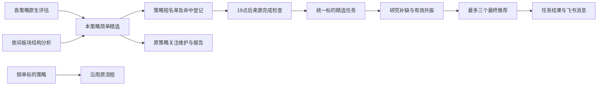

# 多策略统一信号精选机制技术评审

> 文档状态：已确认
> 评审对象：产品、服务端、前端、测试
> 事实来源：用户确认的分层精选方向；当前策略评估、夜间行业分析、任务调度、关注生命周期与飞书代码；当前任务定义和近期运行耗时的只读核实。
> 参考材料：[关注池信号复核方案](design/关注池信号复核方案.md)、[独立部署说明](独立部署说明.md)。
> 最后更新：2026-10-13
> 本文记录当前有效设计与已确认排程；实施及验证证据由中文状态账本记录。

## 评审结论

- **目标：** 各策略先形成少量候选，再由一个独立任务深入研究，向飞书发送最多三个最推荐标的。
- **核心方案：** 提前盘后策略排程，保留各策略原生初筛与关注维护，新任务固定读取同目标日短名单，统一研究、共振增强、行业收敛并保存推荐。
- **主要影响：** 五个盘后多标的任务、一个新增精选任务及通知；铜维持原流程，持仓退出、账户每日计划和既有人工关注不变。
- **排程参数：** 夜间板块 18:40、统一精选 19:30；本策略短名单最多五只、行业最多两只；最终最多三只，不足不凑数。

## 功能与设计主线

| 功能点 | 场景与功能要求 | 设计落点 | 边界与兼容 | 验证信号 |
|---|---|---|---|---|
| F-01 排程收口 | 盘后来源策略以 19:30 前完成为正常运行目标，统一精选随后执行 | 调整四项任务时间，新增一个全局 Agent 任务；在调用模型前检查同目标日来源状态 | 调整启动时间不等于完成保证；迟到、失败、停机漏跑不使用昨天结果冒充 | 计划验证：来源未完成时不开始完整推荐，正常来源齐备时进入研究 |
| F-02 原生简单精选 | 各策略按自己的指标先收敛，正式候选足够时不填接近候选 | 复用原生评估和行业结构分析，领域服务生成统一短名单契约；各任务仍维护自己的关注 | 不引入通用技术评分，不重算信号；落选不当策略失效；铜不参与 | 计划验证：短名单限制成立，原生阈值及退出口径不变 |
| F-03 统一候选读取 | 新任务只读取本次完成的策略短名单，按股票去重并锁定来源 | 一个受控读取工具返回候选、原生证据、完整命中登记和覆盖状态 | 不解析 Markdown 识别候选，不自行扩大候选全集，不允许跨任务写关注 | 计划验证：重复标的只研究一次，名单外标的不能提交推荐 |
| F-04 深入研究与共振 | 基本面、消息面、行业地位、股性、可执行性和股价共同形成研究结论，多策略有效共振增强优先级 | 复用本地财务、画像与新闻，受控补齐缺失原始价，再用现有取数和网页工具补缺；AI 提交结构化维度判断和建议顺序 | 不用同一组技术指标评分；重大风险不能被共振抵消；不承诺胜率数值 | 计划验证：有来源的判断可解释，重复或失效命中不加分 |
| F-05 最终推荐 | 从已核验正式候选中选最多三只，正式足够则忽略接近候选，每行业最多两只 | 领域服务校验推荐和来源类型、配额、研究证据及有效期，保存结果 | 接近候选必须独立标明等待条件；观察或关注不升级为可买入；不能为凑三只放宽条件 | 计划验证：推送名单不超过三只，同行业不超过两只，未核验标的不入选 |
| F-06 飞书与查看 | 新任务结束后推送最终推荐，每只给理由、共振、风险及入场前核对 | 复用任务中心、结果表、通知设置及投递工作器；服务端渲染摘要 | 保持现有任务订阅；仅新增任务发送综合推荐，其他任务仍发送自己的短摘要；共享群不含账户事实 | 计划验证：结构化结果与通知一致，限长与重试幂等成立 |

### 主线图

## 现状约束

| 存量事实 | 证据位置 | 设计影响 |
|---|---|---|
| 策略入场扫描全局执行，持仓与日计划按账户执行 | `server/modules/strategy-runtime/service.ts`、`server/modules/strategy-runtime/daily-plan.ts` | F-03、F-04：新任务全局执行，不复制账户研究 |
| 波段目前将正式和接近候选合并按深度排序后取前五 | `server/modules/plans/swing-signals.ts`，`applySwingDailyDepthLimit` | F-02：先分正式与接近，再按本策略顺序截取，不能原样沿用混排 |
| 两年反转按超跌、回撤和量比排序，当前正式列表截取前二十 | `server/modules/plans/two-year-reversal-signal.ts` | F-02：原生条件保留，最终短名单再收敛至建议上限 |
| 价值错杀的月度前十和财务、分红门槛是自身条件 | `server/modules/plans/value-anchor-signal.ts` | F-02：不修改原排名范围，不统一套其他策略技术标准 |
| 夜间板块未接入统一评估器，实际通过行业结构分析和专用关注工具完成 | `server/analysis/service.ts`，`querySectorTrendStructure`；`server/agent/job-tools.ts`；`server/modules/strategy-runtime/registry.ts` | F-02：保留该分析入口，只增加统一短名单落地，不要求先改造整个运行时 |
| 夜间板块个股一律接近候选，已有每行业两只与分支优先规则；统一 ROE 硬筛已被研究否定 | `server/migrations/0165_夜间板块左侧趋势结构与补涨候选.sql`、`0167_夜间板块新低回升第三触发线.sql` | F-02、F-04：保留状态、分支及证据边界，基本面研究不能重新引入固定高 ROE 门槛 |
| 盘中梯队已有唯一首选；当前收盘打板运行时允许入场归属，但仍有竞价和执行条件 | `server/migrations/0163_盘中涨停梯队唯一首选标的.sql`、当前 `strategy_definition` | F-03、F-05：来源类型和可参与方式独立展示，不把观察升级为买入 |
| 入场任务工具会立即写本策略关注，打板任务写结构化观察预案 | `server/agent/market-domain-tools.ts`、`server/modules/strategy-runtime/attention.ts`、`limit-up-opportunities.ts` | F-02：初筛阶段控制自己的业务投影；新任务不回写这些状态 |
| 关注对账支持数量限制延期集合；已复核但未保留的代码可能被判失效 | `server/modules/pools/attention-lifecycle.ts`，`reconcileAttentionRemainder` | F-02：明确区分原生失效、短名单落选与缺数，不只传入选代码 |
| 已有五维股性画像、财务快照、本地标的研究和网页来源校验能力 | `server/indicators/formulas.ts`、`server/modules/market/research.ts`、`server/agent/tools.ts`、`server/modules/market-news/repo.ts` | F-04：复用已有资料与审计，不建完整研究缓存平台 |
| 本地研究默认取最新资料，财务快照没有单独披露时间字段 | `server/modules/market/research.ts`、`server/migrations/0009_analysis_backtest.sql` | F-04：首版面向当前盘后，不拿当前财务或网页补写历史正式推荐 |
| 调度器三个工作器，约三十秒检查一次；失败默认五分钟后重试一次，没有通用依赖图或任务总时长保证 | `server/scheduler/service.ts`、`runner.ts`、`config.ts` | F-01：错峰并加本任务来源检查，不能仅改 cron 声称七点前保证完成 |
| 通知已有输出编号幂等、双通道和任务订阅；部分成功当前只对盘前消息特许 | `server/modules/notifications/service.ts`、`server/scheduler/runner.ts` | F-06：新任务单独增加可用部分结果规则，不全局放开所有部分任务 |
| 固定资产允许表显式列举，完整私有备份包含运行数据 | `server/volume/portable.ts`、`server/volume/export.ts`、`restore.ts` | 新运行表不进固定资产和 Git，备份恢复需覆盖新增表 |

## 关键设计决策

| 决策 | 选择 | 理由与代价 | 关联功能点 |
|---|---|---|---|
| D-01 两层职责 | 【已确认方向】策略任务负责原生简单精选，新任务负责跨策略深入研究 | 保留各策略规则，避免所有策略任务各自建设复杂消息和财务复核链路 | F-02、F-04 |
| D-02 最终任务只推荐 | 【方案】最终推荐不变更原策略关注、信号状态或持仓策略 | 减少跨策略投影、并发锁和误清理风险；关注池仍包含各策略短名单，而不是只剩最终三只 | F-05 |
| D-03 一次盘后快照 | 【方案】来源就绪后固定一次输入，结束后形成一次结果，来源后续更新通过手动重跑处理 | 不做持续聚合重排、晚到自动补推或跨账户二次排名；当晚重要新消息由后续盘前复核承接 | F-03、F-06 |
| D-04 共振有上限 | 【已确认方向】多策略有效命中视为更强；【方案】独立依据增强，相关条件折减 | 可以提高排名，但必须保留来源与窗口，不能把命中次数当确定胜率 | F-04 |

## 工程变化

工具、表和任务契约以当前代码为准。

### 排程与完成门禁

正常情况下各来源策略在十九点三十分前完成，新任务在十九点三十分启动统一研究。排程如下，均按上海时区、有效交易日执行：

| 任务 | 执行时间 | 说明 |
|---|---|---|
| 收盘打板机会扫描 | 17:25 | 保持行情和市场结构覆盖门禁 |
| 江西铜业左侧启动 | 17:35 | 单标的不参与统一精选，保持原时间 |
| 波段信号扫描 | 18:05 | 保留原生深度排序，调整正式优先 |
| 两年结构反转扫描 | 18:25 | 给执行、缺数补齐和重试留缓冲 |
| 板块机会筛选 | 18:40 | 位于用户指定十七至十九点三十分执行窗口，保留现有模型绑定 |
| 价值错杀机会扫描 | 19:00 | 依赖的月度排名及候选数据应已经可用 |
| 统一标的精选 | 19:30 | 来源齐备后集中研究，完成后通知 |

盘中梯队保持 10:45，不因本方案重复跑一次。其当日结果作为补充背景，仅在原生有效窗口覆盖下一交易意图时参与推荐或共振；不能把当日排队机会自动延长到次日。

只读核实的近期已完成运行中，夜间板块最长约十五点五分钟，两年反转最长约九点五分钟；这些样本支持预留缓冲，但不保证未来耗时。排程提前也必须核对前置行情、行业日线、指标、价值排名和数据更新任务；前置数据未就绪时不放宽数据门禁。

新增任务建议编码 `cross_strategy_selection`，类型沿用 `agent_flow`，全局作用域，不绑定一个策略，角色沿用允许的研究报告角色；使用已有任务级模型机制。实际迁移时登记 cron、用途、提示词和白名单，不通过桌面自动化另建一个重复定时任务。

十九点三十分运行前，服务端检查五个盘后来源任务同一目标日的当前运行：排队或运行中时，利用现有五分钟重试机制延后一次，不在 Agent 对话里轮询，也不占工作器长时间睡眠。十九点三十五仍未完成则退出完整研究，记录具体未完成任务，不能发布完整覆盖的前三推荐。

全部来源都已结束时：成功的空名单代表确实无候选；部分完成来源只使用逐股证据完整的条目，并携带缺口；失败、取消和漏跑来源不使用旧结果，任务可以基于可用来源输出“部分来源推荐”，明确覆盖范围。停用的来源不等待，但不能算成无信号。

这是一项本任务的有限门禁，不设计通用任务依赖图。禁止为满足七点目标强制中止有业务写入的策略任务、放宽检查或提前伪报完成。超过目标时在任务中心显示异常，后续手动重跑仍必须使用真实来源。

### 原策略简单精选与统一契约

建议每个盘后策略最多五只、每行业最多两只。各策略只按自己的排序和分支优先级筛选，不做新的跨维度研究：

- 原生正式候选先占名额。按行业限制收敛后的正式短名单达到三只时，接近候选不填充短名单。
- 正式不足三只时，可以保留最多两只接近候选，合计仍不超过五只；夜间板块的个股始终按接近类型记录。
- 盘中梯队继续保留最多一只首选；收盘打板保持原更严格的数量上限，不因通用上限扩张。
- 原生全部命中事实与短名单分开保存。短名单落选传入现有延期集合，保留至原到期，不续期，也不写成条件失效。
- 初筛不对企业基本面、消息利空或股价重复建立硬门槛，这些研究由新任务集中完成；原策略已经存在的资格门槛继续有效。

原生条件成立即正式候选，但候选类型另标为可入场、条件成立关注或观察。价值错杀的条件成立可以支持其他正式标的，不改变它自身不允许直接新开仓归属的契约。最终报告逐只写明允许参与的方式。

通用初筛辅助服务接收两种已验证来源：统一运行时评估、夜间板块行业结构分析。它不替代原计算；夜间无需先改造待接入的统一评估器。来源生成后通过同一领域服务保存短名单，随后按原任务政策维护共享关注和观察预案。

统一短名单至少包含：目标日、策略编码、来源任务运行、原生评估或分析编号、来源版本与内容哈希、数据日、信号日、有效期、执行窗口、标的代码和主键、当前有效一级行业、原生状态与类型、本策略排序、触发条件、失效条件和完整证据。

另保存截取前的完整命中登记，字段仅保留代码、原生状态、信号日、有效期、来源引用与依据摘要。某标的进入甲策略短名单而在乙策略因数量落选时，仍可以准确识别乙的有效命中；它不会因此自动进入新的研究全集。任务正文不是机器读取来源。

### 新任务研究与推荐协议

1. 受控读取工具 `selection_context_query` 验证来源并读取短名单，锁定来源编号、内容哈希、状态和覆盖；只研究短名单并集。正常约二十至二十五个候选，重复标的只研究一次。
2. 优先研究正式集合；达到至少三个符合研究要求且满足行业限制的正式标的后，不再深入研究接近集合。正式研究全部不足三只时，再检查少量接近或观察候选，独立标注其等待条件。
3. 使用 `stock_research_query`、已存财务和估值、可信股性画像、已有个股消息补充基础事实；缺行情或财务使用已有 `fetch_market_data`，公开公告、行业地位与最新消息使用已有 `web_search` / `web_fetch`。只获取这些候选的必要资料，不扫描全市场。
4. 研究维度采用支持、中性、不利、待核验四类判断，附事实及来源；AI 给出建议排名和每只核心理由。首版不强制引入固定百分制、六十五分准入或未经验证的胜率模型。
5. 受控提交工具 `selection_result_write` 只允许当前精选任务提交；领域服务校验来源、标的范围、证据、原生状态、有效期和配额，再保存结构化推荐和未入选原因。
6. 服务端按通过校验的结构化名单生成摘要；任务最终正文必须引用该结果，不能在自由文本里增删标的。最终结果提交完成后，由现有 Runner 保存任务输出并入队飞书通知。

归一化、来源核验、配额和持久化在服务端；经营背景、消息影响与比较性解释由 AI 完成。提交工具不授予通用 SQL 写权限，不写账户、持仓、关注或交易记录。读工具已经明确无候选时允许提交空结果，不能将无机会视为任务失败。

### 研究标准与共振

| 方面 | 核验内容 | 约束 |
|---|---|---|
| 基本面 | 主营经营、盈利、现金流、负债及其变化是否支持机会逻辑 | 结合金融、周期与一般企业差异，不统一高 ROE、利润增长或低负债硬筛；多期缺失时不猜趋势 |
| 消息面 | 下跌或上涨事件、重大公告、影响强度与持续性、可信度和价格消化程度 | 完成检索且无重要消息不算缺口；重大风险不能被多条小利好或共振抵消；盘前已有快照不能代替盘后新消息检查 |
| 行业地位 | 份额、成本、技术、产品、客户或竞争优势 | 没来源不能写龙头；公司规模不自动加分 |
| 股性 | 已有五维画像的样本、时间、假突破、洗盘恢复、护盘与波动事实 | 结合原策略持有方式，不把所有策略都变成低波动选股；不套用画像止损代替策略风险线 |
| 量价与执行 | 流动性、异常量价、触发区间、跳空及风险线距离 | 不重算原生形态，不统一技术打分；高成交额不直接等于高收益 |
| 股价适配 | 两位数价格偏好、真实未复权价、实际买入单位与分批退出颗粒度 | 十万元是明确标注的参考规模；不读取共享任务不需要的个人账户事实，不宣称资金约束已经满足 |

重大已证实经营、合规或交易阻断问题排除；关键财务风险、公告覆盖或价格无法核实的条目待核验，不进入正式推荐。资料引用以真实工具来源与本地证据为准，校验发布时间、抓取时间和关联标的，拒绝模型杜撰。消息资料截止于任务研究时刻，技术信号保持原数据日，两者分别标明。

推荐来自候选短名单，不宣称是全市场最优。初筛可能遗漏潜在好机会是这条简化链路的已知边界；可以通过适度扩大单策略短名单验证，而不是悄悄扩大新任务范围。

**有效多策略共振提升优先级，但实际胜率增量必须另行验证。**对已满足研究要求的候选，共振是明确增强因素，允许支持理由接近时优先选多策略标的。共振不能解除风险排除、补齐未知证据或把接近状态升级为正式。

每个策略只计一次命中，同策略触发线和重试不累计；波段与两年反转的超跌修复依据相关，收盘打板与盘中梯队的题材情绪依据相关，折减解释；价值与经营支持可形成不同依据的增强。行业板块信号与其派生接近个股属于一个观察来源，不算两个正式命中。

共振必须有同时有效且执行意图相容的股票级来源。当天盘中排队与次日反转不能只因为代码相同就组合；触发区间冲突时展示不同情景，不能取平均。提交结果至少记录命中策略、依据家族、有效窗口、增强原因和相关性说明，服务端对登记和状态做核验。

最终最多三个标的，按主行业合计最多两个。可入场与条件成立关注分别说明；接近或观察只有在已研究正式不足三只时作为补充，并标“等待条件”，不能在飞书里表现成三个都可立即进场。只有两只值得推荐就推两只，无合适推荐则发送明确空结论，不凑数。

### 数据库设计

首版只新增两张本机运行表，不建独立研究快照缓存表、持续重排系统或账户精选表；原生结果、画像、消息、审计和任务输出继续复用。

| 对象 | 最小字段与约束 | 用途与兼容 |
|---|---|---|
| `strategy_candidate_shortlist` | 来源任务运行唯一外键、策略、目标日、原生来源引用、来源哈希、数据日、状态、候选数组、完整命中登记、缺口、生成时间 | 每次来源任务一份统一结构，原生多样结果不用强行改成同一种运行时；同运行重试按代次更新并记录哈希 |
| `candidate_selection_result` | 精选任务运行唯一外键、目标日、来源清单及固定副本、输入哈希、研究截止时刻、状态、推荐数组、逐股研究与引用、落选或待核验原因、缺口、保存时间 | 最终结果按一次任务保存，通过任务运行关联现有 `job_run_output`，无需新增独立发布流程 |

JSON 内容必须经过类型校验，不允许自由形状的排名和来源；索引按目标日、策略和来源任务运行定位。最终研究提交在短事务中复查来源哈希并保存结果，不持有事务调用模型或外部接口。来源发生变化时拒绝旧提交，提示刷新或重新触发，不自动展开持续重排。

最终结果保存为草稿，只有任务最终成功或满足部分完成条件后可展示、通知；Runner 在结果收尾事务中确认其状态，避免结构化提交后任务失败却提前发布。重试沿用同任务运行和输入，幂等覆盖尚未发布草稿；历史已发布结果不改写，新手动运行产生新结果编号。

新增表只进入私有完整备份，不进入可移植允许集合；可补充运行表白名单排除及验证备份恢复顺序。迁移新增中文文件，不改已应用迁移、不预占下一迁移编号，不替换正式固定资产包。

### 代码接入位置

| 已有位置 | 精确增量 | 关联功能点 |
|---|---|---|
| `server/modules/plans/swing-signals.ts`、`two-year-reversal-signal.ts`、`value-anchor-signal.ts` | 暴露短名单计算需要的完整原生候选与命中登记；使用本策略顺序，正式优先；原条件不变 | F-02 |
| `server/modules/strategy-runtime/service.ts`、`attention.ts`、`limit-up-opportunities.ts` | 策略内部简单精选后投影本策略关注或优先预案；数量落选传入延期集合；保留原始复核事实 | F-02 |
| `server/analysis/service.ts`、`server/agent/job-tools.ts` | 夜间仍调用现有行业结构计算和关注链路，增加同一短名单服务接入；不把个股接近状态改为正式 | F-02 |
| `server/modules/selection/` | 短名单归一化、来源读取、结果校验、仓储和摘要渲染，少量函数完成，不建设动态策略插件平台 | F-02 至 F-06 |
| `server/scheduler/runner.ts` | 新任务专用来源门禁，草稿结果确认与收尾；沿用有限重试，不改三个工作器为更多并发 | F-01、F-06 |
| `server/agent/tools.ts`、`tool-validation.ts`、`tool-catalog.ts`、`job-workflow.ts` | 登记新任务白名单、读取及提交工具；完成门禁核验真实结果引用、目标日、来源和摘要 | F-03、F-05 |
| `server/modules/notifications/service.ts` | 新任务使用结构化推荐摘要，允许标注覆盖缺口的可用部分结论；沿用原通道、签名、限长与输出编号幂等 | F-06 |
| `server/migrations/` | 两张运行表、新任务与提示词、四项时间调整、必要的初筛约束及通知默认订阅初始化 | F-01、F-02、F-06 |
| `docs/独立部署说明.md` | 实施时更新真实任务时间与新任务通知说明；设计阶段不把建议时间写成已生效 | F-01、F-06 |

不增加账户二次排名、历史回填、持续监控、通用依赖调度框架或新的外部服务。前端首版复用任务中心结果展示与通知设置，原策略页面和关注列表不强制重做。

### 通知与用户结果

使用现有 `GET /api/notifications/preview` 查看最终摘要，现有任务触发入口为 `POST /api/jobs/:code/trigger`；地址来自 `server/http/router.ts`，新任务只是新增任务编码，不新增触发 API。结构化结果首版通过任务详情关联展示，不为设计虚构尚未存在的读取路由。

新任务使用策略通知通道，受通道启停和 `job_codes` 订阅约束。全部任务订阅无需额外改动；显式选定任务的用户，实施时应将新任务纳入对应范围或在设置页提示启用，不能忽略订阅直接发消息。现有飞书配置关闭或缺密钥时保存推荐并显示通知未启用，不绕过配置。

摘要不超过六百中文字符，按推荐顺序每只说明名称代码、行业、原生类型、最关键入选理由、共振和主要风险，最后说明截止时间与缺口。使用“优先研究或参与候选”，不把研究排名写成买入指令；十万元参考适配不等于个人可用资金已经核实。

部分来源可用时，标题和正文显式标注部分覆盖，推荐只来自完整研究条目；不得宣称所有策略已完成。来源仍在运行且门禁到期时，不发布正式前三；任务中心保留明确缺口，可由现有可用部分结论规则发送“尚未形成完整推荐”通知。正常空名单与主动忽略接近不算缺口。

通知沿用 `job_run_output` 同事务入队和后台发送；重复运行同一个任务输出不重复入队，重新手动触发产生更新版结果。其他策略任务仍保留自己的短摘要，不自动取消用户已订阅任务，最终综合推荐集中在新任务。

## 专项验证与回归

| 类型 | 计划验证方式 | 通过信号 |
|---|---|---|
| 排程与来源 | 扩展 `tests/server/scheduler.test.ts`，覆盖十九点前正常完成、门禁重试、晚到、失败、停用、漏跑和空名单 | 时间使用上海时区；不回退昨天；有限等待不占工作器；缺口不会伪装完成 |
| 原策略与关注 | 扩展现有策略运行时、波段、两年反转、价值与关注生命周期测试 | 原始条件不变，正式优先，数量落选不误清，铜及持仓退出无变化 |
| 统一契约与推荐 | 在现有领域测试中覆盖两种来源、标的去重、共振、状态类型、行业限额、来源哈希变化和名单外提交 | 最多三只且行业最多两只，相关来源不重复强化，接近不升级 |
| 来源与研究 | 使用固定工具来源，验证无新消息、缺数、旧画像、重大风险、未知财务趋势、过期窗口 | 判断有据，未知不补值，无重要消息不当失败，不使用当前网页回填历史 |
| 收尾与通知 | 覆盖结果草稿、任务失败、重试、部分覆盖、订阅关闭及摘要超长 | 发布与任务状态一致，通知幂等、可预览，禁用时不发，共享消息无账户事实 |
| 数据与发布 | 独立测试库执行新增迁移与私有备份恢复，并检查可移植导出 | 新表不进 Git 固定资产，旧报告可读，空库和既有库均能向前执行 |

实施后执行服务端类型检查及相关既有测试，迁移和备份按仓库必跑矩阵验证；跨领域发布前执行 `npm test`。前端如发生修改再执行前端类型检查与构建。禁止对生产库运行测试或恢复演练；无独立价值的临时测试文件验证后删除。

共振和初筛增益另行比较不同市场阶段的阅读数量、机会遗漏、收益与回撤，不只统计胜率；消息历史无法核实时做前瞻记录，不能用当前资料构造历史胜率提升。

## 部署与回退

### 上线准备与顺序

| 顺序 | 操作与依赖 | 生产验证 | 失败处理 |
|---|---|---|---|
| 1 | 发布兼容迁移和服务，新增任务先禁用；旧任务排程暂保持 | 原策略、铜、账户计划和旧通知正常 | 保持新任务禁用，修复后继续；不删除运行表 |
| 2 | 手动验证短名单、来源读取和新任务研究，先预览通知 | 原生状态与推荐一致，新任务不回写关注，来源引用真实 | 停止新任务，旧策略不受影响 |
| 3 | 修改四项排程并启用新任务，核对用户策略通道订阅 | 当天来源正常在目标窗口完成，19:30 来源门禁正确 | 禁用新任务，恢复四项原 cron；不强制中断运行中业务任务 |
| 4 | 确认飞书最终摘要和任务中心详情 | 推荐数与类型、风险、覆盖及结果编号一致 | 停止尚未发送的错误推荐通知，已发送正文不能撤回修改 |

按独立部署说明构建并重启应用，新增向前迁移自动执行；不执行固定资产空库恢复，不更新正式 bootstrap 包。迁移初次启用与配置调整应遵守现有错过任务处理，不为当天过去时间自动补跑；需要验收时显式手动触发。

观察至少覆盖一次完整盘后周期，记录来源完成时间、重试、短名单数量、研究耗时与请求、最终推荐数、缺口和通知投递。来源门禁失败、候选杜撰、类型升级或关注误清时停止新任务，不以放宽条件消除错误。

回退只需禁用新任务、恢复旧任务时间并关闭新增初筛投影；已存在短名单关注继续按原生生命周期管理，最终推荐没有修改持仓或关注，无需反向业务补偿。保留新增表和历史结果，以后续迁移修复；恢复覆盖私有数据的备份仍需真实用户确认。

## 风险

| 风险 | 触发条件与影响 | 缓解措施 |
|---|---|---|
| 十九点前未完成 | 模型、数据源或任务排队异常，导致综合输入不全 | 提前错峰、留缓冲、有限门禁与明确缺口；不承诺 cron 能保证完成 |
| 初筛漏掉潜在强标的 | 单策略短名单有限，深度研究无法评价未入池股票 | 保留完整命中登记，标注推荐范围，验证后再调整短名单上限 |
| 共振重复或不同执行窗口 | 相似价格条件或盘中信号被重复统计 | 家族相关性和原生有效窗口核验，不把计数当概率 |
| 研究资料不足或误判 | 缺多期财务、行业份额或可信消息 | 带来源的结构化结论，关键缺口待核验，不凑三只 |
| 通知未启用 | 现有通道关闭或用户只订阅旧任务 | 保存推荐，在设置与任务结果提示，遵守订阅不绕过 |
| 初筛误清关注 | 原生仍成立但数量落选被当作失效 | 显式延期集合和状态回归；最终任务不写关注 |

## 已确认范围

用户已确认来源策略在十七点至十九点三十分错峰完成，波段十八点之后，统一精选十九点三十分执行；最多三个推荐，通过现有策略飞书通道通知。实际时长受数据源与模型影响，保留完成门禁和缺口，不保证超时任务仍能在截止前完成。

不实现账户二次排名、持续重排或历史资料回填，铜与原生退出规则保持原流程。
