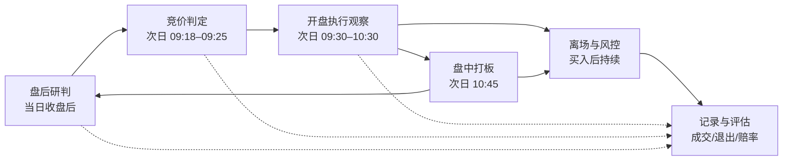

# 超短策略总纲（大纲）

> **状态**：01–04 已按节点落地；05 记录与评估暂缓，待样本积累后再做。
> **定位**：只描述超短线从 T 日盘中到 T+1 盘中的节点、职责和边界；每个节点的具体规则、字段和阈值放进单独文档。
> **边界**：不自动交易；仅沪深主板个股；所有结论需前向验证，不构成收益承诺。

---

## 一、总体思路

超短线只做两件事：**在情绪和筹码最强的标的上找机会，用纪律截断亏损。**

- 选股：最高连板、最先封板、题材核心、同高度竞争；低吸只做强势股回踩，不做无辨识度跟风。
- 执行：竞价 9:20–9:25 和开盘 9:30–9:35 是主窗口；错过就放弃，不追。
- 风控：单笔 3%～5% 止损、单票 20%～40%、连续 2 次止损停止当日新开仓。
- 评估：强势识别、排队成交率、可执行收益分开统计；不以理论涨停收益代替可得收益。

---

## 二、四个执行节点 + 离场风控

图中从盘后研判开始，次日完成竞价、开盘和盘中打板，收盘后进入下一轮。

| 节点 | 时间 | 职责 | 现有/新增 | 独立文档 |
|---|---|---|---|---|
| **盘后研判** | 当日收盘后 | 重构收盘任务：收盘打板 + 盘中信号复核 + 断板/炸板/前期龙头低吸池 + 统一 T+1 关注池 | 重构现有 `limit_up_close_scan`，不新增任务 | [03-盘后研判与关注池](03-盘后研判与关注池.md) |
| **竞价判定** | 次日 09:18–09:25 | 采样 + 判定一体：一字延续（9:20–9:24 实时买入提醒）、换手晋级、高开放弃、低开分歧、成交概率、下单窗口 | 新增 1 个任务；与现有 09:26 竞价任务分工 | [01-竞价判定](01-竞价判定.md) |
| **开盘执行观察** | 次日 09:30–10:30 | 打板接力确认、四种低吸形态触发、止损/失效/撤单提醒；10:30 后不再新触发 | 扩展现有盘中采样与通知，不新建采样器/执行表 | [04-开盘执行与低吸](04-开盘执行与低吸.md) |
| **盘中打板** | 次日 10:45 | 盘中涨停梯队候选、同高度竞争、唯一首选排队提醒；排队状态交给 03 | 保留现有 `first_board_intraday_scan`；新增 T 日竞价强度优先级和首选提醒 | [02-盘中打板与排队](02-盘中打板与排队.md) |
| **离场与风控** | 买入后持续 | 打板/低吸两套止损止盈、时间止损、开板/炸板、情绪止损、连亏熔断 | 60 秒基础层 + 5 秒快速层；复用现有采样与持仓记录，不新增任务/表 | [05-离场与风控](05-离场与风控.md) |
| **记录与评估** | 全程 | 成交/未成交、退出、胜率与赔率、前向验证 | 扩展现有记录，不单列任务 | `06-记录与评估.md` |

### 节点合并原则

- **竞价采样与判定合并**：一个任务在 9:15–9:25 内多次采样并在 9:25 给出判定，不拆成“采样任务 + 判定任务”。
- **盘后打板、断板/炸板分析、晚间融合合并**：都发生在收盘后、服务于同一份 T+1 关注池，作为一个节点的三个内部步骤，不新增三个任务。
- **打板接力与低吸观察合并**：都在 T+1 开盘后、都依赖同一批实时快照和情绪数据，归入“开盘执行观察”一个节点。
- **离场风控不合并两套规则**：打板与低吸的止损、止盈、持有期分开；只共用同一份实时采样和提醒通道。
- **不单列队列记录、情绪计算、关注池生成**：作为节点的内部字段或步骤，不升格为任务。
- **关注池统一**：所有超短标的一视同仁，走同一套 01/04 流程，只按强度/优先级排序，不设“观察/可执行”两类。
- **优先扩展现有任务/服务**：仅“竞价判定”需要新增一个任务；其余复用 `limit_up_close_scan`、`first_board_intraday_scan`、盘中采样和现有通知。
- **离场检查不受 10:30 截止限制**：新开仓 10:30 截止，已买入持仓的止损/时间退出检查全天有效。
- **持久化从简**：T+1 关注池、低吸池和判定结果优先放任务结构化输出；只有竞价轨迹需要新增一张采样表，避免为每个节点建表。

---

## 三、各节点一句话

### 1. 盘后研判（当日收盘后）

重构现有收盘任务，用收盘数据生成次日全部关注候选：盘后打板、盘中信号复核、断板/炸板/前期龙头低吸，合并成一份统一 T+1 关注池。**所有候选都是关注信号，不区分“观察/可执行”，只分优先级；开仓由用户决定。**低吸池不是全市场扫描，只来自前一日涨停、炸板、连板和前期龙头。

### 2. 竞价判定（次日 09:18–09:25）

对关注池逐只判定：一字延续是否值得排队、成交概率多大；非一字是否换手晋级；高开是否过度、低开是否分歧；低吸候选是否出现弱转强。**一字不是“买不到/买得到”的二元判断**，按竞价换手/流通市值、未匹配/竞价量分档；9:20–9:25 不可撤单阶段是核心。**一字延续满足条件时，9:20–9:24 立即提醒买入，不等 9:25；越早排队成交概率越高。**

### 3. 开盘执行观察（次日 09:30–10:30）

对竞价通过的标的做最后确认：打板接力看开盘承接、封板质量、同高度和题材；低吸看形态触发和分时止跌/放量回收。只处理关注池内标的，不临时扩大范围；触发即执行，失效即放弃。

### 4. 盘中打板（次日 10:45）

现有盘中涨停梯队扫描：首板、二至三板、高位续板，比较封单、首次封板、T 日竞价强度、题材角色和同高度竞争，保留最多四只观察候选和唯一首选排队标的。**只对首选发排队提醒；竞价平开/低开/未匹配为负的不作首选；不假设一定买得到。**

---

## 四、低吸形态（只列名单，细节见节点文档）

| 形态 | 一句话 |
|---|---|
| 龙回头 | 强势股回踩 5/10 日线缩量企稳，博弈第二波 |
| 单阳不破 | 放量大阳后小 K 线横盘不破大阳低点，再度放量介入 |
| N 字结构 | 冲高 → 缩量回调 → 再放量拉起，第二波启动点介入 |
| 线上阴线买 | 趋势向上时回踩重要均线收阴线，低吸 |

情绪前提：**退潮期不做低吸**；没有明确主线时，前期/断板龙头被重新认可的概率相对更高；主线明确时只做主线核心，不做支线跟风。具体识别窗口、量能阈值、支撑位、触发和失效放在 [04-开盘执行与低吸](04-开盘执行与低吸.md)。

---

## 五、精简实现

- **任务**：只新增“竞价判定”一个任务；盘后研判重构现有收盘打板任务，开盘观察扩展现有盘中采样服务。
- **数据**：只新增竞价实时采样（一张表或任务内 JSON），其余复用 `market_limit_event`、`strategy_entry_signal`、`first_board_intraday_snapshot`、`intraday_market_sample`、`auction_snapshot`/`auction_short_term_benchmark`。
- **触发**：价格、量能、均线、竞价、止损全部确定性计算；LLM 只做 03 的复核和消息风险核对，不参与 9:20–9:25 判定。
- **执行**：系统只输出候选、判定、价位、止损和窗口；真实成交由用户记录，系统不自动下单。
- **离场**：打板与低吸两套规则分开；硬止损、开板/炸板、时间止损、情绪止损、连亏熔断全部确定性计算，提醒优先于入场。

---

## 六、评估与边界

- 指标：强势识别（次日溢价/涨停率）、排队成交率、可执行收益、胜率、赔率、最大单笔亏损。
- 现状基线：盘中信号约 60% 胜率/1.29 赔率，盘后约 64.3%/1.11；但盘后按自身竞价门禁只有约 26% 通过，可执行口径明显更弱；一字成交概率需要用竞价换手/未匹配量分档。
- 样本要求：至少 20 个交易日、30 笔完整闭环、各分支 10 笔；未达标前只做影子运行和前向观察。
- 交易权限、仓位、止损等硬约束以《投资总策略》和用户确认为准。

---

## 七、后续文档

| 文档 | 内容 |
|---|---|
| [01-竞价判定](01-竞价判定.md) | 采样节奏、竞价指标、成交概率分档、下单窗口、9:20–9:24 一字买入提醒、数据缺口 |
| [02-盘中打板与排队](02-盘中打板与排队.md) | 盘中候选、同高度竞争、T 日竞价强度、首选排队提醒、排队状态交接 |
| [03-盘后研判与关注池](03-盘后研判与关注池.md) | 重构收盘任务：收盘打板、盘中信号复核、断板/炸板/前期龙头低吸池、统一 T+1 关注池与优先级 |
| [04-开盘执行与低吸](04-开盘执行与低吸.md) | 四种低吸形态、开盘触发、止损/失效、撤单提醒、情绪状态 |
| [05-离场与风控](05-离场与风控.md) | 打板/低吸分开的止损止盈、时间止损、开板/炸板、盈亏比、熔断与执行纪律 |
| `06-记录与评估.md` | 成交/退出记录、胜率赔率、样本门槛、前向验证 |

每个节点完成后单独评审，再决定是否进入数据库迁移和任务实现；本文只保留节点级共识，不写死参数。
